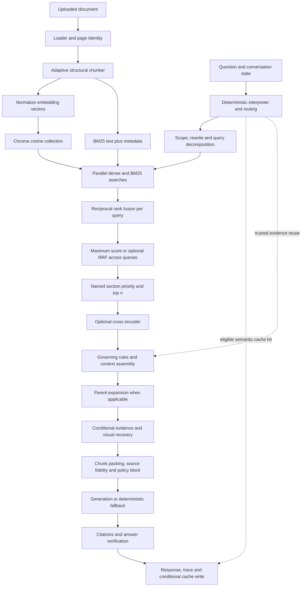

# Mathematics and Intuition Behind My RAG System

Repository-specific mathematical audit and study guide · 22 October 2026

**Audited commit:** `1182a798f6116d9fe882affbffab427d0370007b`
**Repository:** `SoubhagyaJain/Company-policy-rag`
**Application directory:** `company_policy_rag/`

## How to read this guide

Start with the verified architecture, then chapters 1–5, the measured query walkthrough, and the prioritized findings. Return to the remaining chapters as you work through the roadmap. Equations describe the checked-out implementation unless explicitly marked **library-internal**, **theory**, or **proposed**.

Navigate: [Architecture](#verified-architecture-first) · [Inventory](#mathematical-inventory) · [Teaching chapters](#first-principles-teaching-chapters) · [Measured query](#a-measured-query-from-input-to-terminal-response) · [Findings](#prioritized-mathematical-and-algorithmic-findings) · [Roadmap](#personalized-mathematics-roadmap) · [Replay harness](#reproducible-audit-companion-embedded-in-this-markdown) · [Cheat sheet](#final-one-page-mathematical-cheat-sheet).

Evidence labels used throughout:

| Label | Meaning |
|---|---|
| **Implemented** | A reachable repository function performs or invokes the operation. This establishes code behavior, not a claim about a deployed service. |
| **Configured** | A setting or model name exists; its effective value in an independently running server was not inspected. |
| **Dependency-internal** | A library/model performs the mathematics. The repository calls an API rather than implementing that mathematics. |
| **Planned or unused** | Documentation, an alternate entry point, or an optional branch exists but is outside the default backend path. Legacy code can still be executable. |
| **Not found** | No supporting implementation was identified in the relevant source search. |
| **Measured in this audit** | Executed locally with the isolation described below. |
| **Illustrative** | Hand-constructed numbers for teaching, never model measurements. |

Source links include one-based line numbers at the audited commit. A link opens the beginning of the cited range; the label records the full range. These references will drift if source files change.

## Verified architecture first

The project contains **two different RAG stacks**, plus evaluation, optional training, and operational tooling. Treating every file in `src/` as the live FastAPI pipeline would produce the wrong audit.

### Backend request path

The API dependency graph creates `DocumentService`, `EmbeddingService`, `DenseVectorRetriever`, `BM25SearchIndex`, `HybridRetriever`, `CrossEncoderReranker`, `SemanticCacheManager`, and `RAGPipeline`. `ChatService.execute_query` supplies a `ConversationRAGState`, even for an initially empty conversation. See [backend/api/dependencies.py:98–170](C:/Users/jains/Downloads/Company-policy-rag/company_policy_rag/backend/api/dependencies.py:98), [backend/api/routes/chat.py:17–80](C:/Users/jains/Downloads/Company-policy-rag/company_policy_rag/backend/api/routes/chat.py:17), and [backend/services/chat_service.py:191–245](C:/Users/jains/Downloads/Company-policy-rag/company_policy_rag/backend/services/chat_service.py:191).



This diagram includes conditional branches. It does **not** mean every query invokes every box. The actual stage orchestration is in `RAGPipeline._query_internal`, [backend/rag/pipeline.py:3214–3501](C:/Users/jains/Downloads/Company-policy-rag/company_policy_rag/backend/rag/pipeline.py:3214). Greeting, general-chat, clarification, and semantic-cache responses can return before retrieval. Evidence reuse can bypass retrieval and reranking. Source-defined list questions can bypass LLM generation. Optional retries default to zero.

### Ingestion path

`LoaderFactory` registers PDF, spreadsheet, presentation, DOCX, Markdown, HTML, CSV, JSON, and text loaders: [backend/ingestion/loaders/loader_factory.py:20–71](C:/Users/jains/Downloads/Company-policy-rag/company_policy_rag/backend/ingestion/loaders/loader_factory.py:20). The PDF loader tries PyMuPDF extraction first, then pypdf, and can use cached or available vision processing for scanned pages: [backend/ingestion/loaders/pdf.py:49–99](C:/Users/jains/Downloads/Company-policy-rag/company_policy_rag/backend/ingestion/loaders/pdf.py:49). This is parsing and conditional transcription, not a locally implemented OCR optimization algorithm.

`DocumentService._execute_ingestion_stages` explicitly creates `AdaptiveChunker(chunk_size=512, chunk_overlap=64)` at [backend/services/document_service.py:633–634](C:/Users/jains/Downloads/Company-policy-rag/company_policy_rag/backend/services/document_service.py:633). **The backend upload path does not read the legacy `CHUNK_SIZE=480` value here.** It then batches embedding calls, checks finite values and consistent widths, stores vectors in Chroma, updates BM25, fills the shared docstore, and invalidates retrieval cache: [backend/services/document_service.py:680–811](C:/Users/jains/Downloads/Company-policy-rag/company_policy_rag/backend/services/document_service.py:680).

Adaptive selection is a decision tree: tables first; Markdown/HTML/code next; headings/PDF/DOCX next; more than 200 words selects the sentence-grouping chunker; otherwise recursive splitting. See [backend/ingestion/chunkers/adaptive_chunker.py:31–60](C:/Users/jains/Downloads/Company-policy-rag/company_policy_rag/backend/ingestion/chunkers/adaptive_chunker.py:31). **`SemanticChunker` does not calculate embedding similarities or semantic change points.** It groups regex-delimited sentences under approximate length limits: [backend/ingestion/chunkers/semantic.py:24–83](C:/Users/jains/Downloads/Company-policy-rag/company_policy_rag/backend/ingestion/chunkers/semantic.py:24).

### Defaults verified from source

| Setting or behavior | Checked-out default | Consequence |
|---|---|---|
| Answer model | `qwen3.5:9b` | Configured name, not a measured model identity in this audit. [src/config.py:187–191](C:/Users/jains/Downloads/Company-policy-rag/company_policy_rag/src/config.py:187) |
| Embedder | `qwen3-embedding:0.6b` | Uses Ollama because the name contains no `/`. [backend/embeddings/embeddings.py:144–153](C:/Users/jains/Downloads/Company-policy-rag/company_policy_rag/backend/embeddings/embeddings.py:144) |
| Embedding width | Constructor starts at 384; Ollama calls update it from the returned vector length | Do not claim the live Qwen model is a 384-dimensional BGE model. [backend/embeddings/embeddings.py:112–122](C:/Users/jains/Downloads/Company-policy-rag/company_policy_rag/backend/embeddings/embeddings.py:112), [backend/embeddings/embeddings.py:219–231](C:/Users/jains/Downloads/Company-policy-rag/company_policy_rag/backend/embeddings/embeddings.py:219) |
| Dense metric | Collection creation hardcodes cosine | The generic `CHROMA_DISTANCE_FN` setting is not applied by this backend constructor. [backend/embeddings/vector_store.py:247–253](C:/Users/jains/Downloads/Company-policy-rag/company_policy_rag/backend/embeddings/vector_store.py:247) |
| BM25 | `k1=1.5`, `b=0.75`, no stemming; text plus five metadata fields | Actual indexed length includes metadata. [backend/retrieval/bm25.py:16–46](C:/Users/jains/Downloads/Company-policy-rag/company_policy_rag/backend/retrieval/bm25.py:16), [backend/services/document_service.py:90–98](C:/Users/jains/Downloads/Company-policy-rag/company_policy_rag/backend/services/document_service.py:90) |
| RRF | Rank starts at 1; offset 60; equal contribution per list | No learned fusion weights. [backend/retrieval/hybrid.py:14–60](C:/Users/jains/Downloads/Company-policy-rag/company_policy_rag/backend/retrieval/hybrid.py:14) |
| Cross encoder | Implemented; disabled by default | Constructing its wrapper does not prove model inference occurred. [src/config.py:303–316](C:/Users/jains/Downloads/Company-policy-rag/company_policy_rag/src/config.py:303), [backend/rag/pipeline.py:2144–2156](C:/Users/jains/Downloads/Company-policy-rag/company_policy_rag/backend/rag/pipeline.py:2144) |
| Conversation interpreter flag | `false` | Disables its **LLM refinement**, not the deterministic interpreter called for stateful document requests. [backend/rag/conversation_interpreter.py:155–181](C:/Users/jains/Downloads/Company-policy-rag/company_policy_rag/backend/rag/conversation_interpreter.py:155), [backend/rag/pipeline.py:2725–2747](C:/Users/jains/Downloads/Company-policy-rag/company_policy_rag/backend/rag/pipeline.py:2725) |
| LLM query rewrite / decomposition | Both off by default | Deterministic follow-up resolution and multipart splitting remain active. [src/config.py:385–398](C:/Users/jains/Downloads/Company-policy-rag/company_policy_rag/src/config.py:385), [backend/rag/pipeline.py:1667–1678](C:/Users/jains/Downloads/Company-policy-rag/company_policy_rag/backend/rag/pipeline.py:1667) |
| Context assembly | `rank_policy` | Policy questions select `rank_rescue`; other questions use `rank`. [backend/rag/pipeline.py:2212–2224](C:/Users/jains/Downloads/Company-policy-rag/company_policy_rag/backend/rag/pipeline.py:2212) |
| Standard response | Search depth 8 per index; handoff 6; estimated source budget 1500; output cap 700 | Mode budgets overwrite router depth unless experiment flags change it. [backend/rag/response_modes.py:35–41](C:/Users/jains/Downloads/Company-policy-rag/company_policy_rag/backend/rag/response_modes.py:35), [backend/rag/response_modes.py:68–93](C:/Users/jains/Downloads/Company-policy-rag/company_policy_rag/backend/rag/response_modes.py:68), [backend/rag/pipeline.py:335–354](C:/Users/jains/Downloads/Company-policy-rag/company_policy_rag/backend/rag/pipeline.py:335) |
| Semantic answer cache | Enabled, cosine threshold 0.95 | Reuse also requires context/version/model checks and critical-fact compatibility. [src/config.py:82–91](C:/Users/jains/Downloads/Company-policy-rag/company_policy_rag/src/config.py:82), [backend/rag/semantic_cache.py:193–367](C:/Users/jains/Downloads/Company-policy-rag/company_policy_rag/backend/rag/semantic_cache.py:193) |
| Verification / retries | Verification on; retry budget 0 | A verification failure can be returned with failure telemetry. Verification is not universally a blocking answer filter. [src/config.py:154–180](C:/Users/jains/Downloads/Company-policy-rag/company_policy_rag/src/config.py:154), [backend/rag/pipeline.py:3484–3518](C:/Users/jains/Downloads/Company-policy-rag/company_policy_rag/backend/rag/pipeline.py:3484) |
| Vision / lazy recovery | Both on by default | The evidence gate is currently coupled to these flags; see finding F4. [src/config.py:199–218](C:/Users/jains/Downloads/Company-policy-rag/company_policy_rag/src/config.py:199), [backend/rag/pipeline.py:755–788](C:/Users/jains/Downloads/Company-policy-rag/company_policy_rag/backend/rag/pipeline.py:755) |

No `.env` override file was found in the application directory during this audit. Running-process environment variables and Ollama model tags were not queried. Docker defaults also name Qwen3.5 and Qwen3 embeddings: [docker-compose.yml:19–20](C:/Users/jains/Downloads/Company-policy-rag/company_policy_rag/docker-compose.yml:19). README examples and older benchmark documents refer to other models and should not override source evidence.

### The alternate stack and auxiliary systems

The packaged CLI routes to `scripts/index_documents.py` and `scripts/evaluate.py`: [src/cli.py:36–43](C:/Users/jains/Downloads/Company-policy-rag/company_policy_rag/src/cli.py:36). These use the `src/indexing.py`, `src/retriever.py`, `src/hybrid_retrieval.py`, `src/generation.py`, and `src/evaluation.py` stack. That stack has actual hierarchical parent/child construction, LlamaIndex adapters, optional postprocessors, and its own BM25 implementation. It is **reachable through those tools**, but it is not the FastAPI backend path above. Backend upload chunkers emit standalone chunks by default, while backend parent expansion only helps if parent IDs actually exist: [backend/ingestion/chunkers/base.py:43–55](C:/Users/jains/Downloads/Company-policy-rag/company_policy_rag/backend/ingestion/chunkers/base.py:43), [src/chunking.py:190–250](C:/Users/jains/Downloads/Company-policy-rag/company_policy_rag/src/chunking.py:190), [backend/rag/context_compression.py:21–100](C:/Users/jains/Downloads/Company-policy-rag/company_policy_rag/backend/rag/context_compression.py:21).

Optional fine-tuning is independently reachable through `scripts/run_finetune_pipeline.py` and `scripts/finetune_qwen_coder.py`. Its LoRA, NF4, optimizer, scheduler, and causal-LM loss are mostly library-internal. Nothing in the normal query path trains the embedder, reranker, or answer model. Configuration is not evidence that a trained adapter is currently served.

Operational mathematics includes storage-growth regression, telemetry aggregates, image scaling, and rule-based asset ranking. Frontend score displays transform backend values but do not implement retrieval: [backend/services/storage_insights.py:146–171](C:/Users/jains/Downloads/Company-policy-rag/company_policy_rag/backend/services/storage_insights.py:146), [backend/vision/image_asset_manager.py:170–184](C:/Users/jains/Downloads/Company-policy-rag/company_policy_rag/backend/vision/image_asset_manager.py:170), [frontend/lib/utils.ts:74–83](C:/Users/jains/Downloads/Company-policy-rag/company_policy_rag/frontend/lib/utils.ts:74). Decorative animation mathematics is outside the RAG algorithm audit.

## Scope, inspection, and execution evidence

The source inventory contained 102 backend Python files (31,761 lines), 46 `src` Python files (13,061 lines), 25 scripts (5,355 lines), and 165 test Python files (42,740 lines). Counts include package initializers. The audit inventoried these trees, searched their mathematical operations and imports, traced the request and ingestion entry points, and read the relevant implementations and tests in detail. It does not claim that every line in every frontend screen or test received an equal-depth review.

| Area | What was inspected | Coverage boundary |
|---|---|---|
| API/services | Dependency composition, upload, chat sync/stream, state, storage/telemetry | No running service or deployment certification |
| Ingestion | Loader registry, PDF/page labels, adaptive/recursive/sentence/heading/Markdown/table chunking, metadata extraction | No scanned-image model execution |
| Retrieval | Embeddings, Chroma adapter/fallback, both BM25 stacks, fusion, reranking, caching | Learned embeddings and reranker weights not loaded |
| RAG | Routing, interpretation, decomposition, scope, context, policy rules, evidence gate, citations, verification, generation and retry boundaries | No live LLM or LLM judge invoked |
| Evaluation | Graded retrieval, answer scoring, policy metrics, legacy evaluation, conversation benchmark, paired statistics, latency, human agreement | Historical reports treated as records, not fresh measurements |
| Training | Dataset normalization/split, completion mask, LoRA configuration, quantization/trainer/merge/export boundaries | No training, merge, export, or model download |
| Tests | Existing mathematical and algorithmic regression cases, plus direct small probes | Selected suite only, not the complete repository suite |
| Docs/config | READMEs, dependency manifests/lock, Docker/env example, evaluation and ablation reports, roadmap/audit documents | Claims reconciled against code, not accepted from names/comments |

**Measured validation:** 45 existing focused tests passed in 5.77 seconds in Python 3.11. They cover `tests/unit/test_retrieval_eval.py`, `test_policy_metrics.py`, `test_chunker_correctness.py`, `test_policy_reliability.py`, `tests/test_human_judge_agreement.py`, and `tests/test_timing.py`. Pytest caching and bytecode writes were disabled; all configured storage paths were redirected into temporary directories. Network connection attempts were rejected in the audit processes. Temporary Windows file locks caused cleanup messages after two successful processes. Automatic approval review subsequently rejected removal of the three dedicated temporary audit folders with “blocked by policy”; they remain outside the repository. This did not invalidate the test results or change production files.

The Python 3.11 environment had `rank-bm25 0.2.2`, `chromadb 0.5.20`, `sentence-transformers 5.6.0`, `llama-index-core 0.14.23`, and `ollama 0.6.2`. These differ from some `uv.lock` versions, including Chroma 0.6.3 and sentence-transformers 6.1.0. Therefore the numerical trace identifies its runtime rather than pretending it reproduces every locked environment. The default shell's Python 3.12 lacked several required packages; it was not used for the dependency-backed executions.

No production source or configuration was edited. No packages or models were installed, downloaded, trained, or invoked for expensive inference. The only deliverable added to the repository is this Markdown document.

## Mathematical inventory

`I` = implemented repository logic; `D` = dependency-internal; `O` = optional/alternate path. Symbols are defined in the corresponding teaching chapter. Importance reflects what you need to reason about this project, not mathematical prestige.

| Component | Mathematical concept and equation | Where used in code | Why used | Importance/status |
|---|---|---|---|---|
| Chunk lengths/overlap | Character proxy $\hat T=\max(1,\lfloor L/4\rfloor)$; target $4C$, overlap $4O$ | `BaseChunker._estimate_tokens`, [backend/ingestion/chunkers/base.py:21–23](C:/Users/jains/Downloads/Company-policy-rag/company_policy_rag/backend/ingestion/chunkers/base.py:21); `RecursiveChunker`, [backend/ingestion/chunkers/recursive.py:42–105](C:/Users/jains/Downloads/Company-policy-rag/company_policy_rag/backend/ingestion/chunkers/recursive.py:42) | Bound passage size while retaining adjacent information | High · I |
| PDF page labels | Modal offset $o^*=\arg\max_o\#\{p:p-\ell_p=o\}$ | `PrintedPageDetector.resolve_document_pages`, [backend/ingestion/page_detector.py:138–203](C:/Users/jains/Downloads/Company-policy-rag/company_policy_rag/backend/ingestion/page_detector.py:138) | Infer missing printed page labels | Medium · I |
| Embeddings | $f_\theta(x)\in\mathbb R^d$; $\hat x=x/\sqrt{\sum x_i^2}$ | `EmbeddingService`, [backend/embeddings/embeddings.py:15–20](C:/Users/jains/Downloads/Company-policy-rag/company_policy_rag/backend/embeddings/embeddings.py:15), [backend/embeddings/embeddings.py:207–304](C:/Users/jains/Downloads/Company-policy-rag/company_policy_rag/backend/embeddings/embeddings.py:207) | Learned representations plus explicit normalization | High · I+D |
| Hash fallback | $v_{h(t)\bmod d}\mathrel{+}=a(h(t))$, followed by normalization | `_fallback_embed`, [backend/embeddings/embeddings.py:196–205](C:/Users/jains/Downloads/Company-policy-rag/company_policy_rag/backend/embeddings/embeddings.py:196) | Deterministic degraded/test vectors | Medium · I; not semantic learning |
| Dense scoring | $\cos(q,d)=\frac{q^Td}{\|q\|\|d\|}$; Chroma adapter $\max(0,1-\delta)$ | [backend/embeddings/vector_store.py:23–31](C:/Users/jains/Downloads/Company-policy-rag/company_policy_rag/backend/embeddings/vector_store.py:23), [backend/embeddings/vector_store.py:348–424](C:/Users/jains/Downloads/Company-policy-rag/company_policy_rag/backend/embeddings/vector_store.py:348) | Compare vector direction | High · I+D |
| ANN | Approximate top-$k$ cosine neighbors through Chroma/HNSW | `ChromaVectorStore.search`, [backend/embeddings/vector_store.py:372–380](C:/Users/jains/Downloads/Company-policy-rag/company_policy_rag/backend/embeddings/vector_store.py:372) | Avoid exhaustive search at scale | High · D; HNSW not reimplemented |
| BM25 | $\sum_{t\in q}\operatorname{IDF}(t)\frac{f_{t,d}(k_1+1)}{f_{t,d}+k_1(1-b+bL_d/\overline L)}$ | `BM25SearchIndex._rebuild_scorer/search`, [backend/retrieval/bm25.py:138–146](C:/Users/jains/Downloads/Company-policy-rag/company_policy_rag/backend/retrieval/bm25.py:138), [backend/retrieval/bm25.py:233–286](C:/Users/jains/Downloads/Company-policy-rag/company_policy_rag/backend/retrieval/bm25.py:233) | Lexical matching, frequency saturation and length adjustment | High · I+D |
| Fusion | $R(d)=\sum_j1/(60+r_j(d))$ | `reciprocal_rank_fusion`, [backend/retrieval/hybrid.py:14–60](C:/Users/jains/Downloads/Company-policy-rag/company_policy_rag/backend/retrieval/hybrid.py:14) | Merge incomparable score scales | High · I |
| Multipart merge | $S(d)=\max_jR_j(d)$; optional another RRF | `_gather_hybrid_candidates`, [backend/rag/pipeline.py:1790–1810](C:/Users/jains/Downloads/Company-policy-rag/company_policy_rag/backend/rag/pipeline.py:1790) | Deduplicate across search formulations | High · I |
| Reranking | Pair score $s_\theta(q,d)$; commonly $\sigma(z)$ for one-label CrossEncoder | `CrossEncoderReranker.rerank`, [backend/retrieval/reranker.py:186–222](C:/Users/jains/Downloads/Company-policy-rag/company_policy_rag/backend/retrieval/reranker.py:186) | Jointly compare question and passage | High · I+D+O, off by default |
| Relative cutoff | $s_i\ge\rho s_{\max}$, with minimum retained count | `RelativeScoreThresholdPostprocessor.filter`, [backend/retrieval/reranker.py:23–49](C:/Users/jains/Downloads/Company-policy-rag/company_policy_rag/backend/retrieval/reranker.py:23) | Reject weak relative candidates | High · I+O |
| Governing-clause heuristic | Bounded base $1.5\tanh(\max(-5,s)/5)$ plus weighted features | `_specificity_score`, [backend/rag/policy_reliability.py:303–337](C:/Users/jains/Downloads/Company-policy-rag/company_policy_rag/backend/rag/policy_reliability.py:303) | Promote scenario-specific policy clauses | High · I |
| Heuristic confidence | $0.75\sigma((S_1-4)/2)+0.25g$ | `GoverningClauseSelector.select`, [backend/rag/policy_reliability.py:538–541](C:/Users/jains/Downloads/Company-policy-rag/company_policy_rag/backend/rag/policy_reliability.py:538) | Summarize strength and separation | High · I; uncalibrated |
| Citation display | Relative score ratio, clipping, or sigmoid by score branch | `_compute_confidence`, [backend/rag/citations.py:18–44](C:/Users/jains/Downloads/Company-policy-rag/company_policy_rag/backend/rag/citations.py:18) | Present a bounded relevance indicator | Medium · I; not probability |
| Query routing / memory | Ordered predicates; lexical overlap $\vert Q\cap(T\cup E)\vert /\vert Q\vert $; bounded state | [backend/rag/query_router.py:153–216](C:/Users/jains/Downloads/Company-policy-rag/company_policy_rag/backend/rag/query_router.py:153), [backend/rag/conversation_resolver.py:292–316](C:/Users/jains/Downloads/Company-policy-rag/company_policy_rag/backend/rag/conversation_resolver.py:292), [backend/models/conversation.py:196–218](C:/Users/jains/Downloads/Company-policy-rag/company_policy_rag/backend/models/conversation.py:196) | Select strategy and resolve references | High · I; no Bayes classifier found |
| Semantic caching | $\cos(f(q),f(q_c))\ge0.95$ plus compatibility predicates | `SemanticCacheManager.get`, [backend/rag/semantic_cache.py:282–367](C:/Users/jains/Downloads/Company-policy-rag/company_policy_rag/backend/rag/semantic_cache.py:282), [backend/rag/semantic_cache.py:409–450](C:/Users/jains/Downloads/Company-policy-rag/company_policy_rag/backend/rag/semantic_cache.py:409) | Reuse sufficiently equivalent answers | High · I+D |
| Exact/LRU/TTL caching | Hash key; valid while $t\le t_{\rm stored}+\mathrm{TTL}$ | [backend/embeddings/embeddings.py:28–62](C:/Users/jains/Downloads/Company-policy-rag/company_policy_rag/backend/embeddings/embeddings.py:28), [backend/retrieval/retrieval_cache.py:34–81](C:/Users/jains/Downloads/Company-policy-rag/company_policy_rag/backend/retrieval/retrieval_cache.py:34) | Avoid repeated work and bound entry count/age | Medium · I |
| Context budget | Greedy cumulative estimated lengths; $\hat T=1+\lfloor\max(1.4W,L/4.5)\rfloor$ for whole prompts | [backend/rag/context_compression.py:244–275](C:/Users/jains/Downloads/Company-policy-rag/company_policy_rag/backend/rag/context_compression.py:244), [backend/rag/llm_client.py:23–31](C:/Users/jains/Downloads/Company-policy-rag/company_policy_rag/backend/rag/llm_client.py:23) | Fit sources and answer inside model window | High · I; estimates are not tokenization |
| LLM decoding | $p_i=\exp(z_i/T)/\sum_j\exp(z_j/T)$; $p(y\mid x)=\prod_tp(y_t\mid x,y_{<t})$ | Options passed by [backend/rag/llm_client.py:85–92](C:/Users/jains/Downloads/Company-policy-rag/company_policy_rag/backend/rag/llm_client.py:85), [backend/rag/pipeline.py:2558–2587](C:/Users/jains/Downloads/Company-policy-rag/company_policy_rag/backend/rag/pipeline.py:2558) | Generate an answer conditional on evidence | High · D; repository forwards options |
| Attention / cache | Standard full attention $\operatorname{softmax}(QK^T/\sqrt{d_k})V$; stored past keys/values | External model; explicit vision `use_cache=True` at [backend/vision/hf_vision_client.py:300–315](C:/Users/jains/Downloads/Company-policy-rag/company_policy_rag/backend/vision/hf_vision_client.py:300) | Representation and inference efficiency | Medium · D; Qwen3.5 has a hybrid architecture |
| Answer verification | $V=.35F+.30C+.20J+.15H$ plus conjunctive subgates | `SelfReflectionVerifier.verify`, [backend/rag/verifier.py:499–517](C:/Users/jains/Downloads/Company-policy-rag/company_policy_rag/backend/rag/verifier.py:499) | Catch unsupported or incomplete output | High · I; heuristic, not posterior truth |
| Source fidelity | Stem coverage $\vert A\cap E\vert /\vert A\vert $; overlap coefficient $\vert A\cap B\vert /\min(\vert A\vert ,\vert B\vert )$ | [backend/rag/source_fidelity.py:624–653](C:/Users/jains/Downloads/Company-policy-rag/company_policy_rag/backend/rag/source_fidelity.py:624), [backend/rag/source_fidelity.py:670–696](C:/Users/jains/Downloads/Company-policy-rag/company_policy_rag/backend/rag/source_fidelity.py:670) | Check citations and conflicting quantities | High · I |
| Legacy code validation | Matching extracted code-line fraction $m/n\ge.8$ by default | `heuristic_code_grounded`, [src/code_validation.py:141–182](C:/Users/jains/Downloads/Company-policy-rag/company_policy_rag/src/code_validation.py:141) | Detect some unsupported code in the alternate generation stack | Medium · I+O; textual support, not execution correctness |
| Numeric policy checks | Datetime addition; amount comparison; normalized number containment | `_calculate`, [backend/rag/policy_reliability.py:414–466](C:/Users/jains/Downloads/Company-policy-rag/company_policy_rag/backend/rag/policy_reliability.py:414); [backend/rag/verifier.py:176–206](C:/Users/jains/Downloads/Company-policy-rag/company_policy_rag/backend/rag/verifier.py:176) | Separate supported calculations from invented numbers | High · I, narrow coverage |
| Retrieval metrics | Hit, recall, reciprocal rank, $\mathrm{DCG}=\sum(2^g-1)/\log_2(r+1)$, nDCG, aspect coverage | [backend/evaluation/retrieval_eval.py:137–211](C:/Users/jains/Downloads/Company-policy-rag/company_policy_rag/backend/evaluation/retrieval_eval.py:137) | Evaluate rank and evidence survival | High · I |
| Answer/legacy metrics | Keyword recall, citation precision, abstention accuracy; lexical section proxies | [backend/evaluation/answer_eval.py:108–169](C:/Users/jains/Downloads/Company-policy-rag/company_policy_rag/backend/evaluation/answer_eval.py:108), [src/evaluation.py:173–206](C:/Users/jains/Downloads/Company-policy-rag/company_policy_rag/src/evaluation.py:173) | Measure answer behavior and legacy regressions | High · I; different estimands |
| Summaries/latency | Means and several order-statistic/interpolated percentiles | [backend/evaluation/retrieval_eval.py:317–327](C:/Users/jains/Downloads/Company-policy-rag/company_policy_rag/backend/evaluation/retrieval_eval.py:317), [src/timing.py:9–31](C:/Users/jains/Downloads/Company-policy-rag/company_policy_rag/src/timing.py:9) | Summarize quality and tail cost | High · I |
| Paired experiments | Resampled mean differences and random sign-flip $p=(e+1)/(B+1)$ | [backend/evaluation/retrieval_eval.py:255–300](C:/Users/jains/Downloads/Company-policy-rag/company_policy_rag/backend/evaluation/retrieval_eval.py:255) | Quantify uncertainty for configuration comparisons | High · I |
| Judge agreement | Pearson $r$, MAE, tolerance agreement, Cohen $\kappa$ | [src/human_judge_agreement.py:11–50](C:/Users/jains/Downloads/Company-policy-rag/company_policy_rag/src/human_judge_agreement.py:11) | Compare human and model ratings | Medium · I |
| Fine-tuning | Masked cross entropy, $\mathrm{PPL}=e^{\mathcal L}$; LoRA $W'=W+(\alpha/r)BA$ | [src/finetuning/trainer.py:53–84](C:/Users/jains/Downloads/Company-policy-rag/company_policy_rag/src/finetuning/trainer.py:53), [src/finetuning/trainer.py:212–230](C:/Users/jains/Downloads/Company-policy-rag/company_policy_rag/src/finetuning/trainer.py:212), [src/finetuning/trainer.py:384–393](C:/Users/jains/Downloads/Company-policy-rag/company_policy_rag/src/finetuning/trainer.py:384) | Optional adaptation, separate from query serving | Medium · I+D+O |
| Training optimization | Effective batch $baw$; AdamW, warmup/cosine schedule, NF4 | [src/finetuning/trainer.py:133–145](C:/Users/jains/Downloads/Company-policy-rag/company_policy_rag/src/finetuning/trainer.py:133), [src/finetuning/trainer.py:346–352](C:/Users/jains/Downloads/Company-policy-rag/company_policy_rag/src/finetuning/trainer.py:346), [src/finetuning/trainer.py:487–525](C:/Users/jains/Downloads/Company-policy-rag/company_policy_rag/src/finetuning/trainer.py:487) | Control adaptation memory and convergence | Medium · D+O; no training executed |
| Storage forecast | OLS slope $\hat\beta=\sum(t-\bar t)(y-\bar y)/\sum(t-\bar t)^2$ | `forecast`, [backend/services/storage_insights.py:146–171](C:/Users/jains/Downloads/Company-policy-rag/company_policy_rag/backend/services/storage_insights.py:146) | Estimate storage growth | Low for retrieval; I |
| Vision preprocessing | $a=M/\max(w,h)$; resize to $(\lfloor aw\rfloor,\lfloor ah\rfloor)$; weighted asset score | [backend/vision/image_asset_manager.py:170–184](C:/Users/jains/Downloads/Company-policy-rag/company_policy_rag/backend/vision/image_asset_manager.py:170), [backend/vision/image_asset_manager.py:451–504](C:/Users/jains/Downloads/Company-policy-rag/company_policy_rag/backend/vision/image_asset_manager.py:451) | Bound visual input size and choose assets | Medium · I+D+O |

### Mathematics deliberately not claimed

There is no explicit Bayesian query classifier, learned threshold calibration, embedding/reranker training loss in the serving pipeline, independent TF–IDF retriever, PCA/SVD dimensionality reduction, MMR objective, or custom HNSW implementation in the inspected retrieval path. BM25 uses IDF, which does not make it a separate TF–IDF implementation. Euclidean distance is useful for understanding normalized vectors but is not the selected backend metric. Matrix multiplication, neural representation learning, causal token probabilities, and attention take place inside external models. Fine-tuning configures a separate training objective rather than training retrieval during an API query.

## First-principles teaching chapters

The eight numbered subsections in each chapter follow the requested teaching contract. Related equations are grouped so their assumptions and code interactions can be understood together.

### Chapter 1 — Chunking, overlap, and page coordinates

#### 1. What problem does it solve?

The backend needs passages small enough for embedding and context budgets, but large enough to retain a rule and its conditions. It must also preserve source locations. Splitting every fixed number of characters without respecting a code block, table row, or section can detach an exception from its rule.

#### 2. Intuition before mathematics

Think of photocopying a long page in overlapping strips. Some repeated material helps reconnect strips, but too much repetition wastes space. This repository adapts the strip boundary to headings, sentences, code fences, and tables. The word “semantic” in one chunker means sentence grouping, not vector-based topic detection.

Printed page numbers are a different coordinate system from physical pages. If physical pages 5 and 6 are labeled 1 and 2, physical page 7 is likely printed page 3. This inference should not be confused with a retrieved passage's relevance.

#### 3. Mathematical derivation

Let $L$ be character count, $C$ the requested approximate token size, and $O$ requested overlap. The base estimate is

$$\hat T(L)=\max(1,\lfloor L/4\rfloor).$$

It assumes about four characters per token. Recursive and heading splitting instead use the equivalent target $L_{\max}=4C$. Recursive overlap uses $L_o=4O$, retaining whole separator-delimited pieces until their accumulated length is within that overlap target. Thus the overlap is approximate, not exactly $O$ model tokens.

**Sizing approximation, not the exact structural algorithm:** for a uniform sequence of $N$ tokens split into windows of size $C$ and overlap $O<C$, the stride is $C-O$. After the first window covers $C$ positions, each new window covers $C-O$ new positions:

$$m\approx1+\max\left(0,\left\lceil\frac{N-C}{C-O}\right\rceil\right).$$

For a long document, indexed-volume inflation approaches $C/(C-O)$. Structural boundaries, atomic code, and repeated table headers alter this approximation.

For PDF labels let $p$ be physical one-based page number, $\ell_p$ an observed numeric label, and $o_p=p-\ell_p$. The detector counts each offset and takes the mode $o^*$. Once support passes its small-count rule, a missing label is inferred as $p-o^*$ if positive. Internal page index is $p-1$. Roman labels are preserved separately rather than subtracted as decimal integers.

#### 4. Worked numerical example

**Illustrative:** $N=2000$, $C=512$, $O=64$. Stride $448$; additional windows $\lceil1488/448\rceil=4$; approximately five chunks. Long-document volume ratio is $512/448\approx1.143$, about 14.3% repeated content. The backend character target is $2048$, overlap target $256$.

**Illustrative page inference:** observed pairs $(p,\ell)=(5,1),(6,2),(8,4)$ all give offset 4. The unobserved physical page 7 receives label $7-4=3$, internal index 6. An incorrect footer mistaken for a label can corrupt that inference; the modal count is not a statistical confidence interval.

#### 5. Code-to-math mapping

```python
return max(1, len(text) // 4)
target_len = self.chunk_size * 4
overlap_char_count = self.chunk_overlap * 4
```

These are three different lines from [backend/ingestion/chunkers/base.py:21–23](C:/Users/jains/Downloads/Company-policy-rag/company_policy_rag/backend/ingestion/chunkers/base.py:21) and [backend/ingestion/chunkers/recursive.py:42–105](C:/Users/jains/Downloads/Company-policy-rag/company_policy_rag/backend/ingestion/chunkers/recursive.py:42). `SemanticChunker.chunk` accumulates estimated sentence tokens and retains trailing whole sentences under the overlap budget: [backend/ingestion/chunkers/semantic.py:38–69](C:/Users/jains/Downloads/Company-policy-rag/company_policy_rag/backend/ingestion/chunkers/semantic.py:38). Markdown code fences are atomic: [backend/ingestion/chunkers/markdown_aware.py:41–55](C:/Users/jains/Downloads/Company-policy-rag/company_policy_rag/backend/ingestion/chunkers/markdown_aware.py:41). Large tables repeat header rows while splitting data rows: [backend/ingestion/chunkers/table_aware.py:107–147](C:/Users/jains/Downloads/Company-policy-rag/company_policy_rag/backend/ingestion/chunkers/table_aware.py:107). Page-offset counts and the support requirement are in [backend/ingestion/page_detector.py:153–185](C:/Users/jains/Downloads/Company-policy-rag/company_policy_rag/backend/ingestion/page_detector.py:153).

#### 6. Why this specific algorithm?

It is deterministic, cheap, and structure-aware. It avoids an embedding call per sentence boundary. The trade-off is imperfect token accounting and no learned coherence objective. Large atomic code blocks or a single long sentence can exceed a nominal budget. Alternatives include exact tokenizer lengths, topic-change segmentation, or actual hierarchical chunks. The older `src/chunking.py` implements a different parent/child path; the backend's name “heading-aware” does not by itself create parent vectors.

#### 7. What happens if we remove or change it?

Smaller chunks can improve localization but increase vector count, BM25 corpus statistics, duplication, and boundary loss. Larger chunks can dilute embeddings and consume the prompt budget. Increasing overlap changes document frequency as well as storage cost; it is not only a latency parameter. Removing page-coordinate handling causes correct evidence to be cited with confusing page numbers. Evaluate changes through final-context evidence survival, not just the number of chunks.

#### 8. Interview-level explanation

**30 seconds:** “My backend uses an adaptive structural chunker with a 512-unit size and 64-unit overlap. These are approximate token units, often implemented as four characters per token. It preserves code and table structure. PDF page identity separately maps physical pages to printed labels through repeated offsets.”

**2 minutes:** “Chunking defines the statistical units seen by retrieval. In this project, ordinary uploaded passages are usually standalone chunks. Adaptive routing chooses a structural splitter; it does not optimize a semantic-similarity loss. The overlap mechanism retains whole pieces, so its effective overlap varies. Changing size or overlap changes vector count, BM25 length normalization and IDF, reranker truncation exposure, and the number of complete sources that fit into the prompt. That means an apparent improvement at the vector stage can disappear during context packing. I would compare size/overlap settings on the same documents and questions, recording both rank metrics and final-context coverage. For PDFs I would test printed labels independently, since a retrieval result can be relevant while its displayed page coordinate is wrong.”

**Q1:** Does doubling overlap necessarily increase recall? **A:** No. It may preserve boundary facts, but near-duplicate passages can crowd the top-$k$ and change IDF, reducing distinct evidence coverage.

**Q2:** Does a 512-token setting guarantee no model truncation? **A:** No. These chunkers mostly estimate tokens; atomic blocks can exceed the target, and a reranker's pair budget also includes the query and special tokens.

### Chapter 2 — Embedding vectors, normalization, cosine, and the hash fallback

#### 1. What problem does it solve?

The dense retriever needs a numerical representation of a question and each passage. `EmbeddingService` obtains those representations from Ollama or sentence-transformers. Repository code then normalizes them and passes the query vector to the store.

#### 2. Intuition before mathematics

A vector is a list of coordinates. Comparing its direction asks whether two representations point toward similar learned features. Comparing raw magnitude can instead reward a longer vector. Normalization puts nonzero vectors on the same sphere. None of this makes geometric similarity a probability that a passage answers the question.

The deterministic fallback is a different object: it hashes words into buckets. It can share buckets for repeated words but has no learned understanding of paraphrases. Replacing a learned vector with a hash vector of the same width does not preserve its coordinate system.

#### 3. Mathematical derivation

For $x=(x_1,\ldots,x_d)$, its squared length is $x^Tx=\sum_i x_i^2$. Taking the square root gives the Euclidean norm $\|x\|_2$. Divide each coordinate by that norm:

$$\hat x_i=\frac{x_i}{\|x\|_2},\qquad\|\hat x\|_2^2=\sum_i\frac{x_i^2}{\|x\|_2^2}=1.$$

The dot product $q^Td=\sum_iq_id_i$ measures aligned coordinates. Dividing by both lengths removes scale:

$$s(q,d)=\frac{q^Td}{\|q\|_2\|d\|_2}=\hat q^T\hat d.$$

For unit vectors, expand the squared Euclidean distance:

$$\|\hat q-\hat d\|_2^2=\|\hat q\|^2+\|\hat d\|^2-2\hat q^T\hat d=2-2s.$$

Thus maximizing cosine and minimizing squared Euclidean distance induce the same order **when both vectors are unit-normalized and the same points are compared**. This identity does not imply that approximate indexes or mixed model spaces return identical results.

The code returns a zero vector unchanged during normalization. Cosine itself is undefined for a zero vector; the repository's manual function defines its result to be zero. For unequal lengths it also returns zero rather than performing a valid geometric comparison.

For the fallback, let $h(t)$ be the integer MD5 hash of lowercase whitespace token $t$, $d$ the configured width, and

$$j(t)=h(t)\bmod d,\qquad a(t)=\frac{(h(t)\mathbin{\gg}8)\bmod1000}{1000}-0.5.$$

Each occurrence adds $a(t)$ to coordinate $j(t)$, then the vector is normalized. This is the exact repository rule, not an assertion that it has all the guarantees of a standard random feature-hashing construction.

#### 4. Worked numerical example

**Illustrative geometry:** $q=(3,4)$ has norm $5$, so $\hat q=(0.6,0.8)$. For $d=(0,2)$, $\hat d=(0,1)$ and cosine $0.8$. Squared distance is $(0.6-0)^2+(0.8-1)^2=0.36+0.04=0.4=2-2(0.8)$.

**Measured fallback arithmetic:** the token `leave` maps to coordinate 56 at width 384, with contribution approximately $-0.228$. A document consisting of that one token normalizes to $-1$ at coordinate 56. Repeating only that token changes magnitude before normalization but not direction. Adding other tokens changes direction and can introduce bucket collisions.

#### 5. Code-to-math mapping

```python
norm = math.sqrt(sum(x * x for x in vector))
return [x / norm for x in vector]
```

The zero guard is immediately between these lines: [backend/embeddings/embeddings.py:15–20](C:/Users/jains/Downloads/Company-policy-rag/company_policy_rag/backend/embeddings/embeddings.py:15). Learned model outputs are normalized in `embed_text` and `embed_chunks`: [backend/embeddings/embeddings.py:219–236](C:/Users/jains/Downloads/Company-policy-rag/company_policy_rag/backend/embeddings/embeddings.py:219), [backend/embeddings/embeddings.py:279–297](C:/Users/jains/Downloads/Company-policy-rag/company_policy_rag/backend/embeddings/embeddings.py:279). Manual cosine is [backend/embeddings/vector_store.py:23–31](C:/Users/jains/Downloads/Company-policy-rag/company_policy_rag/backend/embeddings/vector_store.py:23). `DenseVectorRetriever.retrieve` uses `embed_query`, not an implicit matrix multiplication written in the repository: [backend/retrieval/vector.py:23–41](C:/Users/jains/Downloads/Company-policy-rag/company_policy_rag/backend/retrieval/vector.py:23).

BGE English models receive a query prefix through `_default_query_instruction`; passages do not: [backend/embeddings/embeddings.py:92–103](C:/Users/jains/Downloads/Company-policy-rag/company_policy_rag/backend/embeddings/embeddings.py:92), [backend/embeddings/embeddings.py:242–255](C:/Users/jains/Downloads/Company-policy-rag/company_policy_rag/backend/embeddings/embeddings.py:242). That prefix is not automatically selected for the configured Qwen name.

#### 6. Why this specific algorithm?

Cosine is a common embedding comparison and normalization simplifies reasoning across APIs. Actual representation learning belongs to the pretrained model. The project neither derives its embedding coordinates nor trains their contrastive loss. Model-specific pooling, truncation, tokenizer, and prompts must be checked at the provider/model boundary. The [Qwen embedding model card](https://huggingface.co/Qwen/Qwen3-Embedding-0.6B) provides query-instruction examples; whether the installed Ollama tag adds an equivalent template was not inspected.

#### 7. What happens if we remove or change it?

Removing normalization changes raw inner products; a cosine implementation that divides by norms may retain the same order, but an inner-product index may not. Changing embedding model requires re-embedding documents and separating caches, even if $d$ stays constant. Allowing fallback vectors into a learned collection can make the store numerically well-formed while semantically incoherent. More dimensions increase approximate vector storage as $Ndb$ bytes for $N$ vectors and $b$ bytes per coordinate, excluding graph/metadata overhead.

#### 8. Interview-level explanation

**30 seconds:** “The repository owns normalization and cosine adaptation. The model owns representation learning. For nonzero unit vectors cosine becomes a dot product, and squared Euclidean distance is $2-2\cos$. The hash fallback is only a degraded/test representation; equal dimensionality does not make it compatible with a learned embedding space.”

**2 minutes:** “I would audit the embedding pipeline as a contract: model identity and revision, query/passsage formatting, tokenizer limit, pooling, vector width, finite values, normalization, and collection metric. This project explicitly checks finite values and batch dimensional consistency during ingestion, and normalizes model outputs. Its default embedding name takes the Ollama branch and updates the width from actual outputs. The constructor's 384 is therefore not proof of deployed dimensionality. The manual fallback cosine handles zero and mismatched vectors by returning zero, while the Chroma path clips negative similarities to zero after distance conversion. That difference matters for score interpretation, even when an existing ranking is retained. The largest correctness risk is silently mixing model spaces, which cannot be repaired merely by normalizing vectors. Reindexing and model-aware cache identity are part of the mathematical contract.”

**Q1:** Why is normalized cosine not a calibrated relevance probability? **A:** It measures angle in a learned representation; correctness and answer support require labels and an explicitly fitted calibration/decision model.

**Q2:** Can two encoders with identical width share one collection? **A:** Only with evidence that they share the same embedding space. Width equality alone supplies no such guarantee.

### Chapter 3 — BM25, document frequency, and length normalization

#### 1. What problem does it solve?

Dense retrieval can miss exact clause IDs, product names, or rare words. `BM25SearchIndex` adds lexical evidence. Its corpus is **chunk text plus selected metadata**, not just the visible passage. It calls `rank_bm25.BM25Okapi` rather than implementing the scoring kernel locally.

#### 2. Intuition before mathematics

A word occurring in one passage is more discriminating than a word occurring everywhere. A passage repeating a word eight times should receive a benefit, but not eight times the benefit forever. Long passages also have more opportunities to contain any query word. BM25 combines rarity, saturation, and length adjustment.

Raw occurrence count lacks all three controls. A raw sum of BM25 and cosine is also problematic because their units differ; that motivates the next chapter's rank fusion.

#### 3. Mathematical derivation

Define $N$ as indexed chunk count, $n_t$ as chunks containing token $t$, $f_{t,d}$ as its count in chunk $d$, $L_d$ as chunk length in indexed tokens, and $\overline L=N^{-1}\sum_dL_d$.

The inspected `rank-bm25 0.2.2` computes initial inverse document frequency

$$I_t=\log\frac{N-n_t+0.5}{n_t+0.5}.$$

This is log odds comparing absence with presence, with $0.5$ smoothing. It is **not** the always-positive variant $\log(1+(N-n_t+0.5)/(n_t+0.5))$. Let $\overline I$ be the mean initial IDF over vocabulary terms. Negative $I_t$ values are replaced by $\epsilon\overline I$, with default $\epsilon=0.25$. Consequently a negative average can still yield negative replacement values in tiny unusual corpora. This was verified by reading the installed package source, not inferred from its name. The public [upstream scoring source](https://github.com/dorianbrown/rank_bm25/blob/master/rank_bm25.py) identifies this variant too.

Construct the length factor $A_d=1-b+bL_d/\overline L$. At average length, $A_d=1$; at $b=0$, length has no effect. The saturation factor is

$$F_{t,d}=\frac{f_{t,d}(k_1+1)}{f_{t,d}+k_1A_d}.$$

It is zero at $f=0$, equals 1 at $f=1$ for an average-length chunk, and approaches $k_1+1$ as $f\to\infty$. The derivative with respect to continuous $f$ is $(k_1+1)k_1A_d/(f+k_1A_d)^2$, positive but decreasing for valid positive parameters. Adding another occurrence therefore has diminishing benefit.

Finally,

$$\operatorname{BM25}(q,d)=\sum_{t\in q}I_tF_{t,d}.$$

The library loops over query tokens, so a repeated query token contributes repeatedly. There is no separately implemented query-frequency saturation term in this call.

#### 4. Worked numerical example

**Illustrative:** $N=5$, $n_t=1$, $f=2$, $L_d=\overline L$, $k_1=1.5$, $b=0.75$.

1. $I_t=\log(4.5/1.5)=\log3\approx1.0986$.
2. $A_d=0.25+0.75=1$.
3. $F=2(2.5)/(2+1.5)=5/3.5\approx1.4286$.
4. Contribution $1.0986(1.4286)\approx1.5694$.

**Measured handbook fixture:** $N=7$, indexed lengths `[64,114,118,98,104,112,103]`, mean $713/7=101.8571$. The parental passage has 114 indexed tokens. `parental` occurs in one chunk and has frequency 4 in this indexed passage because its heading metadata is repeated. Its IDF is $\log(6.5/1.5)=1.466337$. Its length factor is $0.25+0.75(114/101.8571)\approx1.0894$; its contribution is approximately $1.466337\cdot10/(4+1.5\cdot1.0894)=2.60$. `probation` and `probationary` remain distinct tokens under the default tokenizer.

#### 5. Code-to-math mapping

```python
self._bm25 = BM25Okapi(self._tokenized_corpus, k1=self.k1, b=self.b)
scores = self._bm25.get_scores(tokens)
```

See [backend/retrieval/bm25.py:138–146](C:/Users/jains/Downloads/Company-policy-rag/company_policy_rag/backend/retrieval/bm25.py:138) and [backend/retrieval/bm25.py:243–248](C:/Users/jains/Downloads/Company-policy-rag/company_policy_rag/backend/retrieval/bm25.py:243). `_searchable_text` appends metadata before tokenization: [backend/retrieval/bm25.py:42–46](C:/Users/jains/Downloads/Company-policy-rag/company_policy_rag/backend/retrieval/bm25.py:42). The regex `[a-z0-9]+` lowercases and splits punctuation: [backend/retrieval/bm25.py:14–27](C:/Users/jains/Downloads/Company-policy-rag/company_policy_rag/backend/retrieval/bm25.py:14). Search sorts descending, applies metadata filters, and suppresses non-matches while retaining genuine shared-term matches with nonpositive scores: [backend/retrieval/bm25.py:253–284](C:/Users/jains/Downloads/Company-policy-rag/company_policy_rag/backend/retrieval/bm25.py:253).

#### 6. Why this specific algorithm?

It supplies inexpensive lexical matching and tunable normalization. Metadata can improve heading matches but also changes $f$, $L$, $n_t$, and $\overline L$. ASCII tokenization loses non-Latin words, splits hyphenated identifiers, and does not stem `probationary` into `probation`. Stemming is optional and requires the relevant library; it is not active by default. The current implementation scores the entire corpus and sorts it: approximately $O(N|q|+N\log N)$ for the package scoring/sort stages, not the complexity of an optimized inverted-index engine.

#### 7. What happens if we remove or change it?

Removing BM25 loses an independent exact-match signal. Increasing $k_1$ gives repeated terms more influence; changing $b$ alters long-chunk penalties. Changing metadata fields or overlap requires rebuilding statistics. A threshold such as “BM25 > 1 means relevant” is not portable across questions or corpora. Negative IDF handling should not be “fixed” by dropping all negative matches without examining the selected library variant.

#### 8. Interview-level explanation

**30 seconds:** “My sparse retriever calls BM25Okapi with $k_1=1.5$ and $b=.75$. It rewards rare matching terms, saturates repeated term counts, and adjusts for passage length. The indexed text includes headings and other metadata, so those statistics differ from the passage body alone.”

**2 minutes:** “I would begin with the actual tokenizer and indexed unit. Here it is a chunk with appended metadata, tokenized by an ASCII regex. Then I would inspect the installed scoring formula because BM25 has multiple IDF variants. Our package uses a smoothed log-odds IDF and replaces negative values using a fraction of average IDF. It multiplies that rarity by a saturating term-frequency factor whose denominator increases for longer-than-average chunks. The algorithm is valuable for exact terms that embeddings can blur, but it has no understanding of negation or word order. Also, chunking is part of BM25 tuning: overlap changes document frequency, and duplicated headings increase term counts. I would tune $k_1$, $b$, stemming, and metadata fields using held-out queries and track downstream context coverage as well as sparse ranking.”

**Q1:** Why might an exact matching passage have a nonpositive BM25 score? **A:** A term in most documents can have nonpositive IDF in the selected variant, including its average-based replacement behavior.

**Q2:** Does BM25 compute $P(\text{relevant}\mid q,d)$ here? **A:** No. It produces a relevance ranking score. Its probabilistic historical motivation does not make the returned number a calibrated probability.

### Chapter 4 — Top-k, approximate search, rank fusion, and multipart merging

#### 1. What problem does it solve?

The pipeline needs to combine a dense list and a lexical list without comparing cosine and BM25 numbers directly. It then needs one deduplicated candidate pool across sub-queries.

#### 2. Intuition before mathematics

Two judges may use completely different scoring scales. Compare their placements instead: first place earns a little more credit than second, and agreement earns credit twice. This deliberately discards the size of a judge's score margin. The strongest result for one sub-question can then represent that candidate in a merged pool.

#### 3. Mathematical derivation

Let $L_j$ be ranked list $j$, $r_j(d)\in\{1,2,\ldots\}$ the rank of document/chunk $d$, and $k_0$ the RRF offset. An absent chunk contributes zero:

$$R(d)=\sum_{j:d\in L_j}\frac1{k_0+r_j(d)}.$$

The code uses $k_0=60$, not rank zero. This is a design rule, not a theorem-derived optimal constant. The contribution decreases with rank: derivative $-1/(k_0+r)^2$. Increasing $k_0$ flattens differences; for large $k_0$, $1/(k_0+r)\approx1/k_0-r/k_0^2$, so being present in several lists dominates small rank differences.

The maximum contribution from two lists is $2/61\approx.032787$. A one-list rank-1 item earns $1/61\approx.016393$. Top-$K$ selection retains the first $K$ items after sorting these values. Stable ties inherit the insertion order of candidates in Python; they are not randomized or semantically resolved.

With multiple sub-queries $q_a$, the default merge is

$$S(d)=\max_{a:d\in C_a}R_a(d).$$

This retains best-case relevance to any part but does not reward support across parts. The optional `subquery_merge_mode=rrf` applies a second rank fusion. It is not equivalent to summing the original dense/BM25 scores or averaging their probabilities. Optional per-part reranking uses a round-robin list interleave with quota $\max(2,\lceil n/|P|\rceil)$: [backend/rag/pipeline.py:1407–1431](C:/Users/jains/Downloads/Company-policy-rag/company_policy_rag/backend/rag/pipeline.py:1407).

Dense top-$k$ in Chroma delegates candidate search to an approximate index. The adapter does not implement the graph search, and approximate retrieval is not guaranteed to equal exhaustive cosine top-$k$. In-memory fallback does exhaustive scoring and a descending sort. The [Chroma index documentation](https://docs.trychroma.com/docs/collections/configure) describes the HNSW boundary; repository code only sets its metric and requests results.

#### 4. Worked numerical example

**Illustrative:** dense `[A,B,C]`, BM25 `[B,C,D]`.

| Chunk | Dense contribution | BM25 contribution | RRF |
|---|---:|---:|---:|
| A | $1/61$ | 0 | 0.016393 |
| B | $1/62$ | $1/61$ | 0.032522 |
| C | $1/63$ | $1/62$ | 0.032002 |
| D | 0 | $1/63$ | 0.015873 |

New order: `B,C,A,D`. B outranks the dense winner A because the lists agree on B. If a second sub-query gives A score .032787 and B score .016393, maximum-score merging yields `A,B,C,D`. No probability normalization occurs.

#### 5. Code-to-math mapping

```python
for rank, sc in enumerate(node_list, start=1):
    rrf_scores[cid] = rrf_scores.get(cid, 0.0) + (1.0 / (rrf_k + rank))
```

The omitted line assigns `cid = sc.chunk.id`; see [backend/retrieval/hybrid.py:28–31](C:/Users/jains/Downloads/Company-policy-rag/company_policy_rag/backend/retrieval/hybrid.py:28). Single surviving lists are also converted to RRF scale in the ordinary empty-index case: [backend/retrieval/hybrid.py:168–181](C:/Users/jains/Downloads/Company-policy-rag/company_policy_rag/backend/retrieval/hybrid.py:168). Across query formulations, the max/optional-RRF logic is [backend/rag/pipeline.py:1790–1810](C:/Users/jains/Downloads/Company-policy-rag/company_policy_rag/backend/rag/pipeline.py:1790). The **exception fallback** at [backend/rag/pipeline.py:1754–1764](C:/Users/jains/Downloads/Company-policy-rag/company_policy_rag/backend/rag/pipeline.py:1754) violates that score-scale convention; finding F2 reproduces it.

#### 6. Why this specific algorithm?

RRF is robust to incompatible score ranges and easy to inspect. Equal weighting assumes both lists deserve comparable influence; correlated lists can double-count similar signals. Truncating a list makes low-ranked items absent rather than weakly supported. Maximum merging can promote a passage good for only one ambiguous sub-query. Alternatives include weighted RRF, calibrated score fusion, and learning-to-rank, all of which need careful held-out evaluation. None is silently implemented here.

#### 7. What happens if we remove or change it?

Summing raw cosine and BM25 would usually let BM25's scale dominate. Decreasing the RRF offset increases top-rank contrast. Increasing search depth increases candidate recall and work, but later top-$n$ and prompt budgets can erase the benefit. The normal backend always invokes its hybrid retriever; the legacy `ENABLE_HYBRID_BM25` switch should not be assumed to bypass BM25 in this backend implementation.

#### 8. Interview-level explanation

**30 seconds:** “Dense and BM25 scores have different units, so I fuse ranks with $\sum1/(60+r)$ using one-based ranks. I retain the best fused score per chunk across sub-queries by default. A normal single-index result is still put on the RRF scale, but the exception fallback currently misses that conversion.”

**2 minutes:** “RRF converts each ranking into a smoothly decreasing vote. It avoids calibrating cosine against BM25, but that convenience discards score margins. With offset 60, a document present in both shallow lists often beats a rank-1 document present in just one. I would inspect how truncation and overlap affect that behavior, because the votes are not independent evidence of truth. The pipeline then merges sub-query results by maximum score, which preserves specialists but can amplify an ambiguous fragment. That is why query decomposition must preserve referents and why final-context evaluation is necessary. For performance, the independent dense and sparse calls run concurrently, but each index still has its own work and contention. The Chroma search is delegated approximate retrieval; RRF only combines what the indexes returned. It cannot recover an item missing from every list.”

**Q1:** Is RRF invariant to applying a monotonic function to BM25 scores? **A:** Yes if ranks/ties remain unchanged; score magnitudes are not used. It is not invariant to changing list membership or tie resolution.

**Q2:** Can a reranker rescue a passage outside the candidate pool? **A:** No. Candidate recall is an upper bound on what reranking alone can recover; structural context expansion is a separate mechanism.

### Chapter 5 — Cross-encoder scores and relative thresholds

#### 1. What problem does it solve?

An optional cross encoder compares the question and each candidate jointly. A separate filter removes candidates below a fraction of the best score. These features exist but are disabled with the default backend reranker flag.

#### 2. Intuition before mathematics

A bi-encoder writes an independent summary of each passage. A cross encoder reads the question alongside the passage and can inspect their interactions. That is more expensive per pair. A relative threshold asks “how far below the winner is this candidate?” It does not ask “is the winner itself relevant?”

#### 3. Mathematical derivation

Let $z_\theta(q,d)$ be a scalar model output. A common one-label CrossEncoder activation is the sigmoid

$$\sigma(z)=\frac1{1+e^{-z}}.$$

One route to this formula starts with positive odds $o=e^z$. If $p/(1-p)=o$, then $p=o/(1+o)=1/(1+e^{-z})$. It maps real numbers into $(0,1)$ and is strictly increasing. That range alone does not establish empirical probability calibration.

The wrapper calls `predict` without explicitly setting an activation. The installed sentence-transformers source selects sigmoid by default for a one-label model, subject to model configuration. This is verified API behavior, **not** a measured score distribution of the configured BGE weights. Its local variable `logits` should not be taken as proof that `predict` returned raw logits. See the [CrossEncoder API](https://www.sbert.net/docs/package_reference/cross_encoder/model.html).

For scores $s_i$ and $s_{\max}>0$, keep $s_i\ge\rho s_{\max}$. If fewer than $m$ survive, keep the best $m$. If the best score is nonpositive, this implementation retains only the best $m$ directly. Then truncate to requested top-$n$. Candidate scoring is bounded by configured pool size, or the legacy default $\max(4n,20)$.

#### 4. Worked numerical example

**Illustrative:** scores `[.9,.5,.2]`, $\rho=.4$, $m=1$. Threshold $.36$ retains `.9,.5`. Set $m=3$ and all three survive. If scores are `[.01,.009,.008]`, the same relative rule keeps all three even though they may all be irrelevant.

For raw logits `[2,0,-2]`, sigmoid produces approximately `[.8808,.5,.1192]`. A ratio cutoff on logits is not equivalent to a ratio cutoff on sigmoids, although sorting alone is unchanged. For example, $\rho=.4$ on logits would keep only 2; on the sigmoid scores it keeps .8808 and .5.

#### 5. Code-to-math mapping

`CrossEncoderReranker._init_model` supplies the model, device, and `max_length=512`: [backend/retrieval/reranker.py:120–153](C:/Users/jains/Downloads/Company-policy-rag/company_policy_rag/backend/retrieval/reranker.py:120). `rerank` builds full-text query/passage pairs and calls `predict`: [backend/retrieval/reranker.py:186–222](C:/Users/jains/Downloads/Company-policy-rag/company_policy_rag/backend/retrieval/reranker.py:186). Pool resolution is [backend/retrieval/reranker.py:155–163](C:/Users/jains/Downloads/Company-policy-rag/company_policy_rag/backend/retrieval/reranker.py:155). The relative threshold and minimum retained count are [backend/retrieval/reranker.py:23–49](C:/Users/jains/Downloads/Company-policy-rag/company_policy_rag/backend/retrieval/reranker.py:23). Model-unavailable fallback copies candidate scores into `rerank_score`, so that field can contain RRF values: [backend/retrieval/reranker.py:223–253](C:/Users/jains/Downloads/Company-policy-rag/company_policy_rag/backend/retrieval/reranker.py:223).

#### 6. Why this specific algorithm?

Joint scoring can improve ordering when semantic similarity is insufficient. It adds computation roughly proportional to scored pair count and the model's pair-processing cost. Each pair is truncated internally to its token limit; passing full chunk text does not guarantee the entire chunk is seen. The project's ablation reports did not show enough final-context improvement to justify the default latency, so it ships disabled. That historical result is corpus-specific and not a universal theorem about rerankers: [docs/RERANKER_ABLATION.md:1–60](C:/Users/jains/Downloads/Company-policy-rag/company_policy_rag/docs/RERANKER_ABLATION.md:1).

#### 7. What happens if we remove or change it?

With the default already off, deleting only the unused model call would not improve the measured default retrieval order. Enabling it changes the pool, ordering, score interpretation, and possibly relative filtering. A wider pool increases recovery opportunities and cost. An absolute relevance/abstention gate must be separately calibrated; relative filtering and `min_keep=3` cannot provide one. The key `rerank_score or -999.0` also mishandles an exact zero score under raw-logit configurations; treat it as an optional-configuration defect, not proof of a failure in default sigmoid inference.

#### 8. Interview-level explanation

**30 seconds:** “The optional reranker jointly scores each query–passage pair, then filters below a fraction of the top score with a minimum retained count. The wrapper delegates the neural mathematics to sentence-transformers. Its output is not automatically a calibrated probability, and fallback mode can put RRF values into the rerank field.”

**2 minutes:** “I separate candidate generation, neural ordering, and thresholding. Candidate generation limits what the cross encoder can inspect. The scorer jointly processes a question and passage under a 512-token pair budget. Its activation is selected by the model/library, so I would log whether the returned values are logits, sigmoid outputs, or fallback ranks before choosing a filter. Relative filtering is robust to positive multiplicative rescaling, but not to additive shifts or nonlinear activation changes. It also cannot reject an all-bad list, especially when a minimum count is enforced. In this repository I would first reproduce the final-context ablation on a held-out corpus before enabling the scorer. I would record scored-pool recall, ordering before filtering, filtering losses, and prompt evidence survival, alongside actual uncached latency.”

**Q1:** Why can sigmoid preserve rank but change threshold decisions? **A:** It is monotonic, preserving order, but ratios of transformed scores differ from ratios of logits.

**Q2:** Why is setting a larger top-$n$ not enough to improve recall? **A:** Relevant items may be outside the scored pool, lost to truncation, removed by filtering, or displaced later by context assembly and budget limits.

### Chapter 6 — Weighted policy scoring, sigmoid confidence, and calibration

#### 1. What problem does it solve?

The governing-clause selector tries to distinguish the rule that applies to a scenario from passages that merely discuss related topics. Metadata extraction, citation display, and visual-asset selection also use hand-written scores. These are feature-weighted rules, not trained classifiers.

#### 2. Intuition before mathematics

Imagine a checklist: matching the requested words earns points, containing mandatory language earns more, and matching a known policy heading earns a large bonus. Bounded functions keep the upstream retrieval score from dominating. Turning the final checklist score into a number between zero and one makes it readable; it does not convert the checklist into a measured probability of correctness.

#### 3. Mathematical derivation

Let $s$ be the rerank score if available, otherwise the candidate score; $Q$ the query-term set; $D$ the normalized heading/body term set. The general part of `_specificity_score` is

$$S=1.5\tanh(\max(-5,s)/5)+3\frac{|Q\cap D|}{\max(1,|Q|)}+2I_{\rm normative}+.75I_{\rm condition}+S_{\rm profile}+S_{\rm facts}.$$

Here $I$ is an indicator, 1 when its predicate holds and 0 otherwise. The profile term adds 7 for each matching governing heading, or 3 if that phrase occurs only in the body, plus 1.5 per retrieval-term match, .75 per supporting-term match, and minus 3.5 per negative-term match. Amount and relationship matches add 1.25 and 1.5 respectively. These weights were written by humans; no optimization estimating them from labeled data was found.

Since $\tanh x=(e^x-e^{-x})/(e^x+e^{-x})$, large positive raw scores approach a bounded 1.5-point contribution. For small $x$, $\tanh x\approx x$, so a typical RRF score .03 contributes only about .009. A normative-language bonus of 2 can dominate it by more than two orders of magnitude.

For the two largest selector scores $S_1,S_2$, define

$$a=\sigma((S_1-4)/2),\quad g=\operatorname{clip}_{[0,1]}\frac{S_1-S_2}{\max(|S_1|,1)},\quad c=.75a+.25g.$$

This combines an absolute heuristic and a separation heuristic. **Calibration would require** an empirical condition such as $P(Y=1\mid c\approx.8)\approx.8$, where $Y=1$ means the selected clause actually governs a labeled scenario. No such fitted calibration is implemented.

Other weighted rules follow the same idea. Department extraction uses $3h+b$ for header/body alias counts and a capped confidence rule. Its overall metadata confidence is `.35 department + .20 policy-ID + .15 date + .30 tags`. Citation confidence uses relative RRF score or conditional sigmoid/clipping. Those scores have different meanings and should not be averaged together.

#### 4. Worked numerical example

**Illustrative selector:** upstream $s=.03$, query overlap $1/2$, normative phrase present, condition present, no profile/fact bonuses. Then $1.5\tanh(.006)\approx.009$, overlap $1.5$, language $2$, condition $.75$, total $S\approx4.259$.

If $S_2=4$, $a=\sigma(.1295)\approx.5323$, $g=.259/4.259\approx.0608$, so $c\approx.75(.5323)+.25(.0608)=.4144$. This is a computed heuristic value, not a 41.44% chance of truth.

**Illustrative metadata:** two header matches and one body match produce $3(2)+1=7$; department confidence becomes $\min(.85,.60+.05(7))=.85$. The cap does not imply a measured 85% accuracy.

#### 5. Code-to-math mapping

The full selector equation is [backend/rag/policy_reliability.py:303–337](C:/Users/jains/Downloads/Company-policy-rag/company_policy_rag/backend/rag/policy_reliability.py:303), confidence is [backend/rag/policy_reliability.py:538–541](C:/Users/jains/Downloads/Company-policy-rag/company_policy_rag/backend/rag/policy_reliability.py:538), and role assignment is [backend/rag/policy_reliability.py:487–535](C:/Users/jains/Downloads/Company-policy-rag/company_policy_rag/backend/rag/policy_reliability.py:487). Metadata rules are [backend/ingestion/metadata_extractor.py:236–257](C:/Users/jains/Downloads/Company-policy-rag/company_policy_rag/backend/ingestion/metadata_extractor.py:236) and [backend/ingestion/metadata_extractor.py:495–517](C:/Users/jains/Downloads/Company-policy-rag/company_policy_rag/backend/ingestion/metadata_extractor.py:495). Citation transformations are [backend/rag/citations.py:18–44](C:/Users/jains/Downloads/Company-policy-rag/company_policy_rag/backend/rag/citations.py:18). The frontend additionally clips displayed match percentages: [frontend/lib/utils.ts:74–83](C:/Users/jains/Downloads/Company-policy-rag/company_policy_rag/frontend/lib/utils.ts:74).

#### 6. Why this specific algorithm?

Rules remain available without models, and domain profiles can promote governing clauses missed by generic ranking. Their assumptions are brittle: normative language is not sufficient evidence of applicability, and all exceptions are not exceptions to all rules. Existing profiles cover particular topics rather than the full possible document universe. Calibration alternatives include held-out reliability bins, isotonic regression, or a fitted logistic model; these are proposed study directions, not repository implementations.

#### 7. What happens if we remove or change it?

Removing the selector changes the policy support block and rescue ordering; it may remove useful condition handling but also irrelevant rule contamination. Increasing a heading bonus can overwhelm both dense and neural scores. Even if context order uses `rank`, the selector still feeds the policy decision block. Therefore an apparently harmless heuristic change can affect generation without moving retrieval metrics.

#### 8. Interview-level explanation

**30 seconds:** “The policy selector is a deterministic weighted feature model. It bounds the upstream retrieval score with tanh, adds lexical and normative-language bonuses, assigns rule roles, and maps its top score and gap through sigmoid-based confidence. I call this heuristic confidence because the repository has no fitted calibration against governing-clause labels.”

**2 minutes:** “I would write every selector contribution in its actual units. The RRF contribution is around hundredths and becomes about thousandths after the tanh scaling, while a normative-language bonus is two points and a governing-heading match is seven. Consequently these handcrafted features, not the retrieval score, can dominate policy selection. The selector then chooses exceptions and supporting rules by relative score bands. That architecture can help on supported policy topics, but it can also misclassify a security exception as relevant to leave. The bounded confidence equation does not protect against this because its inputs already encode the same heuristic mistakes. I would evaluate role assignment and applicability separately from ranking, using adversarial cases with shared vocabulary and unrelated exceptions. I would calibrate any user-facing confidence only after collecting independent labels.”

**Q1:** Is a sigmoid output necessarily a probability? **A:** It is a number in $(0,1)$; probability interpretation needs an appropriate statistical model and empirical calibration.

**Q2:** Why might retrieval nDCG remain unchanged after a harmful selector change? **A:** The selector can alter the prompt's policy block even when ranked source IDs remain unchanged.

### Chapter 7 — Routing, evidence predicates, and conversational state

#### 1. What problem does it solve?

The pipeline must decide whether to retrieve, decompose, reuse trusted evidence, ask for clarification, or bypass documents. It must also avoid losing a prior subject when the user says “does it apply?” This is mostly symbolic state handling, not probabilistic inference.

#### 2. Intuition before mathematics

An airport routing board sends a traveler down the first matching path. The board's confidence label may be a human-written constant. A conversation state is a notebook containing the current subject, actors, and verified source chunks. Reusing a source from that notebook is different from treating the assistant's previous prose as evidence.

#### 3. Mathematical derivation

An ordered classifier can be written

$$c(q)=c_j,\qquad j=\min\{i:P_i(q)=1\},$$

with a fallback class when no predicate matches. Here $P_i$ are regex conditions for code, implementation, architecture, explanation, comparison, enumeration, procedure, and greetings. Their order matters. Confidence is assigned as constants such as `.95`, `.90`, or `.85`; Bayes' rule is not evaluated.

One fallback follow-up condition uses term-set overlap. Let $Q$ be non-stopword query terms, $T$ topic terms, and $E$ recent entity terms:

$$u=\frac{|Q\cap(T\cup E)|}{|Q|},\quad u=0\text{ if }Q=\varnothing.$$

This is directional coverage, not Jaccard similarity, whose denominator would be $|Q\cup T\cup E|$. Pronoun and phrase rules can decide earlier than this overlap calculation.

State trimming retains the last $w$ turns. API history keeps at most $2w$ messages per chat mode. A time-to-live store admits an entry while $t\le t_0+\tau$. None of these operations computes a Bayesian posterior over conversation topics.

The evidence gate composes Boolean predicates: chunks exist; required code, diagram, or table evidence is detected; continuation cues are resolved. Its statuses are categorical. The separate monotonic-status helper conditionally preserves previous evidence across follow-ups; this is an explicit state transition rule, not a general theorem that evidence can only improve.

#### 4. Worked numerical example

**Illustrative overlap:** $Q=\{leave,probation,contractor\}$, $T\cup E=\{leave,employee,probation\}$. Intersection size 2, $u=2/3$. Jaccard would be $2/4=1/2$, demonstrating that these measures differ.

With $w=5$, ten user/assistant messages from document chat survive the mode-specific history trim. The interpreter's own default context cap is four turns, clamped to the range 1–8. These windows are not necessarily the same. A first-turn API request still has an empty `ConversationRAGState`, so it reaches deterministic interpretation; the retrieval-only helper supplies no state and takes a different classification branch.

#### 5. Code-to-math mapping

Router decision order and constants are [backend/rag/query_router.py:153–216](C:/Users/jains/Downloads/Company-policy-rag/company_policy_rag/backend/rag/query_router.py:153). Lexical overlap is [backend/rag/conversation_resolver.py:292–316](C:/Users/jains/Downloads/Company-policy-rag/company_policy_rag/backend/rag/conversation_resolver.py:292). Interpreter decisions and the optional LLM refinement boundary are [backend/rag/conversation_interpreter.py:139–181](C:/Users/jains/Downloads/Company-policy-rag/company_policy_rag/backend/rag/conversation_interpreter.py:139), [backend/rag/conversation_interpreter.py:183–320](C:/Users/jains/Downloads/Company-policy-rag/company_policy_rag/backend/rag/conversation_interpreter.py:183). Mode history and state trimming are [backend/services/chat_service.py:168–189](C:/Users/jains/Downloads/Company-policy-rag/company_policy_rag/backend/services/chat_service.py:168). TTL and isolated deep-copy state access are [backend/models/conversation.py:196–218](C:/Users/jains/Downloads/Company-policy-rag/company_policy_rag/backend/models/conversation.py:196). Evidence predicates and monotonic transitions are [backend/rag/evidence_gate.py:149–204](C:/Users/jains/Downloads/Company-policy-rag/company_policy_rag/backend/rag/evidence_gate.py:149), [backend/rag/evidence_gate.py:217–458](C:/Users/jains/Downloads/Company-policy-rag/company_policy_rag/backend/rag/evidence_gate.py:217).

#### 6. Why this specific algorithm?

Rules are fast, deterministic, and inspectable. A model-based interpreter is optional, but no trained router posterior is present. The main limitations are phrase/order sensitivity, antecedent loss during decomposition, and high-confidence constants that do not adapt to unfamiliar phrasing. The evidence gate mainly checks evidence type; it does not establish factual entailment for an ordinary text question.

#### 7. What happens if we remove or change it?

Removing reference resolution makes follow-up embeddings underspecified. Concatenating all history can instead retain obsolete topics. Removing state limits increases memory use and context pollution. Enlarging them does not automatically improve answer quality. Status preservation should remain conditional on trusted evidence and a valid continued topic; otherwise stale evidence can appear authoritative after a topic change.

#### 8. Interview-level explanation

**30 seconds:** “Our router and default conversation interpreter are deterministic rules over text and state. Confidence values are heuristic constants. The interpreter resolves references and chooses a retrieval action; only stored source evidence is eligible for trusted reuse. History has explicit turn limits and a TTL, rather than an unbounded conversation prompt.”

**2 minutes:** “I would explain conversation handling as a state machine with evidence provenance. The API passes an isolated copy of state containing the active subject, entities, prior chunks and citations. The interpreter can retrieve, decompose, reuse a trusted turn, clarify, or bypass retrieval. Its LLM flag controls optional refinement, not the existence of deterministic interpretation. Several rules are based on pronouns, explicit topic returns, and lexical coverage. Their confidence constants are not probabilities. For debugging, I would inspect the resolved standalone query and selected action before blaming the vector model. I would also test multipart questions that contain an internal pronoun, because splitting a single user message can remove the antecedent even when there is no cross-turn ambiguity. Finally, evidence sufficiency and answer entailment are separate checks; a detected text passage is not automatically a correct answer.”

**Q1:** Why can `run_retrieval_stages` differ from `query` on the same words? **A:** The helper supplies no conversation state; the API path does, invoking interpretation and potentially different decomposition.

**Q2:** Is retaining `DIRECT` across turns always sound? **A:** No. It requires valid topic/reference continuity and genuinely relevant retained evidence; the enum itself has no mathematical guarantee.

### Chapter 8 — Semantic caching, exact keys, LRU, and TTL

#### 1. What problem does it solve?

The system avoids repeated embedding, retrieval, or generation work. It has several distinct caches whose keys and correctness conditions differ. Semantic answer reuse is the most demanding because a near match can change the answer's meaning.

#### 2. Intuition before mathematics

An exact cache checks whether the full request identity matches a previous one. A semantic cache asks whether two questions are close enough to share an answer. “Eligible” and “ineligible” can occur in very similar sentences; angle alone cannot decide interchangeability. Model, corpus, prompt, scope, and critical facts also matter.

#### 3. Mathematical derivation

For incoming question $q$ and cached question $q_c$, the geometric condition is $s(q,q_c)\ge\tau$, with $\tau=.95$ by default. For unit vectors this equals $\|q-q_c\|^2\le2(1-.95)=.1$, or Euclidean distance at most $\sqrt{.1}\approx.3162$. This geometric ball contains semantically different questions whenever the encoder does not adequately separate them.

The real acceptance rule is conjunctive:

$$\mathrm{hit}=I[s\ge\tau]\land I[\text{critical facts match}]\land I[\text{model, corpus, prompt and context match}].$$

An exact answer-cache key hashes normalized question, model, corpus version, prompt version, and cache context. A retrieval-cache key hashes question, filters, depth, and a caller-supplied version. SHA-256 provides deterministic identity; it does not measure semantic similarity. The larger practical risk is missing or lossy key inputs, not a cryptographic collision.

LRU eviction removes the least recently used key when capacity is exceeded. TTL expiry compares current time with stored expiry. If hit probability is $h$, hit cost $t_h$, and miss cost $t_m$, an idealized expected request cost is $E[T]=ht_h+(1-h)t_m$. This is a planning model; shared-resource contention and miss bursts can change actual latency.

#### 4. Worked numerical example

**Illustrative cache geometry:** $q=(1,0)$ and $q_c=(.96,.28)$ both have unit length, so similarity is .96 and squared distance $.04^2+.28^2=.08$. The default geometric threshold passes. If one question names employees and the other contractors, the critical-fact predicate rejects reuse anyway.

**Illustrative LRU:** capacity two; store A, B; read A; store C. B is evicted. **TTL:** stored at 100 seconds with TTL 10 gives expiry 110; the implementation's `now > expiry` test expires at times greater than 110.

**Measured compatibility probe:** explicit `not eligible` versus `eligible` is rejected, while `ineligible` versus `eligible` passes `_queries_are_interchangeable`. That is a verified gap in the guard, not a measured real-encoder cache hit.

#### 5. Code-to-math mapping

Exact question normalization and critical fact extraction are [backend/rag/semantic_cache.py:37–72](C:/Users/jains/Downloads/Company-policy-rag/company_policy_rag/backend/rag/semantic_cache.py:37). Exact key construction and lookup are [backend/rag/semantic_cache.py:227–278](C:/Users/jains/Downloads/Company-policy-rag/company_policy_rag/backend/rag/semantic_cache.py:227). Semantic query uses plain `embed_text` for symmetric question-to-question matching: [backend/rag/semantic_cache.py:282–322](C:/Users/jains/Downloads/Company-policy-rag/company_policy_rag/backend/rag/semantic_cache.py:282). Model/version/fact gates are [backend/rag/semantic_cache.py:325–367](C:/Users/jains/Downloads/Company-policy-rag/company_policy_rag/backend/rag/semantic_cache.py:325). Retrieval LRU/TTL is [backend/retrieval/retrieval_cache.py:34–81](C:/Users/jains/Downloads/Company-policy-rag/company_policy_rag/backend/retrieval/retrieval_cache.py:34). Embedding cache uses text hashes: [backend/embeddings/embeddings.py:28–62](C:/Users/jains/Downloads/Company-policy-rag/company_policy_rag/backend/embeddings/embeddings.py:28).

The pipeline restricts answer-cache eligibility for filters, scoped documents, follow-ups, and exact repeats: [backend/rag/pipeline.py:3298–3341](C:/Users/jains/Downloads/Company-policy-rag/company_policy_rag/backend/rag/pipeline.py:3298). Cache writes require grounded/cacheable results: [backend/rag/pipeline.py:3665–3688](C:/Users/jains/Downloads/Company-policy-rag/company_policy_rag/backend/rag/pipeline.py:3665).

#### 6. Why this specific algorithm?

Exact caching is easy to reason about; semantic caching increases reuse across paraphrases. The current defenses are stronger than a similarity-only cache, but the fact extractor is finite and heuristic. Persistent semantic entries have timestamps without an implemented age-based TTL in `get`; do not infer expiry merely from that field. Memory fallback also selects its best match before rejecting some version/model mismatches, potentially causing a safe false miss despite an eligible second-best entry.

#### 7. What happens if we remove or change it?

Disabling answer cache increases generation work but avoids semantic reuse mistakes. Lowering $\tau$ can increase both hits and incorrect answers; it must be evaluated on adversarial near-matches. Raising it cannot fully fix logical negation collisions. Changing an embedding model without changing cache identity can invalidate geometry even when width stays constant. Entry count caps are not byte caps because chunk and answer lengths vary.

#### 8. Interview-level explanation

**30 seconds:** “Semantic reuse requires more than cosine above .95. My cache also checks model, corpus, prompt, request context, and extracted critical facts. Exact, embedding, and retrieval caches have different keys. LRU bounds entry count; retrieval TTL bounds age, while the persistent semantic answer cache currently has no analogous expiry check.”

**2 minutes:** “I would treat cache correctness as request equivalence. Two questions can be almost parallel in embedding space yet require opposite answers, especially with changed actors, numbers or negation. Our guard compares several fact sets and versions in addition to similarity. That is useful but still incomplete; an `ineligible` paraphrase is not captured by the explicit negation vocabulary. For performance I would measure hit and miss latency separately and include the cost of the cache's own embedding lookup. I would also distinguish a stale result from a false miss: omitting retrieval settings from a key risks stale candidates, while rejecting a nearest ineligible entry without considering another eligible one reduces hit rate safely. Finally, I would record whether a response was freshly verified or reused, because returning a cached answer is not the same operation as evaluating it again.”

**Q1:** Is a high semantic-cache threshold sufficient for correctness? **A:** No. Cosine closeness does not imply logical interchangeability, and representation-space drift can invalidate the threshold.

**Q2:** Why version a retrieval cache when upload already clears it? **A:** It also protects against changes to corpus identity and retrieval settings, including cases where mutation paths or independent processes do not share the same in-memory invalidation.

### Chapter 9 — Context packing and token budgets

#### 1. What problem does it solve?

Only part of the retrieved evidence fits into a model request. The repository selects whole chunks, formats source blocks, may add policy/fidelity instructions, and sets an output cap. The arithmetic has to cover the **entire** request, not just source text.

#### 2. Intuition before mathematics

Packing a suitcase in ranked order is quick, but a large first item can fill it completely. A whole-chunk policy preserves citations and syntax, yet can violate a capacity limit if an oversize item is always admitted. Adding another instruction booklet after packing also consumes capacity.

#### 3. Mathematical derivation

Let $t_i$ be estimated tokens for source block $i$. `estimate_chunk_tokens` uses

$$\hat t_i=\max\{1,\lfloor1.3(W_i+M_i+12)\rfloor\},$$

where $W_i$ is text word count and $M_i$ counts selected metadata words. Ranked greedy packing accumulates $\sum\hat t_i$ and stops at the first later chunk that would exceed budget $B$. It permits the first chunk regardless of its size.

Whole-prompt estimation is different:

$$\hat T(x)=1+\left\lfloor\max(1.4W(x),L(x)/4.5)\right\rfloor.$$

For context window $C$, requested output $G$, and 32-token margin, the available estimate is $A=C-\hat T-32$. The implemented output cap is

$$G'=\max\{\min(G,A),\min(256,G)\}.$$

This enforces an output floor, so $\hat T+G'+32\le C$ is **not guaranteed**. A strict resource contract would instead require $T_{\rm instructions}+T_{\rm history}+T_{\rm sources}+T_{\rm policy}+G+T_{\rm template}\le C$, with a defined strategy when it cannot be met.

The hypothetical best subset could be a knapsack/coverage optimization $\max\sum_i u_ix_i$ subject to $\sum_i t_ix_i\le B$, $x_i\in\{0,1\}$. That is an alternative formulation, not the current algorithm. A rank-first policy may be preferable when utilities are unreliable, but should still respect hard capacity.

#### 4. Worked numerical example

**Illustrative:** ranked block estimates `[400,800,250]`, budget 1000. Current prefix packing retains only 400, since 400+800 exceeds 1000 and the loop breaks. It does not skip the 800 block and admit 250. This is an intentional algorithmic trade-off, not necessarily a bug.

**Measured probes:** a single 1000-word chunk estimated at 1319 tokens was retained under a budget of 100. A prompt consisting of 3000 repetitions of `word ` estimated to 4201 tokens; a model window 4096 and requested output 700 still produced output cap 256. The estimate already exceeds the window before generation.

#### 5. Code-to-math mapping

Source estimates and greedy loop are [backend/rag/context_compression.py:244–275](C:/Users/jains/Downloads/Company-policy-rag/company_policy_rag/backend/rag/context_compression.py:244). Formatter estimates/limits are separately calculated at [backend/rag/context_compression.py:332–340](C:/Users/jains/Downloads/Company-policy-rag/company_policy_rag/backend/rag/context_compression.py:332). Whole-prompt estimate and output floor are [backend/rag/llm_client.py:23–31](C:/Users/jains/Downloads/Company-policy-rag/company_policy_rag/backend/rag/llm_client.py:23), [backend/rag/llm_client.py:389–400](C:/Users/jains/Downloads/Company-policy-rag/company_policy_rag/backend/rag/llm_client.py:389). Policy/fidelity blocks are appended after source packing at [backend/rag/pipeline.py:2331–2408](C:/Users/jains/Downloads/Company-policy-rag/company_policy_rag/backend/rag/pipeline.py:2331). The final prompt combines instructions and context at [backend/rag/pipeline.py:2502–2558](C:/Users/jains/Downloads/Company-policy-rag/company_policy_rag/backend/rag/pipeline.py:2502).

#### 6. Why this specific algorithm?

It preserves complete source units and predictable ranked order at low cost. Its estimates are cheap but depend heavily on language and code density. The first-item exception and post-packing additions make the budget a soft goal. Complementary packing uses category quotas rather than a globally optimized coverage function and can temporarily select more than `max_chunks`; the pipeline later slices the result.

#### 7. What happens if we remove or change it?

Removing packing risks context truncation and higher inference cost. Cutting chunks blindly can remove citation metadata, exception clauses, or closing code fences. Exact tokenizer-aware repacking should account for source and instruction blocks together, and preserve at least one usable evidence unit only when the full prompt can accommodate it. Increasing context may also increase memory enough to shift a local model onto CPU.

#### 8. Interview-level explanation

**30 seconds:** “Our context packer preserves whole chunks in ranked order using approximate token counts. It is a greedy prefix algorithm, not knapsack optimization. The current first-chunk exception and generation output floor mean it can exceed the nominal budget, especially after policy instructions are added.”

**2 minutes:** “I would distinguish retrieval depth, source budget, full-prompt length, and output capacity. Standard mode retrieves eight per index, hands off six, and targets 1500 estimated source tokens with 700 output tokens. Those settings do not prove the final request fits a 4096-token window. The packer estimates source blocks with words, metadata, and a multiplier, while another helper uses the maximum of a word and character estimate for the whole prompt. The policy block is added later, and oversized first chunks are accepted. The output fitter reduces generation but preserves a 256-token floor even when the prompt itself is too large. I reproduced both conditions without loading a model. A fix should tokenize the final request structure, reserve output explicitly, and repack or decline when the strict inequality cannot hold, then verify evidence survival and citations.”

**Q1:** Why not simply truncate the final prompt string? **A:** It can remove instructions or top-ranked evidence and break source numbering. Repacking must preserve structural units.

**Q2:** Is rejecting the second oversize chunk while accepting a smaller third always better? **A:** It improves capacity utilization but may discard the governing rule. A selection policy must define utility/coverage, not just fill space.

### Chapter 10 — Conditional generation, logits, softmax, and temperature

#### 1. What problem does it solve?

Once evidence is prepared, an external LLM generates answer tokens. Repository code controls prompt content and selected inference options. It does not implement a softmax kernel or train the default answer model during a question.

The active default template is `SOURCE_FIDELITY_ANSWER_PROMPT`: it instructs the model to answer the already-resolved standalone question, cite supporting sources per sentence, preserve list membership/order and exact quantities, avoid copying source headers, and label unsupported gaps or conflicting source versions. Its placeholders are evidence status, response-mode instructions, retry refinement, formatted context and query. Raw conversation history is not a placeholder in this document-answer template: [backend/rag/pipeline.py:211–239](C:/Users/jains/Downloads/Company-policy-rag/company_policy_rag/backend/rag/pipeline.py:211). General chat has a different prompt with history: [backend/rag/pipeline.py:241–251](C:/Users/jains/Downloads/Company-policy-rag/company_policy_rag/backend/rag/pipeline.py:241).

#### 2. Intuition before mathematics

At each step the model assigns relative preferences to possible next tokens. Temperature changes how sharply it favors the largest preference. A more concentrated distribution does not make an unsupported passage true. Grounding comes from the evidence and constraints, not from temperature alone.

#### 3. Mathematical derivation

For a vocabulary of $V$ tokens, logits $z_i\in\mathbb R$ are unnormalized preferences. Exponentiation makes them positive; division by their sum makes them sum to one:

$$p_i(T)=\frac{e^{z_i/T}}{\sum_{j=1}^V e^{z_j/T}},\quad T>0.$$

For numerical stability subtract $m=\max_jz_j/T$ inside every exponential; multiplying numerator and denominator by $e^{-m}$ leaves the ratio unchanged. As $T$ decreases, relative odds satisfy $p_i/p_j=e^{(z_i-z_j)/T}$, emphasizing logit gaps. Temperature zero is a special decoding mode in serving systems, not a valid direct substitution into this formula.

Using the probability chain rule, an answer sequence $y_1,\ldots,y_n$ conditioned on prompt $x$ has

$$p(y\mid x)=\prod_{t=1}^np(y_t\mid x,y_{<t}),\qquad\log p(y\mid x)=\sum_{t=1}^n\log p(y_t\mid x,y_{<t}).$$

This is conditional probability inside the language model. It is not an implemented Bayes retrieval classifier. Greedy decoding selects an argmax at each step; sampling draws from a distribution modified by server options. The repository does not explicitly define all server defaults such as top-$p$ or sampling top-$k$ in the main generation call.

#### 4. Worked numerical example

**Illustrative:** logits $[\log2,0]$. At $T=1$, exponentials `[2,1]` yield probabilities `[2/3,1/3]`. At $T=.5$, exponentials `[4,1]` yield `[.8,.2]`. If an answer's two selected conditional probabilities are $.8$ and $.5$, sequence probability is $.4$ and log likelihood is $\log.8+\log.5=\log.4$.

No logits, model probabilities, or sampled tokens were measured in this audit.

#### 5. Code-to-math mapping

The router sets strategy temperatures, including `.05` for factual requests: [backend/rag/query_router.py:91–102](C:/Users/jains/Downloads/Company-policy-rag/company_policy_rag/backend/rag/query_router.py:91). `_stage_generate` passes `current_strategy.temperature` and a fitted output cap: [backend/rag/pipeline.py:2558–2587](C:/Users/jains/Downloads/Company-policy-rag/company_policy_rag/backend/rag/pipeline.py:2558). `_options` sets Ollama `temperature` and `num_predict`: [backend/rag/llm_client.py:85–92](C:/Users/jains/Downloads/Company-policy-rag/company_policy_rag/backend/rag/llm_client.py:85). `complete_text` calls the actual client chat API: [backend/rag/llm_client.py:195–236](C:/Users/jains/Downloads/Company-policy-rag/company_policy_rag/backend/rag/llm_client.py:195). [Ollama's parameter reference](https://docs.ollama.com/modelfile) documents the serving boundary. `max_new_tokens` for generic test/provider objects is a separate fallback interface.

#### 6. Why this specific algorithm?

Autoregressive generation supports fluent evidence-conditioned answers, but token likelihood measures linguistic plausibility under a model, not proof. The compact prompt and factual strategy use low temperature; `LLM_TEMPERATURE=.1` at construction does not override every per-category call. Source-defined lists and numerical policy repairs can bypass or modify generated text deterministically.

#### 7. What happens if we remove or change it?

Increasing temperature can increase variability; reducing it cannot repair missing evidence or a wrong policy block. A smaller output cap can truncate an otherwise correct answer. A larger cap can increase latency or exceed the context budget. If the LLM is unavailable, `_fallback_synthesis` returns source excerpts, which is a distinct answer mode and should be labeled as such in evaluation.

#### 8. Interview-level explanation

**30 seconds:** “The LLM models the next token conditional on the prompt and earlier tokens. Temperature rescales logits before normalization, changing relative odds. Our code forwards temperature and output caps to Ollama and records usage; the server/model implements decoding. Low temperature improves consistency, not factual guarantees.”

**2 minutes:** “I would explain the boundary from evidence to token distribution. Repository code builds a prompt containing source blocks, policy support, mode instructions, and the resolved question. The external model produces logits at each generation step; softmax converts them to a normalized distribution and the server decodes. The router's per-category temperature can differ from the constructor default, so I would inspect actual options rather than only `.env`. This project includes a helper specifically to forward those options correctly. Real prompt and completion counts are collected from Ollama when available; fallback word counts should not be treated as measured tokens. Changing sampling cannot solve a retrieval or logical-entailment error. I would assess output caps and evidence faithfulness separately, and never claim that a high token likelihood is confidence that an answer's policy conclusion is true.”

**Q1:** Does greedy decoding find the highest-probability complete answer? **A:** Not generally. Locally maximizing each next token need not maximize the product over an entire sequence.

**Q2:** Are retrieval top-$k$ and decoding top-$k$ the same setting? **A:** No. One limits retrieved passages; the other, if used by the server, limits token candidates during decoding.

### Chapter 11 — Matrices, attention, inference state, and computational cost

#### 1. What problem does it solve?

Models need context-dependent representations and efficient repeated token generation. The project delegates these operations to pretrained models and serving libraries. Understanding their resource use helps explain why context length, pair count, and model placement affect latency.

#### 2. Intuition before mathematics

Attention lets a token look at other tokens and mix their information according to relevance weights. Caching retains work for the already-read prefix so each new token need not rebuild everything. A 4096-token configured window is both an information limit and a memory/resource choice.

#### 3. Mathematical derivation

**Standard full-attention theory, not a locally implemented kernel:** let $X\in\mathbb R^{n\times d}$ contain $n$ token representations. Learned projection matrices produce $Q=XW_Q$, $K=XW_K$, $V=XW_V$. If $Q,K\in\mathbb R^{n\times d_k}$, then $QK^T\in\mathbb R^{n\times n}$ contains pairwise dot products. Scaling by $\sqrt{d_k}$ controls growth of dot-product variance when coordinates have roughly unit variance. Applying a row-wise softmax yields nonnegative weights summing to one. Multiplying by $V$ forms weighted averages:

$$\operatorname{Attention}(Q,K,V)=\operatorname{softmax}\left(\frac{QK^T}{\sqrt{d_k}}+M\right)V.$$

Here $M$ is a causal mask with disallowed future positions assigned effectively negative infinity. This equation is from standard transformer theory; the [original attention paper](https://arxiv.org/abs/1706.03762) is background, not repository source.

For $L_f$ full-attention layers, batch $B$, prefix length $n$, $h_{kv}$ cached heads, head width $d_h$, and $b$ bytes/value, a simple cache payload model is

$$M_{KV}\approx2L_fBnh_{kv}d_hb.$$

The factor 2 stores keys and values. This excludes allocation overhead, activations, weights, other recurrent state, and quantization details. Standard full-attention prefill work has a quadratic attention term $O(n^2d_k)$ per layer; each new token attends to an existing prefix in $O(nd_k)$ for that term. Projection and feed-forward costs also matter.

**Architecture boundary:** the configured Qwen3.5-9B model's [official model card](https://huggingface.co/Qwen/Qwen3.5-9B) describes a hybrid of Gated DeltaNet and gated-attention layers. Do not multiply the full-attention formula by every one of its layers or claim the entire model is quadratic attention. The actual Ollama tag, cache dtype, placement, and runtime kernels were not inspected. These formulas teach full-attention contributions and resource reasoning, not an exact measured VRAM budget for that tag.

#### 4. Worked numerical example

**Illustrative attention:** one query $q=[1]$, keys $[\log3,0]$, values `[10,2]`, $d_k=1$. Scores are `[log3,0]`, weights `[.75,.25]`, output $.75(10)+.25(2)=8$. A causal mask can remove an otherwise attractive future token entirely.

**Illustrative cache:** $L_f=2$, $B=1$, $n=4$, $h_{kv}=1$, $d_h=2$, $b=2$. Payload is $2\cdot2\cdot1\cdot4\cdot1\cdot2\cdot2=64$ bytes. Doubling $n$ doubles this payload. This toy model is not the configured Qwen architecture.

#### 5. Code-to-math mapping

`LLM_CONTEXT_WINDOW=4096` is [src/config.py:243–245](C:/Users/jains/Downloads/Company-policy-rag/company_policy_rag/src/config.py:243) and is forwarded at [backend/api/dependencies.py:151–158](C:/Users/jains/Downloads/Company-policy-rag/company_policy_rag/backend/api/dependencies.py:151). Explicit vision generation uses `do_sample=False`, `use_cache=True`, and `torch.inference_mode`: [backend/vision/hf_vision_client.py:290–315](C:/Users/jains/Downloads/Company-policy-rag/company_policy_rag/backend/vision/hf_vision_client.py:290). The code does not allocate attention matrices or implement KV caching itself. `keep_alive=-1` keeps a model resident; it is not the same as explicitly reusing a previous question's attention cache.

#### 6. Why this specific algorithm?

External pretrained models provide the learned computation; custom attention kernels would be a different project. Cached inference trades persistent state memory for less repeated computation. Flash-style kernels can reduce intermediate storage without changing the mathematical attention result, but this repository does not prove which kernel is active. NF4 vision loading is an optional dependency-level weight-memory optimization, not proof that every runtime tensor uses four bits.

#### 7. What happens if we remove or change it?

Disabling inference caching can increase generation cost. Increasing window length can increase memory enough to cause CPU offload, harming latency despite “more context.” More reranker pairs consume pair-processing work even though passage embeddings were precomputed. Reducing model precision can reduce weight memory but needs output-quality validation; no exact Qwen memory estimate should be inferred from parameter count alone.

#### 8. Interview-level explanation

**30 seconds:** “Attention uses projected queries and keys to build mixing weights over values. KV caching preserves prefix state during decoding. Those operations are inside the model/runtime, while our application controls context and output budgets. Our configured Qwen3.5 is hybrid, so textbook all-layer full-attention complexity is not an exact model-wide estimate.”

**2 minutes:** “I would distinguish model mathematics from serving policy. The repository sends text to Ollama and images to a Transformers vision model; it does not implement attention. Standard attention computes a scaled query–key product, normalizes rows, and mixes values, with a causal mask for decoding. Its full-attention layers have a quadratic prefill interaction term and a prefix-length-dependent decoding term. KV caches save prefix key/value projections but occupy memory proportional to retained prefix length and cached head dimensions. Qwen3.5 includes recurrent linear-attention components as well as full-attention layers, so I would inspect the actual model/runtime before predicting total cache size. In this project the useful engineering experiment is to measure latency, first-token time, and device placement across context budgets while holding evidence and output requirements fixed.”

**Q1:** Does model residency imply reusable conversation KV state? **A:** No. Keeping weights loaded and reusing a matching inference prefix are different mechanisms.

**Q2:** Is $O(n^2)$ enough to predict observed latency? **A:** No. Layer types, feed-forward work, batching, kernels, cache hits, memory bandwidth, and CPU/GPU placement all affect constants and sometimes the applicable scaling law.

### Chapter 12 — Verification scores, lexical support, and source fidelity

#### 1. What problem does it solve?

After generation, the system checks whether the answer appears grounded, addresses the question, has valid source references, and has coherent formatting. Source-fidelity checks add term, list, citation, and numeric-conflict constraints. This is a collection of checks rather than a formal proof system.

#### 2. Intuition before mathematics

A copied sentence shares many words with a source. A sentence with the word `not` removed also shares nearly all those words. Word overlap is useful for detecting unrelated content, but insufficient for logical entailment. The verifier's scores should be understood as diagnostic features with hard vetoes, not interchangeable probabilities.

#### 3. Mathematical derivation

Let $A$ and $E$ be answer and evidence term sets after the module's tokenization/stopword rules, and $o=|A\cap E|$. The initial faithfulness feature is

$$F_0=.70\frac{o}{\max(1,|E|)}+.30\frac{o}{\max(1,|A|)}.$$

The code raises this to at least .90 when overlap reaches $\min(3,|E|)$, or at least .80 when there is any overlap. Unsupported numbers/products/code can then cap it at .35 or another branch-specific value. Thus the returned $F$ is piecewise and cannot be interpreted as the raw overlap formula alone.

Completeness $C$ counts query terms matched in the answer using four-character substring stems, then applies coverage boosts and missing-aspect penalties. Citation feature $J$ checks reference existence/range. With some valid tags, $J=.85+.15(v/m)$, where $v$ is valid tag count and $m$ all recognized tags. This is not the fraction of factual sentences entailed by citations. Coherence $H$ uses short-answer and punctuation rules.

The composite is

$$V=.35F+.30C+.20J+.15H.$$

Weights sum to one, so bounded inputs yield a bounded weighted average. Passing additionally requires $V\ge.70$, $F\ge.75$, $C\ge.70$, $J\ge.60$, and no unsupported claims, missing aspects, or citation errors. A special abstention phrase can override the pass decision. A weighted mean alone would allow high formatting to compensate for poor grounding; the subgates prevent some such compensation.

Source-fidelity citation checking uses claim-stem coverage $|A\cap E_c|/|A|$, where $E_c$ is the union of cited source terms. It skips claims with fewer than four content stems and flags coverage below .5. Numeric conflict detection compares same-unit, single-quantity sentences using the overlap coefficient $|A\cap B|/\min(|A|,|B|)$, default .6. This detects some conflicting facts but still relies on lexical context.

For selected high-risk queries an LLM judge can reduce faithfulness: $F\leftarrow\min(F,F_{\rm judge})$. It cannot increase the heuristic score; unparseable/unavailable judge results fall back to heuristics.

The alternate `src` code validator uses another coverage statistic: $r=m/n$, where $n$ is extracted code-line count and $m$ is the number judged textually supported by context. It passes at configured $r\ge.8$ by default, or immediately when all extracted lines match. This checks textual grounding, not whether the code runs, is secure, or preserves behavior; no execution-based correctness proof follows from this ratio.

#### 4. Worked numerical example

**Illustrative composite:** $F=.9$, $C=.8$, $J=1$, $H=.95$ gives $.315+.24+.20+.1425=.8975$ in exact decimal arithmetic. The actual Python floating-point expression rounds to .897 at three places in the inspected environment; do not infer exact decimal rounding from a printed formula. It passes numeric subgates only if no veto lists are populated.

**Measured contradiction:** source “Employees are not permitted to claim travel expenses during probation.” Answer removes `not` and cites Source 1. Without an LLM judge, the actual verifier returned $F=.9$, $C=.833$, $J=1$, $H=.95$, $V=.907$, `passed=True`. Source-fidelity checks were enabled. This reproduces a logical-entailment gap, not a hypothetical model hallucination.

**Illustrative legacy code ratio:** eight supported lines out of ten give $.8$, meeting the default threshold even if the two unsupported lines are behaviorally important. Counting lines gives equal weight to lines with very different consequences.

#### 5. Code-to-math mapping

Faithfulness features and boosts: [backend/rag/verifier.py:209–233](C:/Users/jains/Downloads/Company-policy-rag/company_policy_rag/backend/rag/verifier.py:209). Completeness: [backend/rag/verifier.py:281–347](C:/Users/jains/Downloads/Company-policy-rag/company_policy_rag/backend/rag/verifier.py:281). Citation/coherence: [backend/rag/verifier.py:349–390](C:/Users/jains/Downloads/Company-policy-rag/company_policy_rag/backend/rag/verifier.py:349). Composite, gates, and abstention override: [backend/rag/verifier.py:499–517](C:/Users/jains/Downloads/Company-policy-rag/company_policy_rag/backend/rag/verifier.py:499). LLM judge fallback/restriction: [backend/rag/verifier.py:235–279](C:/Users/jains/Downloads/Company-policy-rag/company_policy_rag/backend/rag/verifier.py:235), [backend/rag/verifier.py:485–495](C:/Users/jains/Downloads/Company-policy-rag/company_policy_rag/backend/rag/verifier.py:485). Source fidelity: [backend/rag/source_fidelity.py:624–653](C:/Users/jains/Downloads/Company-policy-rag/company_policy_rag/backend/rag/source_fidelity.py:624), [backend/rag/source_fidelity.py:670–740](C:/Users/jains/Downloads/Company-policy-rag/company_policy_rag/backend/rag/source_fidelity.py:670).

The alternate code-line ratio and threshold are [src/code_validation.py:141–182](C:/Users/jains/Downloads/Company-policy-rag/company_policy_rag/src/code_validation.py:141); configured `.8` is [src/config.py:445–447](C:/Users/jains/Downloads/Company-policy-rag/company_policy_rag/src/config.py:445).

#### 6. Why this specific algorithm?

It is fast, available offline, and catches many format/reference/number errors. Hard vetoes are useful, but the .90 overlap floor can hide polarity changes. The default zero retry budget means failed verification need not produce a repaired or abstained answer. The service reports low-confidence/failure metadata, which is useful, but should not be confused with a universal generation block.

#### 7. What happens if we remove or change it?

Removing checks loses concrete safeguards. Raising thresholds alone will not repair the reproduced negation error, which already scores highly. Better support checking needs structured actor–action–polarity relations, unit-aware numerical assertions, or an independently validated entailment/judge mechanism. Any stricter check must also measure false rejection of correct paraphrases and valid derived calculations.

#### 8. Interview-level explanation

**30 seconds:** “Our verifier combines lexical faithfulness, completeness, citation validity and coherence with weights .35/.30/.20/.15, then applies separate subgates and veto lists. It is a heuristic diagnostic. I reproduced a negation reversal passing at .907, so I would not call its score a truth probability.”

**2 minutes:** “I would explain verification as several different estimands. Citation index validity tells us whether a reference points to a supplied source, while entailment asks whether that source supports the actual claim. Completeness checks whether the answer covers the question; coherence checks presentation. These are not substitutes for one another. This implementation uses word sets and stem coverage and boosts faithfulness after only a few shared words. It adds source-fidelity checks and can invoke an LLM judge on high-risk questions, but judge failures fall back to heuristics. The composite has hard subgates, which is better than a weighted average alone, yet neither prevents a contradiction that shares the same words. I would add adversarial polarity, actor, comparator, and unit tests, and separate freshly judged, heuristic-only, cached, and verification-disabled results in telemetry.”

**Q1:** Why not train one threshold on the composite and stop there? **A:** Its mixture can hide critical low dimensions, its piecewise features drift across contexts, and threshold selection needs independent labels and error costs.

**Q2:** Does a valid `[Source 1]` tag prove citation correctness? **A:** It proves an index can be resolved; claim-to-source support needs a separate semantic/structured test.

### Chapter 13 — Numerical policy verification and deterministic calculations

#### 1. What problem does it solve?

The model may invent a duration or miscalculate a return time. The policy layer computes a narrow set of results directly and tries to preserve numeric conditions from selected rules. It does not implement a general mathematical reasoner.

#### 2. Intuition before mathematics

If a rule says to rest eight hours after finishing at 10 PM, arithmetic should come from a clock calculation, not the next-token model. But correct arithmetic on the wrong rule still produces the wrong policy conclusion. The system must bind the right actor, condition, unit, and source before calculating.

#### 3. Mathematical derivation

For canonical clock hour $h\in[0,23]$, minute $m\in[0,59]$, and required break $b$ hours, convert to minutes $u=60h+m$. The result clock time is $(u+60b)\bmod1440$, and day increment is $\lfloor(u+60b)/1440\rfloor$. The implementation uses `datetime + timedelta`, then formats only the clock result, so the day increment is not retained in its displayed result.

For dollar amount $a$ and extracted threshold $\theta$, the implemented relation is

$$r(a,\theta)=\begin{cases}\text{above}&a>\theta\\\text{at\_or\_below}&a\le\theta.\end{cases}$$

This is only a numeric comparison. It does not encode whether the source grants permission above or below the threshold, whether equality is included by the policy, or which of several amounts is the governing threshold. Current extraction chooses the first query amount and first rule amount.

Unsupported numeric checks largely compare normalized strings. Substring membership $u\in v$ is not numeric equality: `16weeks` is contained in `116weeks`. A stronger **proposed** representation is a claim tuple `(subject, measure, comparator, value, unit, condition, source)` with values parsed using exact decimal or appropriate time units. Equality or inequalities should operate on the parsed values after unit normalization.

#### 4. Worked numerical example

**Illustrative time:** 10 PM is $22\cdot60=1320$ minutes. Add eight hours: $1320+480=1800$. Clock remainder $1800\bmod1440=360$ gives 6 AM; day increment 1 means the next day. The current result string omits that day qualification.

**Illustrative threshold:** $a=125$, $\theta=100$ gives `above`, while $a=100$ gives `at_or_below`. That comparison alone cannot answer whether USD 125 is permitted.

**Measured numeric weakness:** with source “Employees receive 116 weeks of parental leave,” `_evaluate_faithfulness` accepted “16 weeks” with score .9 and no unsupported-number flag. This is the substring issue in actual code, not floating-point rounding.

#### 5. Code-to-math mapping

Time parsing and break extraction: [backend/rag/policy_reliability.py:389–411](C:/Users/jains/Downloads/Company-policy-rag/company_policy_rag/backend/rag/policy_reliability.py:389). Calculation construction: [backend/rag/policy_reliability.py:414–466](C:/Users/jains/Downloads/Company-policy-rag/company_policy_rag/backend/rag/policy_reliability.py:414). Appending derived results and removing some unsupported time/duration sentences: [backend/rag/policy_reliability.py:745–800](C:/Users/jains/Downloads/Company-policy-rag/company_policy_rag/backend/rag/policy_reliability.py:745). Duration/condition checks: [backend/rag/policy_reliability.py:701–742](C:/Users/jains/Downloads/Company-policy-rag/company_policy_rag/backend/rag/policy_reliability.py:701). The verifier's string membership test is [backend/rag/verifier.py:190–206](C:/Users/jains/Downloads/Company-policy-rag/company_policy_rag/backend/rag/verifier.py:190).

#### 6. Why this specific algorithm?

Deterministic arithmetic is auditable and cheap, and the allowed-derived-facts mechanism can keep correct results from being rejected simply because the number was not printed verbatim. Limitations include `$`-only amount extraction, integer-hour break patterns, clock-only result formatting, first-number selection, and lexical condition matching. The fixture's `USD 180` syntax does not match `_MONEY_RE` merely because it is a monetary amount to a human.

#### 7. What happens if we remove or change it?

Removing direct arithmetic gives generation more responsibility and reduces reproducibility. Expanding regexes without semantic binding can increase false calculations. A fix should first identify the governing clause and quantity role, then compute, preserve day/unit/comparator information, and attach the precise source. Tests should vary equivalent formats, multiple limits, boundary equality, and midnight crossing.

#### 8. Interview-level explanation

**30 seconds:** “Our numerical layer supports specific clock addition and amount comparisons. The arithmetic is deterministic, but rule extraction and quantity binding remain heuristic. Numeric verification currently uses substring checks in places, so 16 weeks can incorrectly appear supported by 116 weeks.”

**2 minutes:** “I would separate parsing, applicability, computation, and validation. First parse a source quantity with its unit and condition. Then prove that the selected rule applies to the user's actor and scenario. Only then perform an operation such as adding a required rest duration to a finish time. Finally compare the generated claim with the computed result and preserve its source. This project performs useful deterministic operations but does not fully separate those steps: it can choose the first amount from combined rules, and it displays a time without its day offset. Its lexical verifier can also accept a numeric substring. Those are representation/binding problems, not difficult arithmetic. I would use structured quantities and exact decimal/time operations, test boundary conditions, and evaluate false positives alongside missed legitimate derived answers.”

**Q1:** Why is adding the correct number of hours not enough? **A:** It may use an inapplicable rule, omit a date transition, or attach the result to the wrong source.

**Q2:** Does seeing `100` in both answer and evidence establish support? **A:** No. It could be a different measure, currency, actor, comparator, or a substring of another value.

### Chapter 14 — Retrieval metrics, graded relevance, and evidence survival

#### 1. What problem does it solve?

The project needs to detect whether correct evidence is retrieved early enough and whether it survives into the final prompt. Retrieval-only scoring cannot tell whether an answer is accurate. The backend harness explicitly records several downstream stages.

#### 2. Intuition before mathematics

“Did I find anything useful?” differs from “Did I find all required evidence?” and from “Was the best passage first?” A rule and its exception may both be required. A perfect retrieval list is useless if later packing drops them.

#### 3. Mathematical derivation

Let $R_q$ be relevant chunk IDs for query $q$, $L_q[:K]$ its top-$K$ ranking, and $g(d)\in\{0,1,2\}$ the grade. The backend counts any positive grade as relevant:

$$\mathrm{Hit@K}=I[R_q\cap L_q[:K]\ne\varnothing],\qquad\mathrm{Recall@K}=\frac{|R_q\cap L_q[:K]|}{|R_q|}.$$

Its hit cutoff is 6; recall cutoffs are 5, 10, and 20. `direct_hit@6` requires grade at least 2. Reciprocal rank is $1/r^*$ for first positive-grade rank $r^*$, or zero on no hit. A single query has reciprocal rank; averaging across queries gives MRR. The backend `mrr` scans the entire supplied stage ranking, so it is not automatically MRR@6.

To reward early high-grade items, define gain $G(g)=2^g-1$ and logarithmic discount $D(r)=1/\log_2(r+1)$. Grades 0,1,2 then give gains 0,1,3. DCG at 10 sums discounted gain; divide by the same calculation over ideal sorted grades:

$$\mathrm{nDCG@10}=\frac{\sum_{r=1}^{10}(2^{g(L_r)}-1)/\log_2(r+1)}{\sum_{r=1}^{10}(2^{g_r^*}-1)/\log_2(r+1)}.$$

When there are no relevant grades, the backend uses NaN for some undefined metrics and zero for hit/MRR. Those cases need separate abstention reporting.

Aspect coverage counts required aspects whose allowed evidence sets intersect top 6. Separately, `context_coverage` divides the sum of **linear grades** in deduplicated context by the best grade sum for that many slots, capped at 6. It is not exhaustive recall and does not use exponential gain. Evidence flow measures relevant handoff IDs discarded or added before final context.

#### 4. Worked numerical example

**Illustrative:** grades A=2, B=1, C=0; ranking `[C,B,A]`. At $K=2$, Hit=1, Recall=$1/2$, direct hit=0, reciprocal rank=$1/2$. DCG@3 is $0+1/\log_2 3+3/\log_2 4\approx.63093+1.5=2.13093$. Ideal DCG is $3+1/\log_2 3=3.63093$. nDCG is approximately .5869.

For final context `[A]`, `context_coverage=2/2=1`, although only one of two relevant chunks was retained and recall is .5. This is a deliberate difference in estimand. If A survives retrieval but is dropped before the prompt, downstream hit/flow expose the loss.

#### 5. Code-to-math mapping

Constants and labels: [backend/evaluation/retrieval_eval.py:19–53](C:/Users/jains/Downloads/Company-policy-rag/company_policy_rag/backend/evaluation/retrieval_eval.py:19). Ranking metrics: [backend/evaluation/retrieval_eval.py:137–168](C:/Users/jains/Downloads/Company-policy-rag/company_policy_rag/backend/evaluation/retrieval_eval.py:137). Context coverage and evidence flow: [backend/evaluation/retrieval_eval.py:171–211](C:/Users/jains/Downloads/Company-policy-rag/company_policy_rag/backend/evaluation/retrieval_eval.py:171). Stage reconstruction uses the first sub-query for dense/BM25/fusion stage views, while later stages are merged: [backend/evaluation/retrieval_eval.py:95–131](C:/Users/jains/Downloads/Company-policy-rag/company_policy_rag/backend/evaluation/retrieval_eval.py:95). Do not interpret its dense-stage metric as union recall across every sub-query.

Legacy `src/evaluation.compute_retrieval_metrics` uses lexical section matching and calls keyword coverage `context_recall`: [src/evaluation.py:148–206](C:/Users/jains/Downloads/Company-policy-rag/company_policy_rag/src/evaluation.py:148). The policy helper uses binary section grades: [backend/evaluation/policy_metrics.py:13–31](C:/Users/jains/Downloads/Company-policy-rag/company_policy_rag/backend/evaluation/policy_metrics.py:13). These are different label definitions and units.

#### 6. Why this specific algorithm?

Hit and RR describe early accessibility; recall and aspect coverage describe completeness; graded nDCG rewards ordering quality; flow identifies downstream losses. No one metric fully characterizes answer support. Label pools can be incomplete, and section-level duplicates can inflate the separate policy helper's DCG; see F6.

#### 7. What happens if we remove or change it?

Removing downstream stage scoring can make a context regression invisible. Changing grade gain or cutoff changes what “improvement” means. Macro averaging gives each query equal weight; corpus-weighted or pooled counts answer different questions. When relevant labels are missing, report uncertainty instead of treating every unjudged chunk as proven irrelevant.

#### 8. Interview-level explanation

**30 seconds:** “I evaluate rank, completeness and evidence survival separately. Hit@6 asks whether any labeled evidence is present; MRR measures first-relevant position; recall counts how much labeled evidence is found; nDCG rewards early direct evidence. The harness also scores the final prompt context, where retrieval successes can be lost.”

**2 minutes:** “I would specify the labels and evaluation unit first. Here the main backend harness uses graded chunk IDs, while older evaluation uses fuzzy section keywords and another helper uses section names. Their similarly named metrics cannot be directly compared. nDCG uses exponential grade gain and log discount, MRR scans the provided ranking, and context coverage normalizes linear grade gain by the number of available context slots. Therefore a one-source context can score full context coverage without exhaustive recall. I would report aspect coverage for multipart policies and evidence-flow counts to detect discarded exceptions. I would also distinguish no-relevance abstention queries from answerable retrieval queries and document pooling bias. Finally, a good final context is a prerequisite, not proof that the LLM's answer or citations are correct.”

**Q1:** Can Hit@6 improve while recall decreases? **A:** Yes. More queries may receive one useful chunk while losing additional evidence on queries requiring several chunks.

**Q2:** Why does context coverage 1 not imply all facts are covered? **A:** Its denominator is ideal graded gain for the context's available slots, not all relevant evidence or all semantic facts.

### Chapter 15 — Answer metrics, averages, percentiles, and latency models

#### 1. What problem does it solve?

The answer harness measures facts/citations/abstention, and benchmark tools summarize quality and time. Correct denominators and percentile conventions are necessary for comparing configurations honestly.

#### 2. Intuition before mathematics

A mean describes total cost spread over requests; a tail percentile describes slow requests. Keyword recall describes whether expected words occur, not whether the sentence asserts them correctly. A large and a small corpus should not accidentally receive the same weight unless that is the intended evaluation question.

#### 3. Mathematical derivation

For $n$ valid per-query scores, $\bar x=\sum_ix_i/n$. Backend `mean` skips NaNs; it does not substitute zero. With corpus means $\bar x_c$ and counts $n_c$, a query-weighted mean is $\sum_cn_c\bar x_c/\sum_cn_c$. The unweighted mean $\sum_c\bar x_c/C$ gives equal weight to corpora instead. Neither is universally wrong; they target different populations.

Keyword recall is matched expected keyword groups divided by group count; `a|b` denotes alternatives. Citation precision divides labeled-relevant cited chunks by cited chunks. Abstention accuracy compares a detected abstention phrase with the expected Boolean label. These are proxies: a negated keyword can still count as a hit.

The separate conversation benchmark pools correct citations over emitted citations and unsupported claims over judged claims: $\mathrm{citation\ correctness}=\sum C_i/\sum E_i$ and $\mathrm{unsupported\ claim\ rate}=\sum U_i/\sum N_i$. These are micro ratios, unlike a mean of per-answer ratios. Its retrieval-policy accuracy is the fraction of correct action decisions. See [scripts/benchmark_conversation.py:400–449](C:/Users/jains/Downloads/Company-policy-rag/company_policy_rag/scripts/benchmark_conversation.py:400). Such different averaging choices are not inherently errors; they need clear labels.

For sorted values $x_{(0)},\ldots,x_{(n-1)}$, backend evaluation uses

$$Q_B(q)=x_{(\operatorname{round}(q(n-1)))}.$$

Python's ties-to-even rounding applies. Legacy timing and conversation benchmarking use linear interpolation: $h=q(n-1)$, $i=\lfloor h\rfloor$, $f=h-i$, then $Q_L=(1-f)x_{(i)}+fx_{(\min(i+1,n-1))}$. Telemetry uses another order-statistic index, approximately $\lfloor nq\rfloor$ clipped to $n-1$. Different valid conventions can disagree on small samples; this is not evidence all percentile calculations are wrong.

Independent dense and BM25 calls ideally give $T_{\rm hybrid}\approx\max(T_d,T_b)+T_{\rm scheduling}+T_{\rm fusion}$, rather than $T_d+T_b$. The entire request still adds dependent stages. A sequential workload's throughput is roughly $n/\sum T_i$, but concurrent service throughput depends on capacity and queueing.

The retrieval ablation harness can estimate reranker time as $\hat T_r=(\text{pair count})(\text{measured ms/pair})$, then replace observed cached scoring time in total retrieval-stage time. That is a modeled latency estimate, not a fresh uncached end-to-end LLM measurement.

#### 4. Worked numerical example

**Measured function comparison:** values `[10,20,30,100]` ms give backend p50 30 and legacy p50 25. Backend p95 is 100; interpolated legacy p95 is 89.5. Neither difference proves one dataset is faster.

**Illustrative aggregation:** corpus A has 90 queries at .9; corpus B has 10 at .5. Query-weighted mean $(81+5)/100=.86$; equal-corpus mean $(.9+.5)/2=.7$.

**Illustrative latency:** dense 40 ms, sparse 10 ms, fusion/scheduling 3 ms: ideal hybrid about 43 ms. A 1000 ms generator still makes the whole request about 1043 ms before other stages, not 43 ms.

#### 5. Code-to-math mapping

Answer scoring: [backend/evaluation/answer_eval.py:108–169](C:/Users/jains/Downloads/Company-policy-rag/company_policy_rag/backend/evaluation/answer_eval.py:108). Summary and missing-value handling: [backend/evaluation/answer_eval.py:185–206](C:/Users/jains/Downloads/Company-policy-rag/company_policy_rag/backend/evaluation/answer_eval.py:185). Backend means/percentiles: [backend/evaluation/retrieval_eval.py:317–327](C:/Users/jains/Downloads/Company-policy-rag/company_policy_rag/backend/evaluation/retrieval_eval.py:317). Interpolated legacy timings: [src/timing.py:9–31](C:/Users/jains/Downloads/Company-policy-rag/company_policy_rag/src/timing.py:9). Parallel retrieval: [backend/retrieval/hybrid.py:142–150](C:/Users/jains/Downloads/Company-policy-rag/company_policy_rag/backend/retrieval/hybrid.py:142). Modeled rerank latency: [scripts/eval_retrieval_backend.py:788–806](C:/Users/jains/Downloads/Company-policy-rag/company_policy_rag/scripts/eval_retrieval_backend.py:788). Telemetry aggregation: [backend/services/telemetry_service.py:974–1010](C:/Users/jains/Downloads/Company-policy-rag/company_policy_rag/backend/services/telemetry_service.py:974).

#### 6. Why this specific algorithm?

Means and quantiles are simple and interpretable. Percentiles need enough observations and a declared convention; p95 from a tiny sample is unstable. `score_response` does not itself supply a `faithfulness` score; the optional judge in the answer script adds that field at [scripts/eval_answers_backend.py:162–165](C:/Users/jains/Downloads/Company-policy-rag/company_policy_rag/scripts/eval_answers_backend.py:162). When the judge is omitted, faithfulness can correctly summarize to NaN/unavailable. Its `verification_passed` field is a different diagnostic and is not a substitute for an independently labeled faithfulness score.

#### 7. What happens if we remove or change it?

Reporting mean alone hides outliers; reporting p95 alone hides total resource use. Mixing cached, cold, warm, fallback, and generated requests can make comparisons meaningless. Summing stage p95s does not yield p95 of total time, because slow stages need not occur on the same requests. Changing percentile conventions should trigger relabeling of comparisons, not claims of system speedups.

#### 8. Interview-level explanation

**30 seconds:** “The backend uses query means and nearest-order-statistic percentiles, while legacy timing interpolates. I separate those conventions, cached and uncached latency, and modeled reranker cost. Keyword and citation metrics are useful proxies but do not prove that an answer's logic is correct.”

**2 minutes:** “I would define the unit and denominator for every summary. Averaging per-query precision is different from pooling cited-chunk counts; weighting corpus means by their query counts is different from giving each corpus equal influence. Missing or undefined values must be reported explicitly. For latency I would record the workload, warmup policy, cache state, concurrency, model placement and sample count. This code correctly overlaps independent dense and sparse work, but whole-request time still includes dependent context and generation stages. Some ablation figures replace cached cross-encoder time with pair-count estimates, so I would label them modeled. Finally, the repository has multiple percentile formulas. On four values its p50 can be 30 or 25 depending on the helper. That needs a consistent reporting convention, not an unsupported accusation that every tail statistic is mathematically invalid.”

**Q1:** Can you add component p95s to estimate total p95? **A:** Not reliably. Compute the percentile from per-request sums or a justified joint latency model.

**Q2:** Why is keyword recall high for a wrong answer? **A:** It ignores relations and polarity; “not eligible for 16 weeks” can contain all expected terms while asserting the wrong policy.

### Chapter 16 — Paired bootstrap confidence intervals and sign-flip tests

#### 1. What problem does it solve?

Configuration comparisons need an estimate of uncertainty over queries. Evaluating both systems on the same query allows their difference to control for query difficulty. The backend implements paired statistics explicitly.

#### 2. Intuition before mathematics

Compare each student's score before and after a lesson, instead of comparing two unrelated classrooms. Then repeatedly reshuffle whole student pairs to see how much the average difference could vary. A sign-flip test asks whether the observed directional differences are unusually coherent under an appropriate no-effect symmetry assumption.

#### 3. Mathematical derivation

For baseline $b_i$ and candidate $c_i$, define $\Delta_i=c_i-b_i$ and $\overline\Delta=n^{-1}\sum_i\Delta_i$. Query pairing matters because

$$\operatorname{Var}(c_i-b_i)=\operatorname{Var}(c_i)+\operatorname{Var}(b_i)-2\operatorname{Cov}(c_i,b_i).$$

A paired bootstrap resamples indices $I_1,\ldots,I_n$ independently with replacement from $\{1,\ldots,n\}$ and computes $\overline\Delta^*=n^{-1}\sum_j\Delta_{I_j}$. Repeat $B=10{,}000$ times and select empirical .025/.975 quantiles for a 95% percentile interval. It estimates query-sampling variability under the empirical query distribution, not uncertainty from retraining or every possible corpus.

For the two-sided sign-flip test, draw independent signs $\epsilon_i\in\{-1,+1\}$ with equal probability. Compare $|\sum_i\epsilon_i\Delta_i|$ to observed $|\sum_i\Delta_i|$. If $e$ of $B=20{,}000$ draws are at least as extreme,

$$\hat p=\frac{e+1}{B+1}.$$

The plus-one correction avoids reporting zero solely because a finite Monte Carlo sample missed an extreme result. Valid interpretation requires exchangeability/symmetry of signed differences under the null. A $p$-value is not $P(\text{null true}\mid\text{data})$; no Bayes posterior is computed.

Wins/losses/ties compare paired scores with numerical tolerance $10^{-9}$. For latency the harness reverses win/loss direction because smaller is better.

#### 4. Worked numerical example

**Illustrative:** deltas `[.2,-.1,0,.3]` have mean $.4/4=.1$. One bootstrap sample of indices `[4,4,1,3]` gives `[.3,.3,.2,0]`, mean .2. A sign draw `[+1,-1,+1,-1]` gives total $.2+.1+0-.3=0$, less extreme than observed $.4$.

If 19 of 999 Monte Carlo draws are as extreme, corrected $p=(19+1)/(999+1)=.02$. This is a demonstration of the algorithm, not a significance result from this repository's current system.

#### 5. Code-to-math mapping

Pair filtering and bootstrap: [backend/evaluation/retrieval_eval.py:255–279](C:/Users/jains/Downloads/Company-policy-rag/company_policy_rag/backend/evaluation/retrieval_eval.py:255). Sign-flip test: [backend/evaluation/retrieval_eval.py:282–300](C:/Users/jains/Downloads/Company-policy-rag/company_policy_rag/backend/evaluation/retrieval_eval.py:282). Wins/losses/ties: [backend/evaluation/retrieval_eval.py:303–314](C:/Users/jains/Downloads/Company-policy-rag/company_policy_rag/backend/evaluation/retrieval_eval.py:303). Answer comparisons align by `(corpus, case_id)`: [backend/evaluation/answer_eval.py:209–223](C:/Users/jains/Downloads/Company-policy-rag/company_policy_rag/backend/evaluation/answer_eval.py:209). Existing paired-statistic tests are [tests/unit/test_retrieval_eval.py:88–95](C:/Users/jains/Downloads/Company-policy-rag/company_policy_rag/tests/unit/test_retrieval_eval.py:88).

#### 6. Why this specific algorithm?

It avoids assuming normally distributed query scores and preserves pairing. Limitations include small query sets, correlated questions from one document, repeated hyperparameter trials, incomplete judgments, and query selection bias. The helper filters NaNs rather than all nonfinite numbers and uses positional `zip`; callers must align inputs and supply finite metrics. The answer harness does align IDs; future callers should not assume the low-level helper does it for them.

#### 7. What happens if we remove or change it?

Without uncertainty, a one-query gain can look decisive. Unpaired resampling can inflate variance or answer a different question. Repeatedly selecting the best configuration on the same evaluation set produces optimistic estimates even if every individual CI is computed correctly. Use grouped splits/cluster bootstrap where queries share documents, hold out a final test set, and account for the search over configurations.

#### 8. Interview-level explanation

**30 seconds:** “The harness compares candidate minus baseline on matched queries. It bootstraps those paired differences for an empirical confidence interval and uses random sign flips for a two-sided null test. The uncertainty is about the sampled query distribution, not proof of generalization to every corpus.”

**2 minutes:** “I would start by aligning query identities and defining the estimand, such as mean final-context nDCG difference. Pairing removes some query-difficulty variation, which is visible in the variance formula's covariance term. The bootstrap resamples complete query pairs with replacement; the percentile interval summarizes the distribution of their mean differences. The sign-flip test constructs a null distribution by changing the sign of each difference and asks how often a statistic is at least as extreme. Its validity depends on null symmetry/exchangeability, and the Monte Carlo correction prevents impossible zero estimates. Neither method fixes biased labels, repeated tuning on the test set, or correlations among questions from one source. I would report effect size, interval, win/loss counts and engineering cost, then confirm a chosen configuration on held-out documents.”

**Q1:** Does a CI containing zero prove equivalence? **A:** No. It may reflect low power; equivalence needs a predeclared practical margin and an appropriate test/interval criterion.

**Q2:** Why can forty configuration tests create misleading discoveries? **A:** Multiple selection increases the chance of chance-positive findings; confirmatory holdout evaluation or multiplicity-aware analysis is needed.

### Chapter 17 — Human/judge agreement: MAE, correlation, and kappa

#### 1. What problem does it solve?

`src/human_judge_agreement.py` compares human and LLM ratings for the same cases. Agreement matters before relying on a model judge as an automatic quality signal. It is distinct from comparing retrieval configurations.

#### 2. Intuition before mathematics

Two thermometers may rise and fall together while one is always ten degrees too high. They correlate well but disagree in absolute value. Likewise, two judges may both label almost everything “pass” and achieve high raw agreement simply because passing is common.

#### 3. Mathematical derivation

For paired human scores $x_i$ and judge scores $y_i$, MAE averages absolute error:

$$\mathrm{MAE}=\frac1n\sum_i|x_i-y_i|.$$

Tolerance agreement counts $I[|x_i-y_i|\le\delta]$ and divides by $n$. Pearson correlation first removes each series' mean, then normalizes their joint deviations:

$$r=\frac{\sum_i(x_i-\bar x)(y_i-\bar y)}{\sqrt{\sum_i(x_i-\bar x)^2}\sqrt{\sum_i(y_i-\bar y)^2}}.$$

It measures linear co-movement rather than absolute agreement. The code returns 0 for insufficient/constant inputs, although mathematical correlation is undefined when a denominator is zero.

For binary kappa, threshold scores at .5 into pass/fail labels. Let $p_o$ be observed agreement, $p_x$ and $p_y$ each judge's pass fraction. Agreement expected from independent draws with those marginal rates is $p_e=p_xp_y+(1-p_x)(1-p_y)$. Normalize agreement beyond that baseline:

$$\kappa=\frac{p_o-p_e}{1-p_e}.$$

Subtracting $p_e$ removes that baseline; dividing by $1-p_e$ scales perfect agreement to 1. The implementation returns 1 when $p_e=1$, an explicit convention for a degenerate denominator. It is not a proof that such a dataset measures meaningful judge discrimination.

#### 4. Worked numerical example

**Illustrative:** human `[1,1,0,0]`, judge `[1,0,0,0]`. Raw agreement $p_o=3/4=.75$. Human pass rate .5; judge pass rate .25. Then $p_e=.5(.25)+.5(.75)=.5$ and $\kappa=(.75-.5)/(.5)=.5$. MAE is $(0+1+0+0)/4=.25$.

For continuous scores $x=[.1,.2,.3]$, $y=[.2,.3,.4]$, Pearson $r=1$ while MAE=.1. Correlation cannot detect that constant rating offset.

#### 5. Code-to-math mapping

Pearson, MAE, tolerance agreement and kappa are [src/human_judge_agreement.py:11–50](C:/Users/jains/Downloads/Company-policy-rag/company_policy_rag/src/human_judge_agreement.py:11). `compare_human_llm` constructs aligned lists by selected case IDs: [src/human_judge_agreement.py:61–108](C:/Users/jains/Downloads/Company-policy-rag/company_policy_rag/src/human_judge_agreement.py:61). The audit ran the existing tests at [tests/test_human_judge_agreement.py:12–24](C:/Users/jains/Downloads/Company-policy-rag/company_policy_rag/tests/test_human_judge_agreement.py:12).

#### 6. Why this specific algorithm?

The measures complement one another. MAE catches absolute offsets, correlation catches co-movement, and kappa considers binary marginal rates. They need enough representative cases and human rating consistency. Low-level functions assume aligned equal-length lists; the main comparison builds them together. Binary thresholding also loses information about score magnitude.

#### 7. What happens if we remove or change it?

Without judge validation, model-generated scores can look authoritative without measuring human judgments. Changing the .5 threshold changes kappa and pass prevalence. A high correlation alone should not justify automatic approval. The next useful study is a blinded, independently rated sample with disagreements examined by failure type, not simply a larger synthetic score table.

#### 8. Interview-level explanation

**30 seconds:** “The agreement tool reports absolute error, tolerance agreement, Pearson correlation and binary kappa. They answer different questions: correlation can be perfect despite systematic score offsets, while kappa compares binary agreement against a marginal-rate baseline.”

**2 minutes:** “I would first ensure human and model scores refer to identical cases and the same rubric. Then I would use MAE for absolute calibration and correlation for linear ordering, without confusing them. Binarizing at a threshold permits a confusion matrix and kappa, where expected agreement comes from the judges' separate pass rates. Kappa can behave strangely with very imbalanced or constant ratings, so I would report the confusion matrix and prevalence too. This project's functions return conventional values for degenerate cases rather than preserving all undefined conditions. The higher-level comparison aligns cases explicitly, which is useful. None of these statistics proves that the human rubric itself is adequate or that the judge generalizes to other documents. I would inspect systematic disagreements such as negation, numeric binding and missing exceptions before using the judge for gating.”

**Q1:** Can a perfectly correlated judge be biased? **A:** Yes. Adding a constant or multiplying by a positive scale preserves correlation while changing absolute scores.

**Q2:** Why can raw agreement be high for a weak judge? **A:** If almost all cases are passes, a judge predicting pass every time agrees often without detecting failures.

### Chapter 18 — Optional fine-tuning: masked likelihood and perplexity

#### 1. What problem does it solve?

The optional training pipeline can adapt a causal answer model using question/answer-style data. It masks prompt tokens so the training objective focuses on completions. This is separate from current retrieval serving and was not executed in the audit.

#### 2. Intuition before mathematics

During an exam, the question text should not count as part of the student's answer. A completion mask tells the trainer which token predictions to score. Perplexity summarizes how surprised the model is by those scored tokens, not whether a RAG answer cites the right policy.

#### 3. Mathematical derivation

For target sequence tokens $y_t$ and model conditional probabilities $p_\theta$, likelihood is a product. Taking negative logs converts it into an additive penalty, and averaging makes lengths comparable. With mask $m_t\in\{0,1\}$:

$$\mathcal L=-\frac{\sum_tm_t\log p_\theta(y_t\mid y_{<t},x)}{\sum_tm_t}.$$

Prompt/padding labels are represented by ignore index `-100`; the model/trainer supplies the causal shift and ignored-label reduction internally. The repository's local fallback collator constructs labels, not the cross-entropy kernel.

Exponentiating average negative log likelihood gives

$$\mathrm{PPL}=e^{\mathcal L}=\left(\prod_{t:m_t=1}\frac1{p_\theta(y_t\mid\cdot)}\right)^{1/M},\qquad M=\sum_tm_t.$$

This is the geometric mean inverse probability assigned to scored targets. It does not measure citation correctness, entailment, retrieval recall, or policy applicability. `calculate_perplexity` returns infinity above loss 100 as a reporting guard rather than evaluating every representable exponential.

Dataset splitting uses a seed-controlled shuffle and validation count $v=\max(1,\min(\operatorname{round}(N\alpha),N-1))$ for eligible $N>1$ and fraction $\alpha>0$. A random row split is not a guarantee that semantically duplicated examples or source documents are separated.

#### 4. Worked numerical example

**Illustrative:** prompt positions have mask 0; two completion tokens have probabilities .5 and .25. Loss $-[\log.5+\log.25]/2=\log\sqrt8\approx1.03972$. Perplexity $e^{1.03972}=\sqrt8\approx2.82843$. Padding adds no loss if ignored correctly.

For $N=10$, validation fraction .1 gives one validation row and nine training rows. If duplicated prompts occur on both sides, the row counts can be correct while the evaluation leaks information.

#### 5. Code-to-math mapping

Local completion-only labels: [src/finetuning/trainer.py:53–84](C:/Users/jains/Downloads/Company-policy-rag/company_policy_rag/src/finetuning/trainer.py:53). Library collator setup: [src/finetuning/trainer.py:403–412](C:/Users/jains/Downloads/Company-policy-rag/company_policy_rag/src/finetuning/trainer.py:403). Perplexity helper: [src/finetuning/trainer.py:212–230](C:/Users/jains/Downloads/Company-policy-rag/company_policy_rag/src/finetuning/trainer.py:212). Dataset splitting: [src/finetuning/dataset_loader.py:288–330](C:/Users/jains/Downloads/Company-policy-rag/company_policy_rag/src/finetuning/dataset_loader.py:288). `train_lora` passes the collator and datasets into `SFTTrainer`: [src/finetuning/trainer.py:516–530](C:/Users/jains/Downloads/Company-policy-rag/company_policy_rag/src/finetuning/trainer.py:516).

#### 6. Why this specific algorithm?

Completion masking targets answer behavior instead of spending the objective on repeating supplied prompts. Causal likelihood is the trainer's natural objective, but optimizing it need not optimize retrieval-grounded correctness. No contrastive embedding loss or cross-encoder ranking training was found in this serving pipeline. Optional training dependencies and a YAML file do not prove training succeeded or that its adapter is active.

#### 7. What happens if we remove or change it?

Scoring prompt/padding changes the objective and can make loss comparisons misleading. Shorter sequence limits can truncate the completion or source evidence. Different tokenizers change perplexity's units. Evaluating on leaked source variants inflates apparent learning. The appropriate experiment is to validate masks and data splits without loading weights first; actual fine-tuning requires separate approval under the user's constraints.

#### 8. Interview-level explanation

**30 seconds:** “The optional trainer configures completion-only supervised learning. Prompt and padding labels are masked with -100; the external model/trainer calculates shifted causal cross entropy. Perplexity is the exponential of that average loss, not an answer-grounding metric.”

**2 minutes:** “I would specify the exact target tokens before discussing loss. The training data supplies a prompt and completion; the collator masks prompt and padding, leaving completion labels for the causal model. The negative log likelihood penalizes assigning low probability to the observed target and averages over the unmasked positions. Exponentiation gives perplexity, which can be understood as a geometric average inverse target probability. That statistic is comparable only under compatible tokenizer, masking, sequence and evaluation conditions. It cannot tell whether a deployed RAG answer is supported by the retrieved clause. The dataset splitter uses seeded shuffled rows, which is reproducible but may leak paraphrases or duplicate source content across train and validation. I would inspect masks and group splits before any expensive run and evaluate the trained model separately on grounded-answer tasks.”

**Q1:** Can loss fall while RAG answer quality worsens? **A:** Yes. The training distribution/objective may reward style or memorized completions that do not improve evidence use.

**Q2:** Is averaging example perplexities equal to corpus perplexity? **A:** Generally no. Corpus perplexity exponentiates token-weighted average loss; averaging exponentials changes weighting and is nonlinear.

### Chapter 19 — Optional LoRA, gradients, optimizer state, and quantization

#### 1. What problem does it solve?

The optional training code reduces the number of trainable parameters and model-memory requirements. It delegates adapter insertion, optimization, and quantization to PEFT, Transformers, TRL, and bitsandbytes.

#### 2. Intuition before mathematics

Instead of rewriting an entire large matrix, LoRA learns a lower-dimensional correction. Gradient accumulation combines several small batches before updating. Quantization stores weights using fewer bits; it does not eliminate the need for higher-precision computation or optimizer state.

#### 3. Mathematical derivation

For base projection $W\in\mathbb R^{d_o\times d_i}$, choose rank $r\ll\min(d_o,d_i)$, $A\in\mathbb R^{r\times d_i}$, and $B\in\mathbb R^{d_o\times r}$. The product $BA$ has rank at most $r$ and the right shape. Standard LoRA uses

$$W'=W+\frac\alpha r BA,\qquad h=W'x.$$

The adapter has $r(d_i+d_o)$ parameters instead of $d_id_o$ in a full update. Base weights can remain frozen. This is the library's standard LoRA configuration; rank-stabilized and other variants should not be assumed. The [LoRA paper](https://arxiv.org/abs/2106.09685) and [PEFT configuration reference](https://huggingface.co/docs/peft/package_reference/lora) describe that boundary.

If loss $\mathcal L$ is differentiable, a basic descent step is $\theta_{t+1}=\theta_t-\eta_t\nabla_\theta\mathcal L$. Adam maintains exponential moving estimates $m_t=\beta_1m_{t-1}+(1-\beta_1)g_t$ and $v_t=\beta_2v_{t-1}+(1-\beta_2)g_t^2$, with elementwise square and bias corrections $\hat m_t=m_t/(1-\beta_1^t)$, $\hat v_t=v_t/(1-\beta_2^t)$. A standard AdamW form is

$$\theta_{t+1}=\theta_t-\eta_t\frac{\hat m_t}{\sqrt{\hat v_t}+\epsilon}-\eta_t\lambda\theta_t.$$

This is explanatory library-level theory. Exact optimizer defaults, scheduling edge cases and implementation kernels were not audited as repository code. The repository selects an optimizer name and passes learning rate/weight decay.

With per-device microbatch $b$, accumulation $a$, and $w$ parallel training workers, effective sequence batch is nominally $baw$. Token counts can vary per sequence. Warmup increases learning rate over early steps; a common zero-final-rate cosine decay after warmup is $\eta(u)=\tfrac12\eta_{\max}(1+\cos\pi u)$, $u\in[0,1]$. Actual schedule behavior is delegated.

Four-bit weight payload has a lower-order estimate $P\cdot4/8$ bytes for $P$ weights, plus scales/codebooks and other states. NF4 is a nonuniform codebook method; it is not the same as uniformly rounding each weight to a four-bit integer. The exact quantizer/optimizer kernels are not implemented here.

#### 4. Worked numerical example

**Illustrative LoRA:** $W=I_2$, $r=1$, $\alpha=2$, $A=[1,2]$, $B=[3,4]^T$. Then $BA=\begin{bmatrix}3&6\\4&8\end{bmatrix}$ and $W'=\begin{bmatrix}7&12\\8&17\end{bmatrix}$. This toy rank is not parameter-efficient at size two; the savings appear when dimensions are large relative to $r$.

**Using configured rank on an illustrative shape:** a $4096\times4096$ projection has 16,777,216 entries; rank 16 adds $16(4096+4096)=131,072$, about .78125% of that matrix, excluding extras. Configured $\alpha=32$ gives scale 2. Batch 2 and accumulation 8 yield 16 sequences per update on one worker. At cosine-decay midpoint, the displayed ideal schedule gives half the peak learning rate.

#### 5. Code-to-math mapping

Default rank/scale, batch, accumulation, learning rate, weight decay and scheduler: [src/finetuning/trainer.py:123–145](C:/Users/jains/Downloads/Company-policy-rag/company_policy_rag/src/finetuning/trainer.py:123). NF4/double quantization choices: [src/finetuning/trainer.py:346–352](C:/Users/jains/Downloads/Company-policy-rag/company_policy_rag/src/finetuning/trainer.py:346). LoRA setup: [src/finetuning/trainer.py:384–393](C:/Users/jains/Downloads/Company-policy-rag/company_policy_rag/src/finetuning/trainer.py:384). Training argument forwarding and CPU optimizer fallback: [src/finetuning/trainer.py:482–525](C:/Users/jains/Downloads/Company-policy-rag/company_policy_rag/src/finetuning/trainer.py:482). Merge delegates to `merge_and_unload`: [src/finetuning/merger.py:279–281](C:/Users/jains/Downloads/Company-policy-rag/company_policy_rag/src/finetuning/merger.py:279). The configuration's claims of “optimal” rank are comments, not mathematical evidence.

#### 6. Why this specific algorithm?

Low-rank updates can reduce trainable state, and quantized frozen weights can reduce training memory. The assumption is that useful adaptation is expressible in the selected low-rank subspaces. Rank, targeted projections, and data matter. Gradients, optimizer state, activations, temporary buffers and cache can still dominate memory; a four-bit loading flag does not make the whole training process four-bit.

#### 7. What happens if we remove or change it?

Full fine-tuning greatly increases trainable state. Increasing rank expands capacity and memory. Changing accumulation affects update frequency and effective batch, but is not always numerically identical to one large batch because of stochastic layers, precision, and reduction details. Quantization can affect quality and compatibility. No expensive training or merge experiment was run for this audit.

#### 8. Interview-level explanation

**30 seconds:** “The optional trainer freezes a base model and uses PEFT LoRA corrections $\alpha BA/r$. It configures rank 16, scale 32, gradient accumulation and optional NF4 loading. The libraries implement gradients, optimizer updates and quantization. This is separate from the served RAG query path.”

**2 minutes:** “I would explain LoRA through matrix dimensions. A low-rank product has the same shape as a full projection but far fewer trainable entries when rank is small. Only that correction is learned, while the frozen base can be stored in lower precision. The repository targets several attention and feed-forward projections and configures an external supervised trainer. Effective batch size depends on microbatch, accumulation and worker count, whereas actual tokens per update also depend on sequence lengths. AdamW adapts coordinate step sizes using gradient moments and applies decoupled weight decay; warmup and cosine scheduling vary the global step size. Those formulas help reason about the settings, but the repository does not implement their kernels. I would first validate data masks and memory estimates, then run an approved small experiment with a held-out grounding evaluation before changing rank or precision.”

**Q1:** Does doubling LoRA rank double total model memory? **A:** No. Adapter state scales with rank, but frozen weights and other states have different scaling and may dominate.

**Q2:** Why isn't a 7B four-bit model simply a 3.5 GB training job? **A:** That is only an ideal weight payload estimate. Scales, adapters, optimizer states, activations and temporary buffers add memory.

### Chapter 20 — Storage forecasting by least squares

#### 1. What problem does it solve?

The storage dashboard estimates future app-data size from historical snapshots. This mathematics is real repository code, but it does not change retrieval ranking or answer generation.

#### 2. Intuition before mathematics

Draw a straight trend line through recorded sizes. Its slope approximates growth per unit time. The code then projects from the **latest observed size**, rather than from the fitted line's intercept. A burst of model downloads is excluded from this app-data forecast.

#### 3. Mathematical derivation

Given times $t_i$ and app bytes $y_i$, choose line $a+\beta t$ to minimize $J(a,\beta)=\sum_i(y_i-a-\beta t_i)^2$. Setting the derivative with respect to $a$ to zero gives $a=\bar y-\beta\bar t$. Substitute and differentiate with respect to $\beta$:

$$\hat\beta=\frac{\sum_i(t_i-\bar t)(y_i-\bar y)}{\sum_i(t_i-\bar t)^2}.$$

The code's variable `variance` is the denominator's sum of squared deviations, not a normalized population/sample variance. The slope formula is still correct because numerator and denominator use compatible sums. At a future horizon $h$ seconds, implementation predicts $\max(0,y_{\rm latest}+\hat\beta h)$, then truncates to integer bytes. It requires a minimum number of points and time span before returning a forecast.

#### 4. Worked numerical example

**Illustrative using days as units:** $(t,y)=(0,100),(1,120),(2,140)$ MB. Means $\bar t=1$, $\bar y=120$. Numerator $(-1)(-20)+0+(1)(20)=40$; denominator $1+0+1=2$; slope 20 MB/day. The seven-day projection from the latest size is $140+7(20)=280$ MB. Real code uses seconds and multiplies by seconds/day.

#### 5. Code-to-math mapping

The complete fit and projection are [backend/services/storage_insights.py:146–171](C:/Users/jains/Downloads/Company-policy-rag/company_policy_rag/backend/services/storage_insights.py:146), called from the storage service's response at [backend/services/storage_service.py:1714](C:/Users/jains/Downloads/Company-policy-rag/company_policy_rag/backend/services/storage_service.py:1714). Growth deltas use snapshot baselines: [backend/services/storage_insights.py:73–104](C:/Users/jains/Downloads/Company-policy-rag/company_policy_rag/backend/services/storage_insights.py:73). No confidence/prediction interval or robust-regression objective is implemented.

#### 6. Why this specific algorithm?

Ordinary least squares is cheap and easy to explain. It assumes a linear trend is useful over the forecast horizon and is sensitive to bursts, cleanup events, and irregularly dense sampling. Those limitations are forecast risks, not proof that the algebra is incorrect.

#### 7. What happens if we remove or change it?

Removing it loses a planning signal but does not affect RAG quality. A robust or piecewise trend could better handle cleanup/burst changes, but needs enough history and validation. Prediction bands would make uncertainty more visible. A negative slope is permitted, with future size clipped to zero rather than physically extrapolated below zero.

#### 8. Interview-level explanation

**30 seconds:** “The storage forecast fits an OLS growth slope from app-data snapshots, then extrapolates from the latest size for seven and thirty days. It is a planning heuristic without prediction intervals and is separate from retrieval.”

**2 minutes:** “I would derive the slope by minimizing squared errors and eliminating the intercept through centering. The implementation computes the covariance-like numerator divided by the centered-time sum of squares. It then uses that slope with the latest measured size, not the fitted intercept, to avoid starting the forecast away from the current observation. Model files are excluded, and minimum-history gates prevent a forecast from only a few immediate snapshots. The algebra is sound for its intended simple trend, but observations may be correlated and storage growth often consists of discrete ingestion or cleanup events. I would validate forecast errors over held-out time windows and present uncertainty before using it for capacity commitments. Renaming `variance` would clarify that the variable stores a sum of squares, but that name does not make the slope wrong.”

**Q1:** Why center time values? **A:** Centering gives the least-squares slope formula and avoids unnecessarily large absolute timestamps in the fit arithmetic.

**Q2:** Does a positive slope prove disk exhaustion is imminent? **A:** No. Future ingestion, cleanup policy, nonlinear changes and model storage can differ from the observed app-data trend.

### Chapter 21 — Vision scaling, asset priorities, and non-retrieval arithmetic

#### 1. What problem does it solve?

When a document's answer is in an image, visual recovery needs a manageable image and the right page asset. The code downsizes images and ranks assets by explicit type/heading rules before external visual inference.

#### 2. Intuition before mathematics

A large image can be reduced proportionally to fit a screen. The number of pixels shrinks approximately with the square of the size ratio. Tiny labels may become unreadable. Choosing the correct code screenshot before looking at a generic diagram can be more useful than invoking a larger visual model on everything.

#### 3. Mathematical derivation

For width $w$, height $h$, and maximum target dimension $M$, if resizing is required let $a=M/\max(w,h)$. Use $w'=\lfloor aw\rfloor$, $h'=\lfloor ah\rfloor$. Ignoring integer rounding, $w'/h'=w/h$ and pixel area becomes $a^2wh$.

Image interpolation is delegated to Pillow's Lanczos resampler; the repository does not implement the filtering kernel. Asset ranking uses a feature sum. For a code intent, a code-type asset receives 15 points, a table 1, other types 2, and a matching section heading can add 4. Diagram intent has different type weights. These are priority scores, not probabilities. Vision classification also assigns fixed confidence constants for matched cues.

Frontend byte display uses $i=\lfloor\log_{1024}|b|\rfloor$ and shows $b/1024^i$ in the chosen unit; percentage display multiplies fractions by 100. This supports observability but is not retrieval mathematics.

#### 4. Worked numerical example

**Illustrative:** image $1536\times1024$ and $M=768$. Ratio .5 yields $768\times512$; pixels fall from 1,572,864 to 393,216, one quarter. A code asset with heading match scores $15+4=19$ for code intent, while an unrelated diagram gets 2. This prioritization says nothing about whether the screenshot was read correctly.

#### 5. Code-to-math mapping

Image scaling: [backend/vision/image_asset_manager.py:170–184](C:/Users/jains/Downloads/Company-policy-rag/company_policy_rag/backend/vision/image_asset_manager.py:170). Asset ranking: [backend/vision/image_asset_manager.py:451–504](C:/Users/jains/Downloads/Company-policy-rag/company_policy_rag/backend/vision/image_asset_manager.py:451). Vision cue confidences: [backend/vision/vision_service.py:321–460](C:/Users/jains/Downloads/Company-policy-rag/company_policy_rag/backend/vision/vision_service.py:321). External model inference and greedy/cache options: [backend/vision/hf_vision_client.py:264–326](C:/Users/jains/Downloads/Company-policy-rag/company_policy_rag/backend/vision/hf_vision_client.py:264). Byte/percentage display: [frontend/lib/utils.ts:8–14](C:/Users/jains/Downloads/Company-policy-rag/company_policy_rag/frontend/lib/utils.ts:8), [frontend/lib/utils.ts:56–58](C:/Users/jains/Downloads/Company-policy-rag/company_policy_rag/frontend/lib/utils.ts:56).

#### 6. Why this specific algorithm?

It reduces image-processing work while preserving aspect ratio and gives predictable asset priorities. It assumes the retained resolution is adequate and metadata/cue labels are useful. These assumptions need visual transcription tests. A fixed `.95` vision confidence is not a calibrated OCR error probability. Default GPU-headroom thresholds and time budgets are resource decisions, not statistical reliability estimates.

#### 7. What happens if we remove or change it?

Larger images may retain labels but increase visual inference latency and memory. Smaller images can erase numbers or code punctuation and corrupt downstream evidence. Removing asset ranking can waste the limited page/image budget. Visual recovery was disabled in the audit executions, so no image-quality or OCR performance claim is made here.

#### 8. Interview-level explanation

**30 seconds:** “The visual branch scales images proportionally to a maximum dimension and ranks page assets using explicit code/diagram/heading weights. Pillow and the pretrained vision model perform interpolation and inference. Those priority scores and fixed cue confidences are not probabilities of correct visual extraction.”

**2 minutes:** “I would separate asset selection, image preprocessing and interpretation. The page identity and continuation logic determine where to look. A weighted rule then prefers code or diagram assets according to intent, and proportional resizing bounds the longest image dimension. Halving dimensions quarters pixels, which can save work but remove small text. Lanczos interpolation and visual tokenization are library-internal; the model's generation is also external. A useful experiment would hold a labeled image set fixed, vary resolution and asset budgets, and measure exact number/code transcription accuracy together with latency and memory. In this repository the evidence gate and visual branch are coupled, so disabling visual inference also bypasses a sufficiency evaluation at present. That coupling should be separated before interpreting visual-off telemetry as evidence verification.”

**Q1:** Does preserving aspect ratio preserve readable information? **A:** No. It preserves shape proportions, but downsampling can lose small labels, thin lines, digits or code punctuation.

**Q2:** Why not interpret an asset score of 19 as stronger confidence than 15? **A:** It only sums hand-selected priority bonuses. There is no empirical probability mapping or shared scale with retrieval scores.

## A measured query, from input to terminal response

### Experiment contract and boundaries

**Question:** “How many weeks of parental leave are available, and does it apply during probation?”

This audit ran two related entry points using actual backend classes and the committed seven-chunk handbook fixture. The fixture states **16 weeks**, available from the first day including probation; annual leave separately has a normal 90-day usage condition. See [data/eval/retrieval/handbook_corpus.json:45–46](C:/Users/jains/Downloads/Company-policy-rag/company_policy_rag/data/eval/retrieval/handbook_corpus.json:45) and [data/eval/retrieval/handbook_corpus.json:171–172](C:/Users/jains/Downloads/Company-policy-rag/company_policy_rag/data/eval/retrieval/handbook_corpus.json:171), or [data/demo/sample_employee_handbook.md:10–14](C:/Users/jains/Downloads/Company-policy-rag/company_policy_rag/data/demo/sample_employee_handbook.md:10) and [data/demo/sample_employee_handbook.md:28–32](C:/Users/jains/Downloads/Company-policy-rag/company_policy_rag/data/demo/sample_employee_handbook.md:28).

All embeddings in the temporary collection were generated by the repository's deterministic 384-dimensional hash fallback. Chroma 0.5.20 and BM25Okapi 0.2.2 were real. No learned embedding, cross encoder, answer model, or visual model was invoked. This makes the following **measured execution of a degraded/test representation**, not evidence of learned dense retrieval quality. It also isolates downstream transformations from model variation.

1. `run_retrieval_stages(question)` supplied no state and searched the full question plus its two parts. It was used to inspect the complete formatted policy block.
2. `query(question, conversation_state=ConversationRAGState(...), llm=None)` followed the API-style stateful entry, searched the two interpreted parts, and completed with deterministic source-excerpt fallback. This is the primary full trace below. The two runs are not silently combined.

Semantic/retrieval caches, vision/lazy recovery, and cross-encoder inference were disabled in the temporary process. Settings were changed in that process only, with storage redirected outside the repository. **The evidence gate was therefore bypassed** by the current vision-flag coupling; its `DIRECT` telemetry came from initialized defaults and is not a measured sufficiency judgment. Separate direct gate probes are reported in F4.

### Primary full trace: actual active stages

| Input → stage | Transformation/equation | Measured intermediate output → next stage |
|---|---|---|
| Original question → deterministic interpretation | State-aware ordered rules and multipart decomposition | Two parts: `How many weeks of parental leave are available` and `does it apply during probation?` → scope/planning |
| Parts → strategy | Standard response mode overrides depth and handoff limits | Dense 8, BM25 8, RRF offset 60, handoff 6 → independent searches |
| Each part → embedding | Hash bucket accumulation plus unit normalization, Chapter 2 | 384-dimensional vectors → actual temporary Chroma cosine search |
| Each part → sparse query | ASCII lowercase tokenization, metadata-augmented BM25 | Actual BM25 rankings below → fusion |
| Dense/sparse lists → per-part fusion | $R_j(d)=\sum1/(60+r)$ | Two fused lists below → maximum merge |
| Per-part candidates → merged candidates | $S(d)=\max_jR_j(d)$; descending sort | `01,04,00,06,03,02,05` → top six |
| Merged list → handoff | Cross encoder disabled; take first six | `01,04,00,06,03,02` → policy/context processing |
| Handoff → governing roles and assembly | Weighted selector; `rank_policy` chooses `rank_rescue` | Primary `01`, exception `06`; source order stays `01,04,00,06,03,02` → packing |
| Sources → formatted context | Whole-chunk packing, metadata formatting, multipart policy block | Six source blocks; estimated total 1437, including 575 policy-block tokens → answer stage |
| Context → terminal answer | No LLM; `_fallback_synthesis` copies source excerpts with tags | Answer begins with the parental-leave source, followed by annual leave and other retained excerpts → citation/verification stage |
| Answer → returned response | Existing citation and verification logic executes; retry budget zero | Replay measured $F=.993,C=1,J=1,H=.95$, composite .990, passed; trace `fallback_reason=llm_offline_fallback`; no generated-model tokens or probabilities claimed |

`01` means `nsl_01`, etc. The source identities are: `00` handbook header, `01` parental leave, `02` travel, `03` remote work, `04` annual leave/probation, `05` VPN access/account recovery, `06` information security. The actual headings, not these short explanatory labels, are the source of truth in the fixture.

### Ranking changes at each search stage

| Search part | Dense order | BM25 order | RRF order |
|---|---|---|---|
| Parental duration | 01,04,03,06,02,05,00 | 01,04,06,02,03 | 01,04,06,03,02,05,00 |
| `does it apply during probation?` | 05,00,06,03,01,04,02 | 04,01,00,03 | 00,04,01,03,05,06,02 |

The second part loses the explicit phrase “parental leave.” Its hash-dense winner is a VPN-access passage, while its sparse winner is annual leave/probation. That dense result is not evidence about a pretrained encoder; it shows the limits of the deliberately degraded representation. The missing antecedent is a separate query-transformation problem visible in the actual text.

| Chunk | Part 1 fused score | Part 2 fused score | Maximum retained |
|---|---:|---:|---:|
| nsl_01 | 0.032786885 | 0.031513648 | 0.032786885 |
| nsl_04 | 0.032258065 | 0.031544958 | 0.032258065 |
| nsl_00 | 0.014925373 | 0.032002048 | 0.032002048 |
| nsl_06 | 0.031498016 | 0.015873016 | 0.031498016 |
| nsl_03 | 0.031257631 | 0.031250000 | 0.031257631 |
| nsl_02 | 0.031009615 | 0.014925373 | 0.031009615 |
| nsl_05 | 0.015151515 | 0.016393443 | 0.016393443 |

The numeric values above are computed directly from the measured one-based ranks using the repository equation. Example: `nsl_00` is dense rank 2 and BM25 rank 3 for part 2, so $1/62+1/63=.03200204813108039$. It can therefore outrank a passage with more useful policy content. `nsl_03` moves behind security because its best per-part fused score is slightly lower. Top-six truncation removes `nsl_05`.

No cross-encoder ranking is reported because no cross encoder ran. No parent-expansion gain is reported: these fixture chunks have no parents and the factual strategy disables expansion. No fresh evidence-gate result or LLM probability is inserted into this trace.

### The separately observed prompt defect

The retrieval-only helper, using the full question plus parts, retained sources in order `01,04,00,03,06,02`. Its final policy block contained:

```text
PART 1: How many weeks of parental leave are available
  primary_rule (Source 1): Employees should notify People Operations at least 30 days before foreseeable leave.
  exception (Source 5): Employees and contractors must report suspected disclosure, malware, or lost devices to Security Operations within one hour of discovery.

PART 2: does it apply during probation?
  primary_rule (Source 2): Leave accrues during probation, but an employee may normally begin using it after 90 days of service.
```

These are **observed formatted-context lines**, not fabricated model outputs. The helper's per-part governing confidences were .493 and .498. The 16-week entitlement and first-day applicability sentences were present in the original source block but omitted from the structured rule set because the rule extractor's patterns did not admit those sentences. The security passage was assigned the exception role because of unrelated exception language. This is why ranking the parental passage first is insufficient to establish a correct final instruction context.

The terminal no-model response copied parental and annual leave passages; it did not generate a concise answer or disambiguate their conditions. A representative correct answer derived by reading the fixture would be: **“Eligible employees may take up to 16 weeks of paid parental leave, and that benefit applies from the first day, including probation; contractors and agency workers are excluded.”** That sentence is an analyst explanation of the fixture, not an observed LLM answer.

### Reproducing the safe execution

The appendix includes an in-memory harness for the same backend path. It redirects settings/storage to a new temporary directory, forces the repository hash embedder, disables neural branches, rejects network connections, and prints trace fields. It intentionally does not use the normal startup path because startup may warm models. The public `scripts/production_retrieval_smoke.py` also uses forced fallback embeddings, but its gate is a different eight-case loader/index smoke test; its published success is not a learned dense-retrieval benchmark: [scripts/production_retrieval_smoke.py:84–125](C:/Users/jains/Downloads/Company-policy-rag/company_policy_rag/scripts/production_retrieval_smoke.py:84).

## Prioritized mathematical and algorithmic findings

These are code properties and small reproductions, **not claims of observed production incidents**. Severity reflects likely consequence when the stated condition occurs. No suggested fix below was applied to production code.

| ID | Priority | Confirmed behavior | Scope/evidence |
|---|---|---|---|
| F1 | P1 | Multipart referent loss and heuristic role selection create a misleading policy support block | Observed on committed handbook using backend stages |
| F2 | P1 | Exception fallback mixes raw BM25 and RRF scales | Direct fault-injection reproduction |
| F3 | P1 | Context packing/output fitting do not enforce their advertised capacity invariant | Direct arithmetic/function probes |
| F4 | P1 | Evidence-type sufficiency is not relevance; turning vision off bypasses the gate and still reports success | Direct gate probe plus reachable branch inspection |
| F5 | P1 | Lexical verifier passes polarity reversal and numeric substring errors | Actual verifier outputs, no model judge |
| F6 | P2 | Section-metric DCG can count repeated relevant sections more than once, yielding nDCG > 1 | Direct metric function reproduction; auxiliary policy evaluator |
| F7 | P2 | Legacy recall counts an absent short label as matched through `all([])` | Actual source function extracted and executed with a lightweight node double |
| F8 | P2 | Shared Hugging Face embedder identity is not keyed by requested model; encode failures can silently use hash coordinates | Static reachable implementation; conditional HF branch |
| F9 | P2 | Observability labels dense similarity with the rerank average in one response path | Static confirmed assignment and frontend mapping |

### F1 — Policy instructions can contradict the correctly retrieved governing passage

1. **Location:** multipart splitting at `decompose_multi_part`, [backend/rag/multi_query.py:97–136](C:/Users/jains/Downloads/Company-policy-rag/company_policy_rag/backend/rag/multi_query.py:97); `_stage_plan`, [backend/rag/pipeline.py:1671–1678](C:/Users/jains/Downloads/Company-policy-rag/company_policy_rag/backend/rag/pipeline.py:1671); weighted selection/role bands, [backend/rag/policy_reliability.py:303–337](C:/Users/jains/Downloads/Company-policy-rag/company_policy_rag/backend/rag/policy_reliability.py:303) and [backend/rag/policy_reliability.py:487–535](C:/Users/jains/Downloads/Company-policy-rag/company_policy_rag/backend/rag/policy_reliability.py:487); rule extraction, [backend/rag/policy_reliability.py:359–386](C:/Users/jains/Downloads/Company-policy-rag/company_policy_rag/backend/rag/policy_reliability.py:359); multipart block construction, [backend/rag/pipeline.py:2396–2405](C:/Users/jains/Downloads/Company-policy-rag/company_policy_rag/backend/rag/pipeline.py:2396).
2. **Mathematical reason:** independent scoring of an underspecified part $q_2$ optimizes relevance to $q_2$, not relevance to $q_2$ conditional on $q_1$. Generic normative bonuses can outweigh retrieval scores; exception assignment uses a score band plus an exception word, without requiring applicability to the selected rule. Regex extraction can discard the actual entitlement statement while preserving nearby conditions.
3. **Concrete failure:** the measured parental-leave question produced `does it apply during probation?` as a separate query. The formatted policy block selected the annual-leave 90-day condition as that part's primary rule and information-security statements as leave exceptions. The parent passage itself was ranked first. The first-day and 16-week statements were absent from the structured rules. No LLM behavior is needed to demonstrate this prompt error.
4. **Correct approach:** resolve each part into a self-contained proposition before searching/scoring: e.g. “Does parental leave apply during probation?” Bind rule roles using a shared subject, action/benefit, actor and condition. An exception must be an exception to that same governing proposition, not simply a nearby high-scoring sentence with `unless`.
5. **Suggested fix:** preserve referents during intra-message decomposition; extract entitlements as well as mandatory clauses; use topic/applicability checks before exception/support assignment; avoid instructing the generator that an unvalidated role is authoritative. If the selector is uncertain, preserve the original passage and express uncertainty rather than emitting a false rule assignment.
6. **Test the fix:** add this exact handbook query; assert that both parts remain about parental leave, `nsl_01` governs probation applicability, its 16-week and first-day statements survive, and `nsl_06` is not a leave exception. Add an approved answer evaluation asserting probation eligibility rather than annual-leave restrictions. Compare policy-block correctness independently from final-context Hit@6.

### F2 — A partially failed multipart request can be dominated by an unrelated fallback score

1. **Location:** `_gather_hybrid_candidates._hits_for` returns raw `bm25_index.search` hits on exception at [backend/rag/pipeline.py:1754–1764](C:/Users/jains/Downloads/Company-policy-rag/company_policy_rag/backend/rag/pipeline.py:1754); the merge compares `.score` at [backend/rag/pipeline.py:1803–1808](C:/Users/jains/Downloads/Company-policy-rag/company_policy_rag/backend/rag/pipeline.py:1803). The ordinary empty-list branch already rescales surviving hits at [backend/retrieval/hybrid.py:168–181](C:/Users/jains/Downloads/Company-policy-rag/company_policy_rag/backend/retrieval/hybrid.py:168).
2. **Mathematical reason:** $8$ BM25 units and $.0328$ RRF units are not commensurate. Taking their maximum or sorting together violates the normalization used by the successful path. Two-list RRF with offset 60 cannot exceed $2/61\approx.032787$, while BM25 is not similarly bounded.
3. **Concrete failure:** forced one sub-query's hybrid call to fail while another returned a valid .032786885 fused result. The fallback returned a different chunk with BM25 score 8. The combined pool sorted the fallback chunk first, even though its magnitude merely came from a different scoring scale. A single-query fallback has no mixed-list comparison; the strongest failure is a partial multi-query failure.
4. **Correct equation:** convert the fallback ranking to $R_f(d)=1/(60+r_f(d))$ before combining with per-query RRF scores, or use a declared rank-only outer fusion for all sub-queries.
5. **Suggested fix:** reuse `reciprocal_rank_fusion([hits], rrf_k=...)` in the exception path, preserve `sparse_score` for diagnostics, and retain degradation provenance. Avoid making raw BM25 look like a neural score later.
6. **Test the fix:** inject one failed and one successful sub-query with deliberately extreme BM25 scale; assert the score-scale invariant and stable intended ranking. Also cover both-index-empty and all-sub-query-fallback cases.

### F3 — The source budget and full-request budget are soft when they need a defined overflow policy

1. **Location:** `ContextCompressor.pack_to_token_budget`, [backend/rag/context_compression.py:259–275](C:/Users/jains/Downloads/Company-policy-rag/company_policy_rag/backend/rag/context_compression.py:259); first-source formatter exception, [backend/rag/context_compression.py:332–340](C:/Users/jains/Downloads/Company-policy-rag/company_policy_rag/backend/rag/context_compression.py:332); post-packing instructions, [backend/rag/pipeline.py:2331–2408](C:/Users/jains/Downloads/Company-policy-rag/company_policy_rag/backend/rag/pipeline.py:2331); `fit_output_budget`, [backend/rag/llm_client.py:389–400](C:/Users/jains/Downloads/Company-policy-rag/company_policy_rag/backend/rag/llm_client.py:389).
2. **Mathematical reason:** the source loop only checks overflow when `selected` is nonempty, allowing $\hat t_1>B$. The output floor can yield $G'>C-\hat T-32$. Additional prompt blocks are not reserved by the source budget. These violate strict capacity inequalities irrespective of which estimator is used.
3. **Concrete failure:** a 1319-token estimated first block survived budget 100. A prompt estimated at 4201 tokens with a 4096 window still received output cap 256. Actual server truncation was not invoked or measured; the violated preflight invariant was measured.
4. **Correct equation:** require $T_{\rm whole\ prompt}+G+\mathrm{margin}\le C$, with a tokenizer-aware or conservative estimate and explicit uncertainty margin. Oversize first evidence requires splitting/repacking or a clear failure response.
5. **Suggested fix:** build/measure all instruction and policy blocks before allocating source capacity, reserve output, then repack and remeasure. Keep an answer floor only if the prompt is made smaller to satisfy it. Record any unresolved overflow instead of assuming that reducing output fixes it.
6. **Test the fix:** oversize first chunk; long atomic code block; large policy block; long detailed-mode instructions; mixed-language/code token ratios; near-window equality. Assert no silent source/citation corruption, and use actual tokenizer counts when testing an approved model-serving run.

### F4 — `DIRECT` can mean “some text exists” or “gate was bypassed”

1. **Location:** `EvidenceSufficiencyGate.evaluate`, [backend/rag/evidence_gate.py:378–458](C:/Users/jains/Downloads/Company-policy-rag/company_policy_rag/backend/rag/evidence_gate.py:378); `_apply_cross_page_vision_fallback_if_needed`, [backend/rag/pipeline.py:755–801](C:/Users/jains/Downloads/Company-policy-rag/company_policy_rag/backend/rag/pipeline.py:755).
2. **Mathematical reason:** for ordinary factual text questions with no required missing modality, existence of any candidate implies the type-based predicate succeeds. There is no semantic-relevance or claim-support constraint in that branch. Furthermore, `vision_enabled=false` or `enable_lazy_vision_fallback=false` returns preinitialized `evidence_sufficiency_passed=True` and `DIRECT` before calling the gate.
3. **Concrete failure:** a single low-scored passage “The office has blue carpets” was considered sufficient `DIRECT` evidence for “What is the parental leave policy?” In both deterministic pipeline executions, vision-off bypassed the gate yet the trace reported sufficiency success.
4. **Correct approach:** separate modality availability from relevance/applicability and represent `not_evaluated` independently from `passed`. A useful overall condition would be `scope_valid AND relevance_sufficient AND required_types_present`, with a calibrated relevance criterion rather than an arbitrary fused-score threshold.
5. **Suggested fix:** always evaluate the nonvisual evidence predicate; use vision flags only to control recovery work. Expose type sufficiency, semantic relevance, answerability and fresh-verification status as separate fields. Do not infer answerability from RRF magnitude alone.
6. **Test the fix:** unrelated prose for a factual question; a valid source with vision disabled; missing required code; an unresolved visual reference; no-context scoped query. Assert that disabling recovery does not fabricate an evaluation pass.

### F5 — Word overlap and number containment fail to establish entailment

1. **Location:** numeric substring checks, [backend/rag/verifier.py:190–206](C:/Users/jains/Downloads/Company-policy-rag/company_policy_rag/backend/rag/verifier.py:190); overlap floors, [backend/rag/verifier.py:211–233](C:/Users/jains/Downloads/Company-policy-rag/company_policy_rag/backend/rag/verifier.py:211); citation stem coverage, [backend/rag/source_fidelity.py:624–653](C:/Users/jains/Downloads/Company-policy-rag/company_policy_rag/backend/rag/source_fidelity.py:624); optional judge fallback, [backend/rag/verifier.py:235–279](C:/Users/jains/Downloads/Company-policy-rag/company_policy_rag/backend/rag/verifier.py:235) and [backend/rag/verifier.py:485–495](C:/Users/jains/Downloads/Company-policy-rag/company_policy_rag/backend/rag/verifier.py:485).
2. **Mathematical reason:** sets largely discard order, polarity and role binding. $|A\cap E|$ can stay unchanged when a claim is negated. Character substring containment is weaker than numeric/unit equality. A weighted average and high overlap floor cannot repair lost semantics.
3. **Concrete failure:** the actual verifier accepted a permission reversal at composite .907 with `passed=True`, source fidelity enabled and `use_llm_judge=False`. It also returned faithfulness .9/no unsupported flag for “16 weeks” when evidence said “116 weeks.” The optional judge can help when invoked and successful, but it does not invalidate these reproduced heuristic-only failures. Some queries do not trigger it, and parse/network failures keep the heuristic verdict.
4. **Correct approach:** use structured claim tuples with actor, action, polarity, quantity, unit and conditions; compare numbers as parsed values, not substrings. A semantic entailment/judge model is another option but needs its own validation and explicit unavailable status.
5. **Suggested fix:** preserve negation in support checks, bind numbers to measures/source sentences, use token boundaries and parsed units, and avoid automatic .90 grounding confidence from three matching terms. Treat judge failure as unevaluated for claims requiring stronger verification.
6. **Test the fix:** `permitted` versus `not permitted`, eligible/ineligible, employee/contractor reversal, 16/116, USD 50/USD 500, at-least/at-most, hours/days, and correct derived results not printed verbatim. Measure both false acceptance and false rejection.

### F6 — Repeated section labels can make policy nDCG exceed one

1. **Location:** `retrieval_ranking_metrics`, [backend/evaluation/policy_metrics.py:20–30](C:/Users/jains/Downloads/Company-policy-rag/company_policy_rag/backend/evaluation/policy_metrics.py:20).
2. **Mathematical reason:** `relevant` is a set of section identities, but every repeated occurrence in `ranked` earns gain. Ideal DCG allocates only one gain per unique relevant section. Actual gain can therefore exceed the ideal denominator.
3. **Concrete failure:** retrieved `['Leave','Leave']`, relevant `['Leave']` gives nDCG $1+1/\log_2 3=1.6309297536$. The standard bounded nDCG interpretation assumes unique ranked items relative to the ideal universe. Multiple chunks from one section make repeated section labels plausible. This is an auxiliary section-level metric defect; the primary backend's candidate lists normally deduplicate chunk IDs.
4. **Correct approach:** deduplicate section identities before applying section-level rank metrics, or define chunk-level graded relevance and compute both observed and ideal gains at that same unit.
5. **Suggested fix:** declare the metric unit explicitly and preserve first occurrence when deduplicating section labels. Defensive deduplication in any public ranking helper can prevent malformed-input inflation.
6. **Test the fix:** repeated relevant/irrelevant sections, normalized spelling variants, more than one relevant section, empty relevance, and the invariant $0\le\mathrm{nDCG}\le1$ for valid inputs.

### F7 — Legacy keyword recall uses vacuous truth for short labels

1. **Location:** `compute_retrieval_metrics`, [src/evaluation.py:195–204](C:/Users/jains/Downloads/Company-policy-rag/company_policy_rag/src/evaluation.py:195), compared with the guarded token list in `is_chunk_relevant`, [src/evaluation.py:167–169](C:/Users/jains/Downloads/Company-policy-rag/company_policy_rag/src/evaluation.py:167).
2. **Mathematical reason:** when all label tokens have length at most three, the filtered token list is empty. Python's `all([])` is true by the logical identity for an empty conjunction. That makes a missing label count as covered.
3. **Concrete failure:** executing these actual source functions with a lightweight node containing only “office carpets” and relevant section `HR` produced `(hit_rate=0, precision=0, context_recall=1, relevant_count=0, expected_count=1)`. The function bodies were extracted through Python AST to avoid importing the legacy model stack. No invented metric value is presented as a full legacy evaluation run.
4. **Correct approach:** compute `tokens`, then require `tokens and all(...)` for the fallback match, or use consistent exact/normalized token matching for short labels.
5. **Suggested fix:** share one label-match predicate between relevance flags and recall computation so they cannot disagree through different empty-input logic.
6. **Test the fix:** absent/present labels `HR`, `IT`, `PTO`, mixed short/long labels, punctuation-only strings, and normal legal section names. Preserve abstention-case conventions separately.

### F8 — Encoder identity and failure mode can diverge from the actual vector space

1. **Location:** module-wide `_shared_embedding_model`/loaded flag and reuse at [backend/embeddings/embeddings.py:87–89](C:/Users/jains/Downloads/Company-policy-rag/company_policy_rag/backend/embeddings/embeddings.py:87), [backend/embeddings/embeddings.py:144–194](C:/Users/jains/Downloads/Company-policy-rag/company_policy_rag/backend/embeddings/embeddings.py:144); encode-failure fallback at [backend/embeddings/embeddings.py:229–236](C:/Users/jains/Downloads/Company-policy-rag/company_policy_rag/backend/embeddings/embeddings.py:229) and [backend/embeddings/embeddings.py:290–297](C:/Users/jains/Downloads/Company-policy-rag/company_policy_rag/backend/embeddings/embeddings.py:290); fallback-status property at [backend/embeddings/embeddings.py:133–142](C:/Users/jains/Downloads/Company-policy-rag/company_policy_rag/backend/embeddings/embeddings.py:133).
2. **Mathematical reason:** a vector space is identified by model/projection/prompt configuration, not just width. The HF singleton returns the already loaded model regardless of a later instance's requested model name. Also, an encode exception can emit hash vectors while `_model` remains non-None, so `is_using_fallback` does not describe that per-call failure.
3. **Concrete conditional scenario:** create HF services A and B with different model names after A loaded; B reuses A's object. Or let a real HF encoder of width 384 fail on a batch; the fallback also returns width 384, so dimensional validation alone cannot detect the change of meaning. These are reachable static defects; no HF weights were loaded or failures induced in an actual learned model during this audit. The configured Ollama branch follows a different path and is not being accused of using this singleton.
4. **Correct approach:** key shared model instances by model/revision/device and encoding configuration; make vectors carry encoder-space identity and degradation provenance. Require consistent space identity throughout ingestion and retrieval.
5. **Suggested fix:** expose per-call fallback status, avoid inserting silent fallback vectors into learned collections, and fail closed or deliberately use lexical retrieval when learned encoding is unavailable. Validate nonzero norms as well as finite values/widths where meaningful.
6. **Test the fix:** stub two differently named HF encoders and assert distinct loading/cache behavior; inject an encode failure and assert an explicit degraded result rather than a hidden same-width vector. Test mixed batch widths and same-width incompatible model spaces without model downloads.

### F9 — One observability response reports the rerank mean as similarity mean

1. **Location:** `TelemetryService.get_observability_summary`, [backend/services/telemetry_service.py:966–969](C:/Users/jains/Downloads/Company-policy-rag/company_policy_rag/backend/services/telemetry_service.py:966); frontend mapping also prefers `retrieval_quality.avg_rerank_score` for similarity at [frontend/lib/api-client.ts:729–730](C:/Users/jains/Downloads/Company-policy-rag/company_policy_rag/frontend/lib/api-client.ts:729). The separate `get_metrics` path computes independent means at [backend/services/telemetry_service.py:991–1010](C:/Users/jains/Downloads/Company-policy-rag/company_policy_rag/backend/services/telemetry_service.py:991).
2. **Mathematical reason:** $\overline{s}_{\rm dense}$ and $\overline{s}_{\rm rerank}$ are different statistics, often in different units and distributions. Assigning the same rerank mean to both fields prevents monitoring their separate changes.
3. **Concrete failure scenario:** actual dense mean .2 and rerank mean .8 would appear as .8/.8 through this assignment/mapping. This example illustrates the confirmed assignment defect; those means were not measured on user traffic.
4. **Correct approach:** aggregate independently typed score populations and attach stage/model/fallback provenance. If dense similarity is unavailable, return unavailable rather than substitute a different score family.
5. **Suggested fix:** trace a dedicated dense-similarity statistic through the backend DTO and frontend adapter. Do not combine RRF fallback values with neural scores under one unlabeled mean.
6. **Test the fix:** provide deliberately different dense/rerank fixture distributions, with reranker-off and cache-hit cases. Assert the UI/API preserve their distinction and missing-value states.

## Potential risks and limitations, separated from confirmed defects

| Risk | Exact evidence | Why it matters / next falsifiable check |
|---|---|---|
| Uncalibrated confidence and thresholds | [backend/rag/query_router.py:153–202](C:/Users/jains/Downloads/Company-policy-rag/company_policy_rag/backend/rag/query_router.py:153), [backend/rag/policy_reliability.py:538–541](C:/Users/jains/Downloads/Company-policy-rag/company_policy_rag/backend/rag/policy_reliability.py:538), [backend/rag/citations.py:18–44](C:/Users/jains/Downloads/Company-policy-rag/company_policy_rag/backend/rag/citations.py:18) | `.95` routing confidence, bounded selector confidence and displayed percentages are not measured probabilities. Fit reliability curves/decision thresholds on held-out labeled errors. No universal “correct cutoff” can be inferred statically. |
| Qwen query formatting may omit useful instruction | [backend/embeddings/embeddings.py:92–103](C:/Users/jains/Downloads/Company-policy-rag/company_policy_rag/backend/embeddings/embeddings.py:92), [backend/embeddings/embeddings.py:242–255](C:/Users/jains/Downloads/Company-policy-rag/company_policy_rag/backend/embeddings/embeddings.py:242) | Only BGE English names get the automatic prefix. Qwen's model card recommends query instructions; Ollama tag templates were not inspected. Verify the deployed template before declaring a defect or changing inputs. |
| Chroma and memory score semantics differ | [backend/embeddings/vector_store.py:392](C:/Users/jains/Downloads/Company-policy-rag/company_policy_rag/backend/embeddings/vector_store.py:392), [backend/embeddings/vector_store.py:418–424](C:/Users/jains/Downloads/Company-policy-rag/company_policy_rag/backend/embeddings/vector_store.py:418) | Chroma scores clip negative cosine to zero; memory fallback preserves signed cosine. Ranking may remain ordered but score comparisons/thresholds and diagnostics can differ. Test negative vectors under both adapters. |
| RRF score preservation has a zero/negative edge | [backend/retrieval/hybrid.py:35–40](C:/Users/jains/Downloads/Company-policy-rag/company_policy_rag/backend/retrieval/hybrid.py:35) | Comparing against `(previous_score or 0)` can fail to retain a negative score after an actual zero. It affects preserved diagnostic score fields, not the RRF sum. Use explicit None checks and test zero/negative mixtures. |
| Exact zero reranker score sorts as missing | [backend/retrieval/reranker.py:222](C:/Users/jains/Downloads/Company-policy-rag/company_policy_rag/backend/retrieval/reranker.py:222) | `score or -999` puts zero behind modest negative logits. Default one-label sigmoid normally avoids negative outputs, so current-default impact was not demonstrated. Explicit raw-logit/custom-model configurations should test `[0,-1]`. |
| Cache fact guard misses morphological negation | [backend/rag/semantic_cache.py:41–72](C:/Users/jains/Downloads/Company-policy-rag/company_policy_rag/backend/rag/semantic_cache.py:41) | `eligible`/`ineligible` passes compatibility in the audit. A wrong actual semantic hit additionally requires sufficient model similarity. Test with approved real embeddings before quantifying false-hit rate. |
| Semantic memory fallback can miss eligible alternatives | [backend/rag/semantic_cache.py:417–442](C:/Users/jains/Downloads/Company-policy-rag/company_policy_rag/backend/rag/semantic_cache.py:417) | Model/KB checks happen after best-vector selection in memory fallback. A better ineligible match can suppress a valid second-best one. This is a safe false-miss risk, not demonstrated incorrect answer reuse. |
| Retrieval-cache version omits some shaping identities | [backend/rag/pipeline.py:1812–1834](C:/Users/jains/Downloads/Company-policy-rag/company_policy_rag/backend/rag/pipeline.py:1812) | Version includes corpus/count/depth/offset/min words/merge, but not every BM25 scorer/tokenizer or embedding-model identity. Runtime reconfiguration without clearing can reuse stale candidates. Eval scripts disable caches, and ingestion clears them, reducing current exposure. |
| Semantic cache hits are marked checked without fresh verification | [backend/rag/pipeline.py:3147–3157](C:/Users/jains/Downloads/Company-policy-rag/company_policy_rag/backend/rag/pipeline.py:3147) | Reused results may have been verified when written, but `faithfulness_checked=True` with score 1 is not a fresh claim-support measurement. Preserve original report and distinguish reused status in evaluation. |
| Cached/fallback token usage mixes estimates and measurements | [backend/rag/pipeline.py:3162–3170](C:/Users/jains/Downloads/Company-policy-rag/company_policy_rag/backend/rag/pipeline.py:3162), [backend/rag/pipeline.py:3698–3704](C:/Users/jains/Downloads/Company-policy-rag/company_policy_rag/backend/rag/pipeline.py:3698) | A cached response has no model generation, yet a whitespace count is put in completion tokens. Generic fallback prompt counts can cover context rather than the complete submitted prompt. Label token provenance and avoid billing/throughput claims from these estimates. |
| Judge context truncation can hide supporting evidence | [backend/rag/verifier.py:247–251](C:/Users/jains/Downloads/Company-policy-rag/company_policy_rag/backend/rag/verifier.py:247) | Only the first 6000 context characters reach the optional judge. It may reject a correct late-source claim. Test source order and long-context facts; no such LLM failure was measured here. |
| Verification failure is not always a response block | [backend/rag/pipeline.py:1698–1711](C:/Users/jains/Downloads/Company-policy-rag/company_policy_rag/backend/rag/pipeline.py:1698), [backend/rag/pipeline.py:3484–3518](C:/Users/jains/Downloads/Company-policy-rag/company_policy_rag/backend/rag/pipeline.py:3484) | Default retries are zero, and live streaming can expose text before final verification. This is a documented behavior/requirements trade-off, not proof that every failed report is hidden. Decide the desired user-visible policy explicitly. |
| Retry “hard cap” is a comment/constant, not a constructor clamp | [backend/rag/retry_engine.py:23–43](C:/Users/jains/Downloads/Company-policy-rag/company_policy_rag/backend/rag/retry_engine.py:23) | Passing a value above 2 is accepted. Default zero makes this inactive, but configured retries can exceed the documented cap. Test the constructor boundary before relying on bounded worst-case cost. |
| Correlated and repeatedly tuned evaluation queries | [docs/RERANKER_ABLATION.md:13–60](C:/Users/jains/Downloads/Company-policy-rag/company_policy_rag/docs/RERANKER_ABLATION.md:13), [backend/evaluation/retrieval_eval.py:259–300](C:/Users/jains/Downloads/Company-policy-rag/company_policy_rag/backend/evaluation/retrieval_eval.py:259) | Paired query bootstrap does not model shared-document clusters or selection over many experiments. A grouped held-out evaluation is needed for generalization claims. |
| Historical expansion leakage was already removed | [docs/PHASE4_AB_LOG.md:1–90](C:/Users/jains/Downloads/Company-policy-rag/company_policy_rag/docs/PHASE4_AB_LOG.md:1), [backend/rag/multi_query.py:207–223](C:/Users/jains/Downloads/Company-policy-rag/company_policy_rag/backend/rag/multi_query.py:207) | The log records old question-specific expansion leakage. Current inspected fallback uses the question and generic decomposition. Do not report the deleted tables as a current defect. Continue auditing handwritten topic profiles against held-out domains. |
| Incomplete reproducibility of historical headline figures | [docs/RERANKER_ABLATION.md:13–25](C:/Users/jains/Downloads/Company-policy-rag/company_policy_rag/docs/RERANKER_ABLATION.md:13), [docs/PHASE4_AB_LOG.md:1–7](C:/Users/jains/Downloads/Company-policy-rag/company_policy_rag/docs/PHASE4_AB_LOG.md:1) | Some raw runs/corpora are described under ignored/local storage and were not present as runnable historical artifacts in this checkout. Historical figures are not independently remeasured here; current defaults also use different model names. |
| Training split leakage | [src/finetuning/dataset_loader.py:319–330](C:/Users/jains/Downloads/Company-policy-rag/company_policy_rag/src/finetuning/dataset_loader.py:319) | Seeded row shuffling does not group duplicates/documents/topics. No actual leaked train/validation pair was established. Measure overlap and group by source before an approved training run. |
| Forecast uncertainty | [backend/services/storage_insights.py:146–171](C:/Users/jains/Downloads/Company-policy-rag/company_policy_rag/backend/services/storage_insights.py:146) | OLS extrapolation lacks intervals and burst/cleanup modeling. This limits capacity planning, not retrieval correctness. Backtest against future snapshots. |

### What the audit did not establish

No evidence supports claiming a wrong global dense-ranking direction: both implementations rank higher similarity first. Nonzero embeddings are explicitly normalized. No evidence supports claiming that every BM25 zero/negative match is discarded: the current backend checks actual shared terms. Multiple percentile conventions exist, but choosing an order statistic rather than interpolation is not automatically incorrect. No current embedding/reranker training run, production traffic incident, actual semantic-cache false hit rate, GPU memory figure, or live LLM quality score was measured.

## Improvement experiments in engineering order

| Order | Hypothesis | Controlled comparison | Success criterion |
|---|---|---|---|
| 1 | Self-contained multipart queries and applicable rule roles remove contradictory policy instructions | Same handbook chunks, representation, ranking budget and prompt; change decomposition/role binding only | Exact F1 assertions pass; no new lost exceptions; answer evaluation improves once model use is approved |
| 2 | Consistent fallback score units avoid fault-dependent ranking changes | Same synthetic rankings; inject one index/sub-query error | All returned candidate `.score` values obey the declared fusion scale; expected ranking survives |
| 3 | Strict full-request budgeting prevents instruction/source truncation | Fixed long/code/multilingual fixtures and response modes | Whole submitted request plus reserved output fits window; governing evidence and citations survive |
| 4 | Structured polarity and quantity checks reduce false grounding passes | Adversarial claim pairs plus correct paraphrases | Fewer false accepts at an explicitly bounded false-reject rate; missing judge status visible |
| 5 | Separate gate execution from vision makes evidence telemetry truthful | Same text queries with vision on/off and recovery unavailable | Same nonvisual check runs; unavailable modality does not imply fresh verification pass |
| 6 | Model-aware caches and vector identities prevent stale-space reuse | Stub model A/B and changed BM25 settings at fixed corpus count | Cache/version changes track actual shaping identities; degraded vectors never silently mix |
| 7 | Reranking improves final evidence enough to justify cost | Approved uncached model run, fixed candidates and held-out queries | Predeclared final-context/answer improvement with paired uncertainty and measured latency/memory trade-off |

## Personalized mathematics roadmap

The levels follow dependencies rather than a calendar. Every experiment below is a **study exercise/proposal**, unless already identified as measured earlier. Keep experiments isolated; do not change production settings or run models merely because an exercise mentions them. Model inference/training experiments require the approval specified in the original request.

### Level 1 — Essential mathematics for this system

#### L1.1 Vectors, norms, and score units · difficulty 2/5

- **Prerequisites:** arithmetic, squares, square roots, summation.
- **Core equations:** $\|x\|_2=\sqrt{\sum x_i^2}$; cosine $q^Td/(\|q\|\|d\|)$; unit-vector distance $2-2\cos$.
- **Intuition to master:** direction versus magnitude; a coordinate system belongs to a specific encoder; similarity is not probability.
- **Your code:** `normalize_vector`, `cosine_similarity`, Chroma conversion, [backend/embeddings/embeddings.py:15–20](C:/Users/jains/Downloads/Company-policy-rag/company_policy_rag/backend/embeddings/embeddings.py:15), [backend/embeddings/vector_store.py:23–31](C:/Users/jains/Downloads/Company-policy-rag/company_policy_rag/backend/embeddings/vector_store.py:23), [backend/embeddings/vector_store.py:392](C:/Users/jains/Downloads/Company-policy-rag/company_policy_rag/backend/embeddings/vector_store.py:392).
- **Handwritten exercise:** normalize `(3,4)` and `(4,3)`; compute cosine and squared distance; repeat with a zero vector and explain the convention.
- **Python exercise:** implement norm/cosine with the standard library; test scaling invariance, orthogonality, zero and dimension mismatch explicitly.
- **Repository experiment:** use tiny temporary vectors under memory and Chroma search; compare signed negative scores and ordering. No learned model needed.

#### L1.2 Counts, logarithms, and BM25 · difficulty 3/5

- **Prerequisites:** sets, ratios, logarithms, simple functions.
- **Core equations:** log-odds IDF, saturation factor, length normalization from Chapter 3.
- **Intuition to master:** term occurrence is not document occurrence; repeated headings affect both term frequency and length.
- **Your code:** `BM25SearchIndex`, [backend/retrieval/bm25.py:42–46](C:/Users/jains/Downloads/Company-policy-rag/company_policy_rag/backend/retrieval/bm25.py:42), [backend/retrieval/bm25.py:138–146](C:/Users/jains/Downloads/Company-policy-rag/company_policy_rag/backend/retrieval/bm25.py:138), [backend/retrieval/bm25.py:233–286](C:/Users/jains/Downloads/Company-policy-rag/company_policy_rag/backend/retrieval/bm25.py:233).
- **Handwritten exercise:** calculate one token's BM25 contribution for short, average and double-length chunks at $k_1=1.5,b=.75$.
- **Python exercise:** write a transparent BM25 scorer matching the installed package's negative-IDF replacement; compare on a five-document toy corpus.
- **Repository experiment:** temporarily build handbook BM25 with body-only versus current metadata fields; inspect `parental`, `probation` and `probationary` statistics and rank changes.

#### L1.3 Rankings, top-k, and RRF · difficulty 2/5

- **Prerequisites:** ordered lists, dictionaries, reciprocals, sorting.
- **Core equations:** $R(d)=\sum1/(k_0+r)$; default outer maximum $S(d)=\max_jR_j(d)$.
- **Intuition to master:** rank fusion discards score magnitudes, rewards list agreement, and depends on truncation/ties.
- **Your code:** [backend/retrieval/hybrid.py:14–60](C:/Users/jains/Downloads/Company-policy-rag/company_policy_rag/backend/retrieval/hybrid.py:14), [backend/rag/pipeline.py:1790–1810](C:/Users/jains/Downloads/Company-policy-rag/company_policy_rag/backend/rag/pipeline.py:1790).
- **Handwritten exercise:** fuse `[A,B,C]` and `[B,C,D]` at offsets 10 and 60; explain every changed margin.
- **Python exercise:** implement RRF with one-based ranks, deduplication and preserved score-family metadata; test a single surviving list.
- **Repository experiment:** reproduce F2 with stubs, then compare proposed fallback rescaling without editing production functions.

#### L1.4 Logic, predicates, and reference binding · difficulty 3/5

- **Prerequisites:** Boolean logic, sets, functions, basic language ambiguity.
- **Core equations:** ordered rule selection; $|Q\cap(T\cup E)|/|Q|$; conjunctions of applicability predicates.
- **Intuition to master:** being related is weaker than governing; removing `not` changes logic while preserving many words; an exception needs a target rule.
- **Your code:** [backend/rag/conversation_interpreter.py:183–320](C:/Users/jains/Downloads/Company-policy-rag/company_policy_rag/backend/rag/conversation_interpreter.py:183), [backend/rag/conversation_resolver.py:292–316](C:/Users/jains/Downloads/Company-policy-rag/company_policy_rag/backend/rag/conversation_resolver.py:292), [backend/rag/policy_reliability.py:487–535](C:/Users/jains/Downloads/Company-policy-rag/company_policy_rag/backend/rag/policy_reliability.py:487).
- **Handwritten exercise:** rewrite both parts of the parental-leave query without pronouns, then represent employee/contractor eligibility and exceptions as predicates.
- **Python exercise:** represent claims as small dataclasses with actor/action/polarity/condition and compare them without token overlap.
- **Repository experiment:** replay F1 and F5 using committed source chunks; distinguish query-resolution, role-assignment and answer-validation failures.

#### L1.5 Length estimates, budgets, and greedy selection · difficulty 2/5

- **Prerequisites:** inequalities, integer rounding, cumulative sums.
- **Core equations:** chunk token estimate; full-prompt estimate; $T_{\rm prompt}+G+\mathrm{margin}\le C$.
- **Intuition to master:** character, word and tokenizer counts are different units; whole-source integrity and capacity must both be handled.
- **Your code:** [backend/rag/context_compression.py:244–275](C:/Users/jains/Downloads/Company-policy-rag/company_policy_rag/backend/rag/context_compression.py:244), [backend/rag/llm_client.py:27–31](C:/Users/jains/Downloads/Company-policy-rag/company_policy_rag/backend/rag/llm_client.py:27), [backend/rag/llm_client.py:389–400](C:/Users/jains/Downloads/Company-policy-rag/company_policy_rag/backend/rag/llm_client.py:389).
- **Handwritten exercise:** pack lengths `[400,800,250]` into 1000 with prefix and skip policies; add 300 instruction tokens and reserve 700 output.
- **Python exercise:** implement a budget validator that never accepts an impossible inequality, including an oversize first item.
- **Repository experiment:** reproduce the 1319-under-100 and 4201-over-4096 cases; compare a proposed strict packer on the same inputs.

#### L1.6 Retrieval and answer metric definitions · difficulty 3/5

- **Prerequisites:** ratios, sets, ranks, logarithms, means.
- **Core equations:** Hit, Recall, RR/MRR, DCG/nDCG, aspect coverage, citation precision.
- **Intuition to master:** “some evidence,” “all evidence,” “early evidence” and “correct answer” are different outcomes.
- **Your code:** [backend/evaluation/retrieval_eval.py:137–211](C:/Users/jains/Downloads/Company-policy-rag/company_policy_rag/backend/evaluation/retrieval_eval.py:137), [backend/evaluation/answer_eval.py:124–169](C:/Users/jains/Downloads/Company-policy-rag/company_policy_rag/backend/evaluation/answer_eval.py:124), [src/evaluation.py:173–206](C:/Users/jains/Downloads/Company-policy-rag/company_policy_rag/src/evaluation.py:173).
- **Handwritten exercise:** score `[C,B,A]` with grades 0/1/2; calculate recall versus capacity-normalized context coverage for `[A]`.
- **Python exercise:** implement metrics with a declared unit, duplicate handling, cutoffs and empty-label conventions; reproduce F6 and F7.
- **Repository experiment:** compute each stage's labeled evidence survival for the handbook trace; explain why its good hit does not certify the policy block.

### Level 2 — Engineering-depth mathematics

#### L2.1 Score transformations and calibrated decisions · difficulty 4/5

- **Prerequisites:** Level 1 score units, exponentials, conditional probability, labeled binary outcomes.
- **Core equations:** sigmoid, tanh, relative threshold, selector confidence; proposed calibration target $P(Y=1\mid c\approx p)\approx p$.
- **Intuition to master:** rank preservation is weaker than threshold equivalence; a bounded heuristic is not probability.
- **Your code:** [backend/retrieval/reranker.py:23–49](C:/Users/jains/Downloads/Company-policy-rag/company_policy_rag/backend/retrieval/reranker.py:23), [backend/rag/policy_reliability.py:303–337](C:/Users/jains/Downloads/Company-policy-rag/company_policy_rag/backend/rag/policy_reliability.py:303), [backend/rag/policy_reliability.py:538–541](C:/Users/jains/Downloads/Company-policy-rag/company_policy_rag/backend/rag/policy_reliability.py:538).
- **Handwritten exercise:** apply ratio .4 before/after sigmoid to logits `[2,0,-2]`; compute the selector score for one normative and one irrelevant clause.
- **Python exercise:** make reliability bins and confusion matrices from a small explicitly labeled toy dataset; choose a threshold using stated false-accept costs.
- **Repository experiment:** evaluate selector role correctness and heuristic verifier false accepts on held-out adversarial fixtures. Real cross-encoder calibration is a later approved inference experiment.

#### L2.2 Cache equivalence and geometric neighborhoods · difficulty 3/5

- **Prerequisites:** cosine, logical equivalence, hashes, sets, time arithmetic.
- **Core equations:** $s\ge\tau$; unit-distance threshold $\sqrt{2(1-\tau)}$; TTL validity; expected cache latency.
- **Intuition to master:** approximate semantic equality must preserve answer-changing facts; version identity matters as much as vector closeness.
- **Your code:** [backend/rag/semantic_cache.py:37–72](C:/Users/jains/Downloads/Company-policy-rag/company_policy_rag/backend/rag/semantic_cache.py:37), [backend/rag/semantic_cache.py:227–367](C:/Users/jains/Downloads/Company-policy-rag/company_policy_rag/backend/rag/semantic_cache.py:227), [backend/retrieval/retrieval_cache.py:34–81](C:/Users/jains/Downloads/Company-policy-rag/company_policy_rag/backend/retrieval/retrieval_cache.py:34).
- **Handwritten exercise:** draw the .95 cosine acceptance region in two dimensions and list five question changes it must not silently admit.
- **Python exercise:** implement an exact-key/LRU/TTL cache with a controllable clock and test boundary expiry; build a fact-compatibility predicate including morphology/polarity.
- **Repository experiment:** use fixed embedding doubles to inspect compatibility/version filtering separately from encoder similarity. Quantify real false-hit rates only with approved encoder calls.

#### L2.3 Descriptive statistics and performance measurement · difficulty 3/5

- **Prerequisites:** means, ordered samples, percentiles, units, basic probability.
- **Core equations:** weighted/unweighted means; interpolated/order-statistic quantiles; $\max(T_d,T_b)$ overlap; throughput under a declared workload.
- **Intuition to master:** p95 is a sample statistic; stage percentiles cannot simply be added; cache and hardware conditions define the measurement.
- **Your code:** [src/timing.py:9–31](C:/Users/jains/Downloads/Company-policy-rag/company_policy_rag/src/timing.py:9), [backend/evaluation/retrieval_eval.py:317–327](C:/Users/jains/Downloads/Company-policy-rag/company_policy_rag/backend/evaluation/retrieval_eval.py:317), [scripts/eval_retrieval_backend.py:788–806](C:/Users/jains/Downloads/Company-policy-rag/company_policy_rag/scripts/eval_retrieval_backend.py:788).
- **Handwritten exercise:** calculate all three percentile conventions for `[10,20,30,100]`; compare query-weighted and corpus-weighted quality.
- **Python exercise:** simulate correlated stage timings and compare percentile of sums with sum of percentiles; keep measured and estimated costs separate.
- **Repository experiment:** benchmark only stub/deterministic retrieval at fixed concurrency/cache state; record cold/warm differences without making LLM latency claims.

#### L2.4 Paired experiments and uncertainty · difficulty 4/5

- **Prerequisites:** expected value, variance/covariance, sampling, Level 1 metrics.
- **Core equations:** paired mean differences; bootstrap distribution; sign-flip Monte Carlo $p=(e+1)/(B+1)$.
- **Intuition to master:** pairing controls difficulty; confidence intervals do not repair biased data or repeated model selection.
- **Your code:** [backend/evaluation/retrieval_eval.py:255–314](C:/Users/jains/Downloads/Company-policy-rag/company_policy_rag/backend/evaluation/retrieval_eval.py:255), [backend/evaluation/answer_eval.py:209–223](C:/Users/jains/Downloads/Company-policy-rag/company_policy_rag/backend/evaluation/answer_eval.py:209).
- **Handwritten exercise:** enumerate all sign assignments for three nonzero query deltas and compare the exact tail probability with a Monte Carlo estimate.
- **Python exercise:** implement paired bootstrap with a seeded RNG, align IDs explicitly, and test missing/nonfinite values and different input lengths.
- **Repository experiment:** compare a purely deterministic context-selection change on held-out handbook-style queries; predeclare one primary metric and inspect per-query losses.

#### L2.5 Verification, numeracy, and error analysis · difficulty 4/5

- **Prerequisites:** logic, units, normalized text, conditional error rates, weighted sums.
- **Core equations:** verification composite/subgates, claim coverage, parsed quantity comparisons, time addition with day offset.
- **Intuition to master:** a correct number in the wrong relation is wrong; false acceptance and false rejection need separate denominators.
- **Your code:** [backend/rag/verifier.py:101–233](C:/Users/jains/Downloads/Company-policy-rag/company_policy_rag/backend/rag/verifier.py:101), [backend/rag/verifier.py:499–517](C:/Users/jains/Downloads/Company-policy-rag/company_policy_rag/backend/rag/verifier.py:499), [backend/rag/policy_reliability.py:414–466](C:/Users/jains/Downloads/Company-policy-rag/company_policy_rag/backend/rag/policy_reliability.py:414).
- **Handwritten exercise:** verify 10 PM + eight hours with a date offset; explain why source 116 weeks cannot support 16 weeks and why permission polarity changes the claim.
- **Python exercise:** parse numeric assertions into values/units/comparators using decimal/time types; implement a confusion matrix for the adversarial cases.
- **Repository experiment:** assemble an isolated fixture set of polarity, actor, amount, unit and exception changes; report heuristic-only behavior separately from future model-judge behavior.

#### L2.6 Judge validation and operational models · difficulty 3/5

- **Prerequisites:** covariance, absolute error, marginal probabilities, least squares.
- **Core equations:** MAE, Pearson $r$, tolerance agreement, kappa, OLS slope.
- **Intuition to master:** correlation is not agreement; a forecast is a model of a trend, not a guarantee.
- **Your code:** [src/human_judge_agreement.py:11–50](C:/Users/jains/Downloads/Company-policy-rag/company_policy_rag/src/human_judge_agreement.py:11), [backend/services/storage_insights.py:146–171](C:/Users/jains/Downloads/Company-policy-rag/company_policy_rag/backend/services/storage_insights.py:146).
- **Handwritten exercise:** compute kappa for the four-case example and the storage slope through `(0,100),(1,120),(2,140)`.
- **Python exercise:** implement an agreement report with degenerate-case labels; fit and backtest a synthetic bursty storage series.
- **Repository experiment:** recompute committed human/judge agreement from existing score files without invoking a judge; test storage forecasts on synthetic cleanup/ingestion snapshots.

### Level 3 — Research-level mathematics for redesign

#### L3.1 Representation learning, geometry, and ANN recall · difficulty 5/5

- **Prerequisites:** linear algebra, probability, gradients, embeddings/BM25/RRF, held-out evaluation.
- **Core equations:** contrastive objectives as **background theory**, cosine geometry, recall of approximate neighbors versus exhaustive neighbors; score calibration under distribution shift.
- **Intuition to master:** the pretrained encoder's learning objective shapes which distinctions survive in a vector; ANN can lose neighbors even with a good representation.
- **Your code:** learned-encoder boundary at [backend/embeddings/embeddings.py:219–231](C:/Users/jains/Downloads/Company-policy-rag/company_policy_rag/backend/embeddings/embeddings.py:219), ANN adapter at [backend/embeddings/vector_store.py:372–380](C:/Users/jains/Downloads/Company-policy-rag/company_policy_rag/backend/embeddings/vector_store.py:372). No local embedding-training objective is implemented.
- **Handwritten exercise:** for a toy query with one positive and two negatives, compute a softmax contrastive loss and show how moving one negative closer changes it.
- **Python exercise:** build exact brute-force normalized search and compare an approximate index on controlled vectors with known neighbors; measure recall/cost rather than assuming an asymptotic guarantee.
- **Repository experiment:** after approval for model use, compare query-instruction/model choices with separately versioned vectors and caches, holding chunks and labels fixed; isolate ANN loss from representation loss.

#### L3.2 Transformer and hybrid inference systems · difficulty 5/5

- **Prerequisites:** matrix multiplication, probability, softmax, memory/computation accounting.
- **Core equations:** standard attention; cache payload scaling; separate recurrent-state accounting for hybrid models.
- **Intuition to master:** a dependency's architecture determines the applicable complexity, while hardware placement determines practical cost.
- **Your code:** [backend/rag/llm_client.py:85–108](C:/Users/jains/Downloads/Company-policy-rag/company_policy_rag/backend/rag/llm_client.py:85), [backend/vision/hf_vision_client.py:290–315](C:/Users/jains/Downloads/Company-policy-rag/company_policy_rag/backend/vision/hf_vision_client.py:290), plus the external Qwen model card cited in Chapter 11.
- **Handwritten exercise:** perform one attention row manually, check matrix dimensions, and estimate a toy model's full-attention cache without applying it blindly to Qwen3.5.
- **Python exercise:** implement tiny masked attention with existing NumPy and compare cached incremental versus full-prefix toy calculations.
- **Repository experiment:** with approved inference, vary context length and output cap while tracking actual prompt counts, first-token time, total latency, and device placement; distinguish model residency from prefix reuse.

#### L3.3 Low-rank adaptation and optimization · difficulty 5/5

- **Prerequisites:** derivatives, gradients, matrix rank, likelihood, learning-rate schedules.
- **Core equations:** masked cross entropy, perplexity, LoRA $\alpha BA/r$, AdamW moment updates, effective batch.
- **Intuition to master:** parameter efficiency differs from objective quality and total memory efficiency.
- **Your code:** [src/finetuning/trainer.py:53–84](C:/Users/jains/Downloads/Company-policy-rag/company_policy_rag/src/finetuning/trainer.py:53), [src/finetuning/trainer.py:384–393](C:/Users/jains/Downloads/Company-policy-rag/company_policy_rag/src/finetuning/trainer.py:384), [src/finetuning/trainer.py:487–525](C:/Users/jains/Downloads/Company-policy-rag/company_policy_rag/src/finetuning/trainer.py:487).
- **Handwritten exercise:** multiply a rank-one adapter, count trainable entries for rank 16, and calculate perplexity from two target probabilities.
- **Python exercise:** implement a tiny frozen linear model with a trainable low-rank correction and transparent gradients; verify prompt-label masks without loading the Qwen weights.
- **Repository experiment:** inspect dataset splits/masks and trainable-parameter calculations first. Only after approval, run a small adaptation with grouped held-out data and answer-grounding evaluation alongside loss.

#### L3.4 Experimental validity, leakage, and clustered uncertainty · difficulty 5/5

- **Prerequisites:** paired inference, sampling design, hypothesis testing, data provenance.
- **Core equations:** cluster-level resampling; nested selection/holdout estimands; false-discovery control as a proposed method.
- **Intuition to master:** a statistically precise result on contaminated labels is still wrong; tuning on a test set spends its independence.
- **Your code:** query bootstrap [backend/evaluation/retrieval_eval.py:259–300](C:/Users/jains/Downloads/Company-policy-rag/company_policy_rag/backend/evaluation/retrieval_eval.py:259), pooling/stage handling [backend/evaluation/retrieval_eval.py:95–131](C:/Users/jains/Downloads/Company-policy-rag/company_policy_rag/backend/evaluation/retrieval_eval.py:95), documented historical leakage [docs/PHASE4_AB_LOG.md:1–90](C:/Users/jains/Downloads/Company-policy-rag/company_policy_rag/docs/PHASE4_AB_LOG.md:1).
- **Handwritten exercise:** group six questions into two source documents; compare the resampling units and explain why six rows are not six independent domains.
- **Python exercise:** simulate correlated question clusters and compare naive query bootstrap with cluster bootstrap coverage.
- **Repository experiment:** split by source document/topic, freeze a confirmatory set, and preregister the main context/answer metric before comparing many retrieval configurations.

#### L3.5 Evidence selection as constrained decision-making · difficulty 4/5

- **Prerequisites:** combinatorics, greedy algorithms, coverage metrics, elementary optimization.
- **Core equations:** constrained utility/coverage objective under token capacity; marginal evidence gain; error/latency cost trade-off.
- **Intuition to master:** the best individual passages need not form the best evidence set; a rule and its exception have complementary value.
- **Your code:** current greedy packing [backend/rag/context_compression.py:115–275](C:/Users/jains/Downloads/Company-policy-rag/company_policy_rag/backend/rag/context_compression.py:115), policy rescue [backend/rag/policy_reliability.py:567–599](C:/Users/jains/Downloads/Company-policy-rag/company_policy_rag/backend/rag/policy_reliability.py:567), evidence flow [backend/evaluation/retrieval_eval.py:185–211](C:/Users/jains/Downloads/Company-policy-rag/company_policy_rag/backend/evaluation/retrieval_eval.py:185).
- **Handwritten exercise:** assign utilities and aspect sets to four chunks with lengths, then compare prefix selection, quota selection and exhaustive budget-feasible subsets.
- **Python exercise:** enumerate optimal subsets for a tiny corpus and contrast them with the current greedy policy; do not claim MMR/submodular optimization is already implemented.
- **Repository experiment:** use labeled aspects to compare a proposed coverage-aware packer with `rank_policy`, preserving source fidelity and strict capacity, then measure final-context gains before any generation run.

### Mastery checkpoints

You are ready to **explain** the system when you can trace one chunk's length, tokenization, embedding score, fused rank, context position and citation without conflating their units. You are ready to **debug** it when you can isolate representation loss, candidate loss, prompt loss, policy-role errors and answer errors. You are ready to **optimize** it when you can design a paired held-out experiment with measured cost and explicit error trade-offs. You are ready to **redesign** it when you can state which component's assumptions a new method changes and what evidence would falsify its benefit.

## Cross-component interview preparation

1. **Your top-ranked passage is correct, but the answer is wrong. Where do you look?** Inspect governing-role assignment, policy support text, parent/adjacent expansion, source fidelity, packing, source numbering and generation/verification. F1 demonstrates a prompt-level error even with a first-ranked correct source.
2. **Why do you need both retrieval and answer evaluation?** Retrieval measures evidence availability/order. Answer evaluation measures actual assertions, citations, abstention and formatting. A model can ignore excellent evidence; a correct answer can also be unsupported by its cited source.
3. **What is the most dangerous score-family confusion here?** Comparing raw BM25 fallback values with RRF values, then treating bounded display confidence as correctness probability. Scores need stage/model/fallback provenance.
4. **How would you choose semantic-cache threshold .95?** Build labeled interchangeable/noninterchangeable pairs including actors, units, polarity, time, scope and numerical boundaries; choose a decision threshold from false-hit cost and validate on held-out cases. Geometry alone cannot certify answer equality.
5. **Would enabling the reranker automatically improve quality?** No. It can only inspect its pool, can truncate key clauses, and later packing can erase gains. Its value must be measured on final evidence and answers with uncached cost.
6. **Why doesn't temperature zero make policy answers reliable?** Greedy next-token choice can deterministically express a false instruction or wrong source. Correctness requires relevant evidence, correct applicability and supported claims.
7. **Which algorithms are yours versus external?** Repository logic owns structural chunking rules, normalization, adapters, RRF, heuristic selection, cache predicates, packing, metric/statistical functions and numerical checks. Libraries/models own neural encoding/scoring, BM25 kernel, ANN, tokenization/decoding, attention, training kernels and quantization.
8. **Why is the fallback smoke gate still useful if its embeddings are not semantic?** It tests loader/chunker/index wiring and deterministic fusion regressions. It cannot establish the quality of a learned embedding model.
9. **Why is a one-source context coverage of 1 not a perfect result?** That helper compares gain to the best available one-slot gain. It says nothing about missing additional facts, exception completeness or final answer entailment.
10. **How do you distinguish a reproduced defect from a production claim?** Report the exact inputs, code branch, isolation and output. State that no real traffic/model inference was measured, then describe the conditional production consequence without claiming it occurred.
11. **Which mathematical assumption would you challenge first?** That lexical similarity and normative wording establish policy applicability. The measured prompt and verifier counterexamples show they do not.
12. **What would you optimize first?** Preserve referents and governing facts, maintain score-unit invariants, enforce full-request capacity and improve claim validation. Expensive model changes should follow a stable evidence/measurement pipeline.

## Reproducible audit companion, embedded in this Markdown

This is a reviewable code block, not another repository file. Run it from the repository root using the already installed Python 3.11 environment if you want to reproduce the safe fallback path. It uses actual backend classes, rejects socket connections, forces hash embeddings, keeps models unloaded, and redirects configured storage. It leaves its dedicated temporary directory for inspection because Chroma file handles can outlive local cleanup on Windows.

```python
import json, logging, os, socket, sys, tempfile
from pathlib import Path

sys.dont_write_bytecode = True
project = (Path.cwd() / "company_policy_rag").resolve()
assert (project / "backend/rag/pipeline.py").is_file()
sys.path.insert(0, str(project))
audit_dir = Path(tempfile.mkdtemp(prefix="rag-math-replay-"))
os.environ.update(
    POLICY_RAG_ROOT=str(audit_dir),
    HF_HUB_OFFLINE="1", TRANSFORMERS_OFFLINE="1",
    ANONYMIZED_TELEMETRY="false", VISION_ENABLED="false",
    ENABLE_LAZY_VISION_FALLBACK="false", ENABLE_RERANKER="false",
    RETRIEVAL_CACHE_ENABLED="false", SEMANTIC_CACHE_ENABLED="false",
)
logging.disable(logging.CRITICAL)

def reject_network(*args, **kwargs):
    raise RuntimeError("Network disabled for mathematical replay")

socket.socket.connect = reject_network

from backend.models.chunk import Chunk, ChunkMetadata
from backend.models.conversation import ConversationRAGState
from backend.models.rag import ScoredChunk
from backend.embeddings.embeddings import EmbeddingService
from backend.embeddings.vector_store import ChromaVectorStore
from backend.retrieval.bm25 import BM25SearchIndex
from backend.retrieval.vector import DenseVectorRetriever
from backend.retrieval.hybrid import HybridRetriever
from backend.rag.pipeline import RAGPipeline
from backend.rag.context_compression import ContextCompressor
from backend.rag.verifier import SelfReflectionVerifier
from backend.evaluation.policy_metrics import retrieval_ranking_metrics

chunks = [Chunk.model_validate(row) for row in json.loads(
    (project / "data/eval/retrieval/handbook_corpus.json").read_text("utf-8")
)]
embedder = EmbeddingService(model_name="deterministic-ci", cache_enabled=False)
# Force the repository's explicit deterministic fallback. No model initialization.
embedder._model_loaded, embedder._model = True, None
for chunk, vector in zip(chunks, embedder.embed_chunks([c.text for c in chunks])):
    chunk.embedding = vector
store = ChromaVectorStore("math_replay", audit_dir / "chroma")
store.add_chunks(chunks)
sparse = BM25SearchIndex(storage_dir=str(audit_dir / "bm25"))
sparse.build_index(chunks)
hybrid = HybridRetriever(DenseVectorRetriever(store, embedder), sparse,
                         min_chunk_words=5)
pipeline = RAGPipeline(hybrid, docstore={c.id: c for c in chunks}, llm=None)
question = ("How many weeks of parental leave are available, "
            "and does it apply during probation?")
result = pipeline.query(question,
    conversation_state=ConversationRAGState(conversation_id="math-replay"),
    thinking_detail_level="off")
print(json.dumps({
    "representation": "repository deterministic hash fallback, 384 dimensions",
    "store": "Chroma" if store._collection is not None else "memory fallback",
    "stages": result.trace.retrieval_stages,
    "verification": result.trace.verification_report,
    "fallback": result.trace.fallback_reason,
    "answer": result.answer,
}, indent=2, default=str))

# Inspect the helper's separate no-state path; do not conflate its rankings
# with the stateful query above.
ctx = pipeline.run_retrieval_stages(question)
print("HELPER_POLICY_CONTEXT", ctx.formatted_context)

def scored(cid, text):
    return ScoredChunk(chunk=Chunk(id=cid, text=text,
        metadata=ChunkMetadata(document_id="audit", source_file="audit.txt",
                               chunk_index=0)), score=1.0)

contradiction_source = scored("polarity",
    "Employees are not permitted to claim travel expenses during probation.")
report = SelfReflectionVerifier().verify(
    "Can employees claim travel expenses during probation?",
    "Employees are permitted to claim travel expenses during probation. [Source 1]",
    [contradiction_source], [], use_llm_judge=False)
print("POLARITY", report.model_dump())
big = scored("big", "word " * 1000)
print("SOFT_BUDGET", ContextCompressor().pack_to_token_budget([big], 100)[1])
print("DUPLICATE_SECTION", retrieval_ranking_metrics(["Leave", "Leave"], ["Leave"]))
print("Temporary audit directory:", audit_dir)
logging.shutdown()
```

Expected invariants for the audited code/runtime: parental leave ranks first; stateful final context starts `nsl_01,nsl_04,nsl_00`; the no-state helper exposes the misleading policy block; the polarity report passes in the heuristic-only case; the oversize estimate exceeds 100; duplicate-section nDCG exceeds 1. Chroma/library changes or source fixes may alter details. The runtime numbers in the walkthrough came from the identified environment, not from executing this block in an unknown environment.

The documented harness was also executed successfully during the audit, reusing an existing dedicated temporary audit root to avoid adding another leftover directory. Assertions checked the fallback route, initial context IDs, and reproduced .907 polarity pass. Its full-query verifier returned faithfulness .993, completeness 1, citation feature 1, coherence .95, composite .99 and passed. That measures the checker on the excerpt-style fallback answer; it does not establish correctness of a hypothetical neural answer generated from the misleading policy block.

### Existing focused tests used

The following test selection was invoked through `pytest.main` in a process with `POLICY_RAG_ROOT` set to a dedicated temporary root, network rejected, bytecode disabled, and the cache provider off:

```text
tests/unit/test_retrieval_eval.py
tests/unit/test_policy_metrics.py
tests/unit/test_chunker_correctness.py
tests/unit/test_policy_reliability.py
tests/test_human_judge_agreement.py
tests/test_timing.py

Result: 45 passed in 5.77s
```

Existing tests passing does not mean the new counterexamples are covered. The findings identify additional targeted regression cases; no new test or production source files were written in this audit.

## Evidence index and external theory references

Repository evidence is linked throughout, with exact function names and ranges. Useful entry points for continuing the audit:

- Backend construction: [backend/api/dependencies.py:98–170](C:/Users/jains/Downloads/Company-policy-rag/company_policy_rag/backend/api/dependencies.py:98).
- Ingestion transaction: [backend/services/document_service.py:472–811](C:/Users/jains/Downloads/Company-policy-rag/company_policy_rag/backend/services/document_service.py:472).
- Full query orchestration and trace: [backend/rag/pipeline.py:3214–3705](C:/Users/jains/Downloads/Company-policy-rag/company_policy_rag/backend/rag/pipeline.py:3214).
- Retrieval-only harness boundary: [backend/rag/pipeline.py:3173–3212](C:/Users/jains/Downloads/Company-policy-rag/company_policy_rag/backend/rag/pipeline.py:3173).
- Main graded retrieval metrics/statistics: [backend/evaluation/retrieval_eval.py:137–327](C:/Users/jains/Downloads/Company-policy-rag/company_policy_rag/backend/evaluation/retrieval_eval.py:137).
- Historical evaluation provenance: [docs/RERANKER_ABLATION.md:1–60](C:/Users/jains/Downloads/Company-policy-rag/company_policy_rag/docs/RERANKER_ABLATION.md:1), [docs/PHASE4_AB_LOG.md:1–90](C:/Users/jains/Downloads/Company-policy-rag/company_policy_rag/docs/PHASE4_AB_LOG.md:1).
- Independent optional training configuration: [src/finetuning/trainer.py:111–156](C:/Users/jains/Downloads/Company-policy-rag/company_policy_rag/src/finetuning/trainer.py:111), [configs/train_qwen_lora_default.yaml:1–57](C:/Users/jains/Downloads/Company-policy-rag/company_policy_rag/configs/train_qwen_lora_default.yaml:1).

External sources are used only for library/API contracts and mathematical background; they do not establish which model weights or runtime behavior were active on a user's server. Consulted on 22 October 2026:

- [rank_bm25 upstream source](https://github.com/dorianbrown/rank_bm25/blob/master/rank_bm25.py): BM25 variant cross-check. The exact installed 0.2.2 source was also read at `C:/Users/jains/AppData/Local/Programs/Python/Python311/Lib/site-packages/rank_bm25.py`, especially `BM25Okapi._calc_idf` and `get_scores`, lines 85–121.
- [Sentence Transformers CrossEncoder API](https://www.sbert.net/docs/package_reference/cross_encoder/model.html): score/activation interface. Installed 5.6.0 source was inspected at `C:/Users/jains/AppData/Local/Programs/Python/Python311/Lib/site-packages/sentence_transformers/cross_encoder/model.py`, including activation selection around lines 425–426. No cross-encoder weights were loaded.
- [Chroma collection/index documentation](https://docs.trychroma.com/docs/collections/configure): ANN/index configuration background. The repository uses the older `metadata={"hnsw:space":"cosine"}` interface, confirmed directly in source and runtime; current documentation examples are not substituted for the installed API.
- [Ollama model parameter reference](https://docs.ollama.com/modelfile): temperature/context/output option semantics.
- [Attention Is All You Need](https://arxiv.org/abs/1706.03762): standard attention background, not a claim that every layer of the configured answer model follows that exact architecture.
- [Official Qwen3.5-9B model card](https://huggingface.co/Qwen/Qwen3.5-9B): hybrid-layer architecture caution; the installed Ollama artifact itself was not inspected.
- [Official Qwen3-Embedding-0.6B model card](https://huggingface.co/Qwen/Qwen3-Embedding-0.6B): query-instruction background, not a measured improvement in this repository.
- [LoRA paper](https://arxiv.org/abs/2106.09685) and [PEFT LoRA configuration](https://huggingface.co/docs/peft/package_reference/lora): optional low-rank adaptation theory/API boundary. No training or merge was executed.

## Final one-page mathematical cheat sheet

| Question | Equation / fact to remember | Implementation anchor |
|---|---|---|
| How long is a chunk? | Backend upload uses size 512/overlap 64; often characters/4, not exact tokens | [backend/services/document_service.py:633](C:/Users/jains/Downloads/Company-policy-rag/company_policy_rag/backend/services/document_service.py:633), [backend/ingestion/chunkers/base.py:21–23](C:/Users/jains/Downloads/Company-policy-rag/company_policy_rag/backend/ingestion/chunkers/base.py:21) |
| What is an embedding? | $f_\theta(x)\in\mathbb R^d$; model owns meaning, repository normalizes | [backend/embeddings/embeddings.py:207–255](C:/Users/jains/Downloads/Company-policy-rag/company_policy_rag/backend/embeddings/embeddings.py:207) |
| How is dense similarity computed? | $q^Td/(\|q\|\|d\|)$; unit distance squared $2-2\cos$ | [backend/embeddings/vector_store.py:23–31](C:/Users/jains/Downloads/Company-policy-rag/company_policy_rag/backend/embeddings/vector_store.py:23) |
| What does BM25 reward? | Rarity × saturated frequency ÷ length adjustment; indexed metadata matters | [backend/retrieval/bm25.py:42–46](C:/Users/jains/Downloads/Company-policy-rag/company_policy_rag/backend/retrieval/bm25.py:42), [backend/retrieval/bm25.py:138–146](C:/Users/jains/Downloads/Company-policy-rag/company_policy_rag/backend/retrieval/bm25.py:138) |
| How are ranks merged? | $R(d)=\sum1/(60+r)$, rank starts at 1; default sub-query merge is max | [backend/retrieval/hybrid.py:28–31](C:/Users/jains/Downloads/Company-policy-rag/company_policy_rag/backend/retrieval/hybrid.py:28), [backend/rag/pipeline.py:1803–1808](C:/Users/jains/Downloads/Company-policy-rag/company_policy_rag/backend/rag/pipeline.py:1803) |
| Does the reranker always run? | No; default off. Pair score is external; $s_i\ge\rho s_{\max}$ is only relative | [backend/rag/pipeline.py:2144–2156](C:/Users/jains/Downloads/Company-policy-rag/company_policy_rag/backend/rag/pipeline.py:2144), [backend/retrieval/reranker.py:23–49](C:/Users/jains/Downloads/Company-policy-rag/company_policy_rag/backend/retrieval/reranker.py:23) |
| Are confidence numbers probabilities? | Not by construction. Sigmoid/tanh/ratios and clipping do not provide calibration | [backend/rag/policy_reliability.py:538–541](C:/Users/jains/Downloads/Company-policy-rag/company_policy_rag/backend/rag/policy_reliability.py:538), [backend/rag/citations.py:18–44](C:/Users/jains/Downloads/Company-policy-rag/company_policy_rag/backend/rag/citations.py:18) |
| When may an answer be cached? | Similarity ≥ .95 AND compatible facts/model/corpus/prompt/context; eligibility gates apply | [backend/rag/semantic_cache.py:325–367](C:/Users/jains/Downloads/Company-policy-rag/company_policy_rag/backend/rag/semantic_cache.py:325), [backend/rag/pipeline.py:3327–3341](C:/Users/jains/Downloads/Company-policy-rag/company_policy_rag/backend/rag/pipeline.py:3327) |
| What must fit the model? | Whole prompt + template + reserved output + margin ≤ context window | [backend/rag/llm_client.py:389–400](C:/Users/jains/Downloads/Company-policy-rag/company_policy_rag/backend/rag/llm_client.py:389); current invariant is not strict |
| What does temperature do? | $p_i\propto e^{z_i/T}$; changes concentration, not truth | [backend/rag/llm_client.py:85–92](C:/Users/jains/Downloads/Company-policy-rag/company_policy_rag/backend/rag/llm_client.py:85) |
| Where is attention? | External models; standard full-attention contribution is softmax$(QK^T/\sqrt{d_k}+M)V$ | [backend/vision/hf_vision_client.py:300–315](C:/Users/jains/Downloads/Company-policy-rag/company_policy_rag/backend/vision/hf_vision_client.py:300); Qwen3.5 is hybrid |
| How is verification summarized? | $.35F+.30C+.20J+.15H$ plus subgates/vetoes; lexical entailment gaps remain | [backend/rag/verifier.py:499–517](C:/Users/jains/Downloads/Company-policy-rag/company_policy_rag/backend/rag/verifier.py:499) |
| What measures first evidence? | RR=$1/r^*$; mean across queries is MRR. Hit asks only whether any evidence appears | [backend/evaluation/retrieval_eval.py:137–155](C:/Users/jains/Downloads/Company-policy-rag/company_policy_rag/backend/evaluation/retrieval_eval.py:137) |
| What measures graded order? | nDCG = discounted $(2^g-1)$ gain / ideal gain; use consistent unique items | [backend/evaluation/retrieval_eval.py:156–161](C:/Users/jains/Downloads/Company-policy-rag/company_policy_rag/backend/evaluation/retrieval_eval.py:156) |
| What measures downstream loss? | Compare relevant IDs at rerank handoff and final prompt; retrieval success can be lost | [backend/evaluation/retrieval_eval.py:185–211](C:/Users/jains/Downloads/Company-policy-rag/company_policy_rag/backend/evaluation/retrieval_eval.py:185) |
| How uncertain is an A/B gain? | Paired $\Delta_i=c_i-b_i$; bootstrap queries; sign-flip $p=(e+1)/(B+1)$ | [backend/evaluation/retrieval_eval.py:259–300](C:/Users/jains/Downloads/Company-policy-rag/company_policy_rag/backend/evaluation/retrieval_eval.py:259) |
| How should latency be compared? | State quantile convention, workload, caches and hardware; p95 sums are not total p95 | [src/timing.py:9–31](C:/Users/jains/Downloads/Company-policy-rag/company_policy_rag/src/timing.py:9), [scripts/eval_retrieval_backend.py:788–806](C:/Users/jains/Downloads/Company-policy-rag/company_policy_rag/scripts/eval_retrieval_backend.py:788) |
| What does optional training optimize? | Masked negative log likelihood; PPL=$e^{\mathcal L}$; not RAG correctness | [src/finetuning/trainer.py:53–84](C:/Users/jains/Downloads/Company-policy-rag/company_policy_rag/src/finetuning/trainer.py:53), [src/finetuning/trainer.py:212–230](C:/Users/jains/Downloads/Company-policy-rag/company_policy_rag/src/finetuning/trainer.py:212) |
| How does optional LoRA adapt weights? | $W'=W+(\alpha/r)BA$, $r(d_i+d_o)$ adapter parameters | [src/finetuning/trainer.py:384–393](C:/Users/jains/Downloads/Company-policy-rag/company_policy_rag/src/finetuning/trainer.py:384) |

**Three invariants to defend in an interview:** compare scores only within a declared scoring system; preserve governing facts and their conditions from source to prompt; report a check as successful only when the relevant check actually ran and measured what its name implies.
